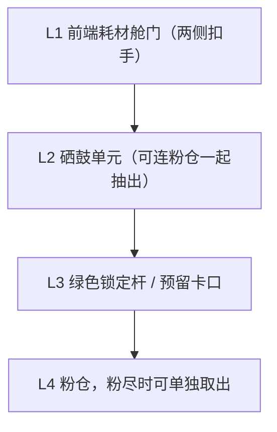

# 鼓粉分离：感光鼓与碳粉仓分件更换（对照传统鼓粉一体）

> [!summary] 一句话概述
> 鼓粉分离把感光鼓单元和碳粉仓做成两个可分别更换的模块：粉用尽只换粉仓，鼓的寿命到了再换鼓。兄弟把粉仓卡入硒鼓单元，用绿色锁定杆解锁后再整组推回机前耗材舱；佳能 LBP913 则把墨粉盒与感光鼓做成两条独立插槽，按与插槽相同的角度分别抽出。中关村在线把对照写得很清楚：传统鼓粉一体是换粉时连感光鼓一起换，所以更换成本更高。

## 配图

![[附件/pconline-brother-tn-b020-drum-assembly.jpg]]
*图源：[太平洋电脑网：鼓粉分离，按需供粉（兄弟 DCP-B7530DN 评测第 4 页）](https://office.pconline.com.cn/1097/10974306_3.html)；粉仓（标 TN-B020）已经装进硒鼓单元。框架上印有三步安装示意图，两侧有绿色操作件，左端可见齿轮。评测正文写：对准预留卡口即可把两者合二为一，凡绿色组件均可活动。*

![[附件/pconline-brother-dcp-b7530dn-bay.jpg]]
*图源：同一篇评测；打开前端耗材舱门后，粉仓与硒鼓组件已坐在机内。评测写：扣动机身两侧扣手即可打开耗材仓门，组装好的组件再装入前端耗材舱。*

![[附件/pconline-brother-green-lever.jpg]]
*图源：同一篇评测的局部；绿色锁定/滑动件和框架上的安装示意特写。兄弟（中国）HL-B2000D 官方 FAQ 写：从设备中取出墨粉盒/粉仓和硒鼓单元组件后，按下绿色锁定杆，再从硒鼓单元中取出粉仓；清洁电晕丝时则左右滑动绿色滑块，并须将滑块返回。照片中的绿色件与官方所述的锁定杆、滑块相对应，具体哪一只是锁、哪一只是电晕丝滑块，以机身示意图为准。*

> 图片版权归原作者所有，仅作个人学习收藏；出处见文末「来源与核实记录」。

## 结构原理

> 本节所有数字只写来源里给出的；来源没有就写「来源未给出」。兄弟是「先组合成组件再入机」，佳能 LBP913 是「两个耗材各走一条插槽」，同属鼓粉分离，不把一家的手柄或页产量套到另一家。

### 堆叠方案

方向：**以兄弟按需供粉机型为主，从机外组合到推入机前耗材舱**。佳能分槽方式在表中另注。

| 层级 | 零件 | 材料 | 厚度/尺寸 | 固定方式 | 依据 |
| --- | --- | --- | --- | --- | --- |
| L1（机前舱） | 耗材舱门与舱体 | 未注明 | 来源未给出舱口尺寸。HL-B2000D 整机外形 356×360×183 mm（产品页规格，不是耗材尺寸） | 两侧扣手打开舱门（评测） | 太平洋电脑网；整机尺寸见兄弟产品页，不当作耗材尺寸 |
| L2 | 硒鼓单元（感光鼓框架） | 未注明 | 兄弟随机赠送硒鼓标称 12 000 页（基于 1 页/次作业）；佳能 Drum Cartridge 050 平均打印量 10 000 张、重量约 0.6 kg | 兄弟：整组插入耗材舱；佳能：沿感光鼓插槽、以与插槽相同的角度轻轻取出或插入 | 兄弟产品页；佳能《耗材》《更换感光鼓》 |
| L3 | 粉仓 / 墨粉盒与鼓单元的接口 | 未注明。评测写预留卡口；官方写绿色锁定杆 | 来源未给出卡口尺寸 | 对准卡口合二为一；拆卸时按下绿色锁定杆，从硒鼓单元中取出粉仓 | 太平洋电脑网；兄弟 FAQ |
| L4（最内可单独换） | 粉仓 / 墨粉盒 | 未注明 | 兄弟随机粉仓 2 600 页（ISO/IEC 19752）；评测写单支售价 99 元、可打印 2600 页。佳能 Toner Cartridge 050：2 500 张、约 0.2 kg | 卡在硒鼓单元内（兄弟）；或单独沿墨粉盒插槽抽换，推回手柄（佳能《更换墨粉盒》） | 兄弟产品页与评测；佳能《耗材》与《更换墨粉盒》 |

剖面示意：

### 零件清单

| 零件 | 数量 | 功能 | 材料 | 依据 |
| --- | --- | --- | --- | --- |
| 粉仓 / 墨粉盒 | 1 | 容纳碳粉，粉尽时单独更换 | 未注明 | 兄弟产品页；佳能《耗材》 |
| 硒鼓单元 / 感光鼓 | 1 | 提供感光鼓等成像表面，寿命长于单支粉仓 | 未注明 | 同上 |
| 绿色锁定杆 | 兄弟 FAQ 写明 1 处操作（「按下绿色锁定杆」）；评测写凡绿色组件均可活动 | 解锁后才能把粉仓从硒鼓单元里取出 | 未注明 | 兄弟 FAQ；评测 |
| 绿色滑块（电晕丝清洁） | 来源未给出数量 | 左右滑动以清洁硒鼓单元内的电晕丝，用后须返回 | 未注明 | 兄弟产品页「清洁电晕丝」FAQ |
| 预留卡口 | 来源未给出只数 | 粉仓与感光鼓对位并结合 | 未注明 | 太平洋电脑网 |
| 齿轮（评测照片可见，官方 FAQ 未用文字说明） | 照片可见于硒鼓单元端部 | 评测照片可见，推测用于与机内驱动对接；兄弟该段 FAQ 未写齿轮，故功能标注为推断 | 未注明 | 评测照片；推断须标明 |
| 耗材舱门与两侧扣手 | 门 1，扣手在两侧 | 打开后才能把组件推入或取出 | 未注明 | 太平洋电脑网 |
| 佳能墨粉盒手柄与插槽 | 墨粉盒有手柄 | 拉动手柄，以与插槽相同的角度取出或装回；更换感光鼓时先取墨粉盒再取鼓 | 未注明 | 佳能《更换墨粉盒》《更换感光鼓》 |

### 装配顺序

按兄弟官方 FAQ 与评测（装回为取出的反推）以及佳能官方步骤分列。

兄弟（HL-B2000D 官方 FAQ + DCP-B7530DN 评测）：

1. 设备电源已打开（官方更换粉仓 FAQ 原文）。打开前盖 / 前端耗材舱门（评测：两侧扣手）。
2. 从设备中取出墨粉盒/粉仓和硒鼓单元组件。
3. 按下绿色锁定杆，从硒鼓单元中取出旧粉仓。切勿触摸官方示意图中的阴影部分，以免弄脏手或衣服。
4. 新粉仓对准预留卡口，与感光鼓合二为一（评测）。
5. 将组装好的组件装回前端耗材舱，关上门。官方该段 FAQ 在产品页上以省略号截断，装回的细节以评测「装入耗材舱」为准，不补充未写出的「咔哒」力值。

佳能 LBP913 / 同类官方步骤（与兄弟不是同一套机构，只说明另一种分件方式）：

1. 更换墨粉盒：取下输出口顶盖，关闭纸张挡板，打开墨粉盒盖，拉动墨粉盒手柄，以与插槽相同的角度轻轻取出；新盒摇匀 5 到 6 次后装入，推回手柄，关闭盖与顶盖。不要摇晃或撞击以免漏粉。
2. 更换感光鼓：抬起操作面板，关闭纸张挡板，打开墨粉盒盖；先取出墨粉盒，再以与插槽相同的角度取出感光鼓；装入新鼓后再插入墨粉盒，关盖并放下操作面板。

> 佳能《更换墨粉盒》个别步骤用语出现「硒鼓」「墨粉盒」混用，本篇以同手册《耗材》页的 Toner Cartridge 050 与 Drum Cartridge 050 区分为准，并以《更换感光鼓》「先取墨粉盒、再取感光鼓」的顺序为准。

### 受力与运动分析

- **受力路径**：用户抽组件时，力沿耗材舱的抽出方向作用在框架上；分开粉仓时，要先按下绿色锁定杆，再把粉仓从鼓单元里抽出。佳能路径是沿各自插槽的倾斜角度抽拉手柄或鼓身。来源未给出抽入力或锁定力。
- **运动关系**：兄弟：组件相对机舱是直线抽插；粉仓相对硒鼓单元是先解锁再分离。佳能：两个耗材各自沿插槽运动，更换鼓时必须先让墨粉盒让开。电晕丝清洁是绿色滑块的左右滑动，用后返回，不是拆模块。
- **失效风险**：触摸感光面或官方阴影区造成污染、漏粉（两家都强调不要摇晃、倾斜或触碰指定区域）；电晕丝滑块没有回到原位会影响打印质量（兄弟 FAQ 写须返回）；把鼓粉一体和鼓粉分离的更换习惯混用，会误把还能用的鼓一起扔掉——这正是中关村在线指出的一体式成本问题。

## 设计要点与参数

| 要点 | 内容 | 依据 |
| --- | --- | --- |
| 结构本质 | 感光鼓与碳粉仓是两个可分别更换的模块 | 兄弟产品页「鼓粉分离技术」；佳能中国新闻；中关村在线对照段 |
| 兄弟页产量 | 随机粉仓 2 600 页（ISO/IEC 19752）；硒鼓 12 000 页（基于 1 页/次作业） | 兄弟 HL-B2000D 产品页。评测另写 99 元、2600 页，针对 DCP-B7530DN |
| 兄弟拆分动作 | 先取出「粉仓 + 硒鼓单元」组件，再按绿色锁定杆，从单元中取出粉仓 | 兄弟 FAQ |
| 兄弟对位 | 对准预留卡口，合二为一；绿色组件可活动 | 太平洋电脑网 |
| 兄弟入机 | 前端耗材舱，两侧扣手开门 | 太平洋电脑网 |
| 佳能页产量与重量 | Toner 050：2 500 张、约 0.2 kg；Drum 050：10 000 张、约 0.6 kg | 佳能《耗材》 |
| 佳能抽换 | 以与插槽相同的角度轻轻取出；换鼓时先取墨粉盒再取鼓 | 佳能《更换墨粉盒》《更换感光鼓》 |
| 对照一体式 | 传统鼓粉一体：碳粉和感光鼓都会消耗，但做成一体后换粉就要连鼓一起换，更换成本更高 | 中关村在线。本次未打开可用的惠普官方手册，不写惠普机型的具体抽换步骤 |
| 齿轮 | 评测照片可见硒鼓单元端部有齿轮；官方 FAQ 未用文字描述 | 只作为照片所见，功能为推断 |

## 优缺点

**优点**
- 粉和鼓的寿命可以分开设计：兄弟写粉尽只换粉仓、不必换硒鼓；佳能新闻用同样的逻辑说明可降低后期耗材成本。
- 用户操作被收束到少数明确件：绿色锁定杆、卡口、舱门扣手，或佳能的手柄与插槽角度。
- 先取出整组再在机外分拆（兄弟），漏粉和触摸感光面的风险比在机内硬掰更可控。

**缺点 / 代价**
- 比一体式多一个接口（卡口/锁杆或第二条插槽），装错角度、锁杆不到位或滑块不回位都会造成漏粉或打印缺陷。
- 仍须避免触摸感光面和规定的阴影区，分件并不等于可以随意用手抓成像件。
- 两种分件路线不能混用步骤：把「先抽整组再按绿杆」用到「先抽粉盒再抽鼓」的机型上会卡死或漏粉。

## 可借鉴点

- **按寿命切模块，而不是按「看起来是一块」切**：粉仓消耗快、感光鼓消耗慢，接口就应该允许只换快的那一件。写需求时先问「哪一层先到寿命」。
- **机外先解锁再分离**：兄弟把绿色锁定杆放在「组件已经拿出机箱之后」，避免在狭窄舱内撬卡口。
- **用颜色和示意图降低误操作**：绿色代表可活动件，框架上直接印三步图，比只在说明书里画一次更接近现场。
- **如果改成两条独立插槽（佳能路线），一定要规定顺序和抽拉角度**：「与插槽相同的角度」是为了保护插槽导向，换鼓时先让粉盒让路。

## 与库中相似案例对比

| 对比项 | 本案例（鼓粉分离耗材） | 传统鼓粉一体（本篇对照，不单独立篇） | [[Nano-SIM 针顶出托盘（Pin-eject）：外部顶针把客户自制托盘顶出]] | [[Fairphone 6 螺丝模块化（屏、电池、摄像头、USB-C）]] |
| --- | --- | --- | --- | --- |
| 模块如何切开 | 粉仓与感光鼓按寿命分开，可只换粉 | 粉和鼓做成一件，换粉就连鼓一起换 | 卡与托盘是一套顶出机构，不是耗材寿命分层 | 按维修件（屏、电池等）用螺丝分件 |
| 解锁 | 兄弟：绿色锁定杆；佳能：沿插槽抽拉 | 通常整支抽出，无「从鼓上解下粉仓」这一步（中关村在线只给一体式的成本结论，未给某品牌锁的构造） | 针顶出 | 螺丝 |
| 入机方式 | 兄弟：整组进前端舱；佳能：两个插槽 | 一支耗材进舱 | 托盘推进卡座 | 模块放入整机再锁紧 |
| 分类取舍 | 06：整机耗材如何被设计成可分件更换 | 只作为对照，不收录第二篇同质硒鼓 | 02 / 卡座机构 | 06，消费电子整机模块化 |

## 相关案例

- [[Nano-SIM 针顶出托盘（Pin-eject）：外部顶针把客户自制托盘顶出]]
- [[Fairphone 6 螺丝模块化（屏、电池、摄像头、USB-C）]]
- [[电动工具电池包：滑轨插入与按压锁舌（得伟拆解）]]
- 分类索引：[[06-拆解与可维修 索引]]

## 来源与核实记录

- 主来源：[HL-B2000D \| 兄弟（中国）商业有限公司](https://www.brother.cn/printer/prt/hl-b2000d)（2026-11-22 打开。鼓粉分离：耗材由粉仓及硒鼓两部分组成；随机 2 600 页粉仓、12 000 页硒鼓；FAQ：打开前盖，取出粉仓和硒鼓单元组件，按下绿色锁定杆后从硒鼓单元取出粉仓；清洁电晕丝须左右滑动绿色滑块并返回。support.brother.com 手册本次抓取为 403，故以 brother.cn 产品页已显示的官方 FAQ 为准。）
- 补充来源 1：[太平洋电脑网：鼓粉分离，按需供粉（测兄弟 DCP-B7530DN）](https://office.pconline.com.cn/1097/10974306_3.html)（独立机构，作者：卡夫卡。交叉卡口对合、绿色可活动件、前端耗材舱与两侧扣手，并下载评测照片。）
- 补充来源 2：[佳能（中国）：满足中小企业成本控制需求，佳能推出 2 款鼓粉分离激光打印机新品](https://www.canon.com.cn/info/products/2206.html)（2020-06-01。独立墨粉盒与感光鼓，墨粉耗尽只需换墨粉盒。）
- 补充来源 3：[佳能 imageCLASS 官方手册《耗材》《更换感光鼓》](https://oip.manual.canon/USRMA-2591-zz-SS-zhCN/contents/SS113_maintenance_0252.html)、[更换感光鼓](https://oip.manual.canon/USRMA-3173-zz-SS-zhCN/contents/SS113_maintenance_0253.html)（Toner 050 / Drum 050 的页产量与重量；分槽抽换步骤与「先取墨粉盒再取鼓」。）
- 补充来源 4：[中关村在线：一文看懂兄弟「按需供粉」系列产品](https://oa.zol.com.cn/835/8356727.html)（独立机构。交叉传统鼓粉一体式带来更高更换成本，以及分离后只需换碳粉盒。）
- 核实：2026-11-22 打开上述页面并下载评测配图。惠普用户指南 PDF 本次下载不完整、无法提取正文，不引用。不把评测照片里的齿轮写成官方已说明的接口，除非标注推断。
