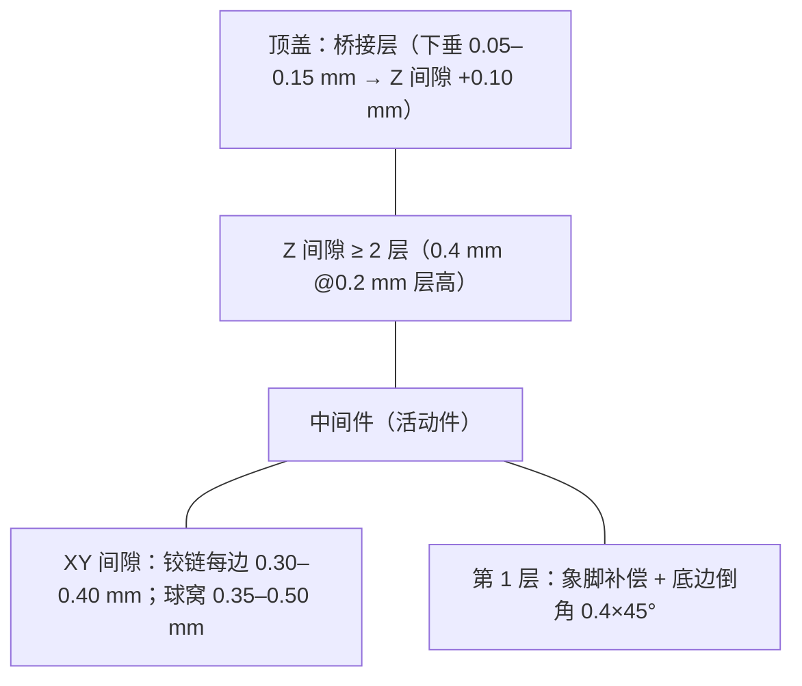

# FDM 一体打印活动件（Print-in-Place）：XY 每边 0.3 mm、Z 两整层的间隙规则

> [!summary] 一句话概述
> 一体打印（Print-in-Place，PiP）是把铰链销和铰链孔、关节和关节窝按装配好的状态一次打出来，零件之间只靠一圈空气隔开。QIDI 给出的工作值是：0.4 mm 喷嘴、0.2 mm 层高下，**一体打印铰链每边 0.30–0.40 mm，球窝每边 0.35–0.50 mm，Z 向间隙取层高的整数倍且至少两层（0.4 mm）**；这大约是打印后再装配的销孔间隙（每边 0.15–0.25 mm）的两倍，因为熔在一起的一体件没法再磨开。B 站爱能特专栏（转述 Irv Shapiro 的教程）补充了做法：用「间隙 + 桥接」造出四周悬空的中间件，先打 0.2–0.6 mm 五孔测试块确认机器精度。

## 配图

![[附件/pip-hinge-concept-drvax.jpg]]
*图源：[B 站专栏 cv8345243](https://www.bilibili.com/read/cv8345243)（爱能特Anet3D，转引 Irv Shapiro / DrVax 视频截图）；铰链概念剖面：间隙 0.20–0.50、层高 0.15–0.30（单位 mm），顶层用桥接把中间件「关」在里面，第 1 层要注意象脚*

![[附件/pip-clearance-test-block.jpg]]
*图源：同上；0.2–0.6 mm 五孔间隙测试块，插入对应插头检查孔边是否溢料*

![[附件/pip-scissor-first-layer-fused.jpg]]
*图源：同上；底层粘连的一体打印剪刀，热床温度过高导致第一层软化扩张，把转轴焊死*

> 图片版权归原作者所有，仅作个人学习收藏；出处见文末「来源与核实记录」。

## 结构原理

> 本节数字只写来源里给出的；来源没有就写「来源未给出」。

### 堆叠方案

方向：**卧式铰链沿 Z 向（打印层方向）从下到上**（按 DrVax 剖面图整理）

| 层级 | 零件/区域 | 材料 | 厚度/尺寸 | 固定方式 | 依据 |
| --- | --- | --- | --- | --- | --- |
| L1 | 第 1 层（外件与中间件同层，但被间隙隔开） | PLA 等 | 层高 0.15–0.30 mm；需象脚补偿，QIDI 建议底边倒角 0.4 mm × 45° | 打印 | cv8345243 图；QIDI |
| L2 | 中间件（活动件）主体 | 同上 | 四周与外件留间隙 0.20–0.50 mm（DrVax 图）；QIDI 铰链取每边 0.30–0.40 mm | 不与外件接触 | cv8345243；QIDI |
| L3 | Z 向间隙（中间件顶面与外件顶盖之间） | 空气 | 层高整数倍，至少 2 层：0.2 mm 层高取 0.4 mm；0.12 mm 层高取 0.36 mm | — | QIDI |
| L4 | 顶盖桥接层 | 同上 | 悬空首层下垂 0.05–0.15 mm，所以 Z 间隙再加 0.10 mm；桥长取决机型（文中举 10/30/40 mm） | 桥接 | QIDI；cv8345243 |

剖面示意：

### 零件清单

| 零件 | 数量 | 功能 | 材料 | 依据 |
| --- | --- | --- | --- | --- |
| 外件（带铰链孔/关节窝） | 1 | 固定侧 | PLA/PETG 等 | 全部来源 |
| 中间件（销/关节头） | 1 或多节 | 活动侧，打印时四周悬空 | 同上 | cv8345243 |
| 桥接顶盖 | 1 | 把中间件「锁」在外件内 | 同上 | cv8345243 |
| 间隙测试块 | 1 | 每台机器标定一次 | 同上 | cv8345243（0.2–0.6 mm 五孔）；OzFDM（0.1–0.4 mm，0.1 递增）；QIDI（0.10–0.50 mm） |
| 干石墨粉 | 适量 | 转动销润滑 | 石墨 | 3dcalculators 转述 QIDI |

### 装配顺序

> 一体打印没有装配；以下是「标定 → 设计 → 打印 → 释放」的流程：

1. 每台打印机先打间隙测试块，用正式件的朝向、层高、喷嘴和材料，在同一次打印里打多个间隙版本（QIDI：同一批次热历史一致）。
2. 选「能分开的最小间隙」和「能自由活动的最小间隙」（OzFDM）。
3. 建模：XY 按测试值，Z 按层高整数倍；悬空顶面加 0.10 mm；内部悬垂 ≤ 45°（卧式孔用 45° 泪滴形顶）。
4. 切片：机构部分可用 0.12–0.16 mm 层高、机体 0.2 mm（按对象分别设置）；开象脚补偿；不加支撑（支撑会把间隙焊死）。
5. 打印完冷却到室温，固定一边、轻轻来回扳动直到活动件松开。尼龙件 24 小时后再试（吸湿后会变大）。

### 受力与运动分析

- **为什么会焊死**：FDM 在高温下逐层挤出，相邻零件距离小于约一个层高（Z）或一个挤出线宽（XY），两边的熔体会粘到一起（QIDI）。层高 0.2 mm 时最小可靠 Z 间隙就是 0.2 mm。
- **运动副**：销在孔内转动属于间隙配合；间隙越大越松旷，OzFDM 称 0.4 mm 以上「很松、晃动大」。
- **方向与强度**：销竖着打，XY 圆度最好、不需桥接，但销沿层间受力容易断；销平放打印层沿销长方向，强度更好，孔顶变成悬垂（3dcalculators 转述 Snapmaker、Sovol）。
- **失效模式**（爱能特四因素）：热床温度过高 → 第一层软化扩张、底部粘连；流量（挤出倍增）偏大 → 实际线宽大于 0.4 mm 吃掉间隙；打印温度过高 → 料软膨胀，过低 → 层间结合差；打印速度过快 → 振动定位不准。另外冷却不足 → 桥接下垂。

## 设计要点与参数

| 要点 | 内容 | 依据 |
| --- | --- | --- |
| 铰链（一体打印） | 每边 0.30–0.40 mm，直径方向 0.60–0.80 mm | QIDI |
| 球窝 | 每边 0.35–0.50 mm，直径方向 0.70–1.00 mm | QIDI |
| 打印后装配的销 | 半径方向 0.15–0.25 mm，直径方向 0.30–0.50 mm | QIDI |
| 滑轨 | 每边 0.20–0.30 mm；低于 0.20 mm 层纹变成干涉，摩擦急升 | QIDI |
| Z 间隙 | 层高整数倍：0.2 mm 层高取 0.4 mm；0.12 mm 层高取 0.36 mm；0.25 mm 在 0.2 mm 层高会被取整为 0.2 或 0.4 | QIDI |
| 悬空首层 | 下垂 0.05–0.15 mm → 加 0.10 mm | QIDI |
| PLA 经验值 | 0.2–0.3 mm 可用；标定好的机器 0.15 mm 可行；0.4 mm 以上很松 | OzFDM |
| 材料加量 | PETG 比 PLA 加 0.1–0.15 mm（易拉丝）；TPU 推荐 95A、直驱挤出 | OzFDM |
| 机器门槛 | 能做出 0.2 mm 间隙的打印机才适合做可动小装置 | cv8345243 |
| 孔偏小 | 内孔建模放大 0.10–0.30 mm 或开孔补偿；FDM PETG 20 mm 孔误差可达 0.28–0.52 mm | QIDI |
| 缩放陷阱 | 模型缩放会同比缩放间隙：0.6 mm 缩到 50% 变 0.3 mm；关节龙放大到 150% 会变松 | 3dcalculators 转述 JLC3DP、QIDI |

> 口径差异（推断后的提醒）：QIDI 写「每边 0.30–0.40」，Sovol 公差指南写铰链「总量约 0.3–0.4」，DrVax 图写「Gap Spacing 0.20–0.50」未说明口径。照抄数值前先确认是半径方向还是直径方向，差一倍。

## 优缺点

**优点**
- 零装配，没有销钉等额外零件
- 可以做出装配上不可能的结构（关节链、被关在框里的活动件）

**缺点 / 代价**
- 间隙是空气，活动件总有晃动（比装配件间隙大一倍）
- 结果只对标定时那一组机器、材料、层高、朝向成立
- 不能加支撑，几何受悬垂角限制（≤ 45° 或 Prusa 给的 45–60°）

## 可借鉴点

- **给每台机器建一张间隙表**：同一批次打一组 0.1 mm 步进的测试件，结果写进设计规范
- **Z 向间隙永远按层高的整数倍画**，桥接顶面多给 0.1 mm
- **要精度又要速度**：机构部位用细层高，机体用粗层高（按对象切片）
- **大批量产品不要照搬**：注塑件的活动铰链靠材料弯曲而不是间隙，见 [[活动铰链（Living Hinge）：一体成型的柔性铰链]]

## 与库中相似案例对比

| 对比项 | 本案例 | [[活动铰链（Living Hinge）：一体成型的柔性铰链]] | [[3D 打印件热熔铜螺母：孔径与拉拔力实测]] |
| --- | --- | --- | --- |
| 「一体」的方式 | 两个刚体之间留空气间隙 | 同一材料的薄弯曲带 | 打印后热压金属件 |
| 关键数 | XY 0.3–0.4 mm/边，Z ≥ 2 层 | 铰链厚度（见该案例） | 孔径与拉拔力 |
| 工艺 | FDM | 注塑（PP） | FDM + 热熔 |

## 相关案例

- [[活动铰链（Living Hinge）：一体成型的柔性铰链]]
- [[3D 打印件热熔铜螺母：孔径与拉拔力实测]]
- [[卡扣三种基本形式：悬臂、环形、扭转]]
- 分类索引：[[07-材料与工艺 索引]]

## 来源与核实记录

- 主来源：[3D Printed Interlocking Parts: Clearance & Fit Guide](https://qidi3d.com/blogs/news/how-to-3d-print-interlocking-parts-and-assemblies)（QIDI 3D 官方博客）
- 补充来源 1：[铰链设计 让3D打印玩具动起来](https://www.bilibili.com/read/cv8345243)（B 站专栏，爱能特Anet3D，2020-11-13；转述 Irv Shapiro 视频）
- 补充来源 2：[Print in Place Designs: Hinges, Joints, and Mechanisms](https://ozfdm.com.au/blogs/knowledge-base/print-in-place-designs-hinges-joints-and-mechanisms)（OzFDM，James Hill，2025-10-14）
- 补充来源 3：[Print-in-place clearance](https://3dcalculators.com/blog/print-in-place-clearance)（3D Calculators，2026-10-26；汇总 QIDI、Sovol、JLC3DP、Snapmaker、Prusa、Stratasys 数值。其中 Sovol、Snapmaker、JLC3DP 的数字只经这篇转述，未逐一打开原文）
- 核实：2026-11-13 打开 QIDI、B 站、OzFDM、3dcalculators 四篇核对数值；QIDI 原文数值与 3dcalculators 转述一致。
