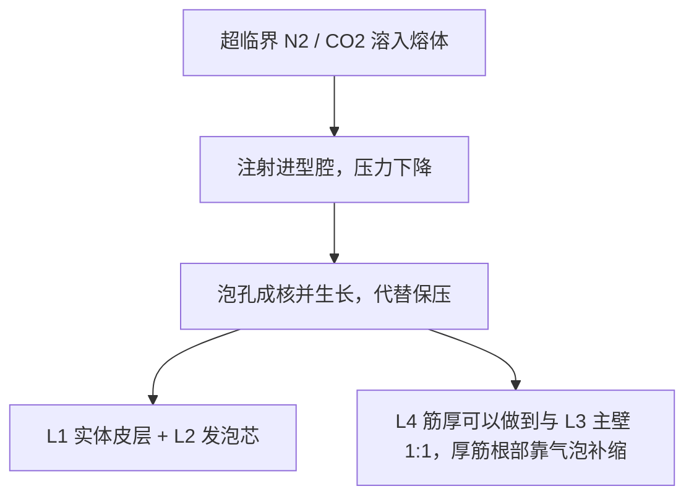

# MuCell微发泡：气泡生长代替保压，筋壁比可以做到1比1

> [!summary] 一句话概述
> MuCell 微发泡把超临界氮气或二氧化碳溶进熔体，注射进型腔后靠泡孔成核、生长来填满并「保压」，不再依赖注塑机的高压保压。结构上的直接后果是：加强筋不必再按实心件 0.4–0.6 倍壁厚去削薄。伊之密写明可以「实现 1:1 的主壁与筋位结构」；Trexel 手册把同一条写成 Rib to wall thickness ratios of 1:1，并配对照图：常规设计筋明显细于主壁，MuCell 设计允许筋厚等于公称壁厚且不出现缩痕。它和 [[发泡件缩水：模温、排气与保压和实心件相反]]、[[气体辅助注塑（GAIM）：用气道掏空厚筋消缩痕]] 都在处理厚区收缩，但本篇的主角是筋壁比这条设计规则为什么可以放宽。

## 配图

![[附件/trexel-rib-wall-ratio.jpg]]
*图源：[Trexel MuCell Corporate Brochure](https://trexel.com/wp-content/uploads/2019/08/Brochure-Corporate-1.pdf) 第 4 页；左侧对照「从薄壁流向厚壁」的浇注建议，并画出 Conventional Design 与 MuCell Design 的筋壁比：后者筋厚与主壁接近 1:1。右侧是带微发泡芯层和实体皮层的筋根剖面，引文写：cell growth 比实心保压更能把厚区压实，多数情况下可以做出筋厚等于公称壁厚、而且没有缩痕的零件*

![[附件/matsui-wall-section-2p8-1p8.jpg]]
*图源：[松井制作所《物理发泡成型 MuCell》](https://matsui.net/zh-CHS/lineup/mucell/) 文内剖面照片；同一类结构把实心设计的主壁 2.8 mm 减薄到 1.8 mm（图中同时标出筋或局部壁 1.8 mm）。松井用这个例子说明：发泡抑制缩痕后，可以把结构需要的地方留厚、不需要的地方减薄，并配有「MuCell 设计（壁厚比 1:1）」的图题。这是 Trexel 技术链上的中文图解，不作为第二机构*

> 图片版权归原作者所有，仅作个人学习收藏；出处见文末「来源与核实记录」。

## 结构原理

> 本节所有数字只写来源里给出的；来源没有就写「来源未给出」。

### 堆叠方案

方向：**从制件表皮到微发泡芯层，再对照筋与主壁的厚度比**

伊之密把过程写成：塑化时注入超临界流体，熔体进入模腔后压力下降，流体成核、泡孔长大，直到充满型腔或熔体冷却才停止，最终形成细微的蜂巢状结构。Trexel 手册把它分成四步：计量注入 SCF、在螺杆混合段形成单相熔体、注射后降压成核并形成带实体皮层的闭孔结构、用受控的泡孔生长代替 pack & hold，在型腔里建立均匀的低压填充。

对结构设计，最重要的不是设备，而是「谁在做保压」。实心注塑靠浇口把压力传到厚筋根部，所以筋必须削薄，避免缩痕；微发泡的压力来自型腔里到处生长的气泡，厚筋根部反而可以被就地补缩。因此 Trexel 写：可以把材料放在真正需要强度的位置，不需要结构的地方减薄；浇口可以开在薄截面，让泡孔生长去填后面的厚截面。

| 层级 | 零件 / 区域 | 材料 | 厚度/尺寸 | 固定方式 | 依据 |
| --- | --- | --- | --- | --- | --- |
| L1 | 实体皮层（skin） | 与所选塑料相同 | 来源未给出皮层厚度数字 | 与制件一体 | Trexel 第 3–4 页 |
| L2 | 微发泡芯层 | 同材 + 闭孔气泡 | Trexel 未在本手册给出泡孔直径范围 | 一体 | Trexel；伊之密 |
| L3 | 主壁 | 同上 | 可以按功能减薄。松井 / Trexel 案例把某类内饰件主壁从 2.8 mm 减到 1.8 mm | 一体 | 松井；Trexel 体系案例 |
| L4 | 加强筋 | 同上 | 允许筋厚与主壁 1:1，而不按实心件那样削到约 0.5 倍壁厚 | 一体 | 伊之密 NO.6；Trexel 第 4 页 |

CMSA2014（Trexel 梁兆云，与手册同一机构）还给出过另一组门板数字，不要和 2.8/1.8 mm 混成同一案例：传统设计主壁 2.4 mm、筋 0.8 mm；MuCell 设计主壁 1.8 mm、筋 1.2 mm。这里筋/壁 = 1.2/1.8，还没有到 1:1，但已经明显高于传统的 0.8/2.4。手册把 1:1 写成可以实现的规则，案例数字则按具体零件各记各的。

剖面示意：

### 零件清单

| 零件 | 数量 | 功能 | 材料 | 依据 |
| --- | --- | --- | --- | --- |
| 微发泡塑件（皮芯结构） | 1 | 在减重的同时保持结构，并减轻缩痕和翘曲 | 多数热塑性塑料；Trexel 写除 LCP 外几乎都可发泡 | Trexel；伊之密 |
| 加强筋 | 按结构需要 | 按功能需要可以做到与主壁等厚 | 与塑件同材 | 伊之密；Trexel |
| SCF 计量与注射单元 | 1 套，装在注塑机上 | 把超临界流体注入料筒 | 设备；松井、Trexel 提供系统 | 松井；Trexel |
| 浇口与流道 | 按模具 | 优先从薄截面进胶，厚截面放在填充末端靠气泡补缩 | 模具 | Trexel 第 4 页 |

### 装配顺序

这是成型工艺对零件几何的约束，不是多零件装配。对应的设计 / 成型顺序（按已打开来源整理）：

1. 按功能布置主壁和筋，不必为了消缩痕把筋削到 0.4–0.6 倍壁厚。伊之密、Trexel 都把 1:1 当作可以采用的筋壁比。
2. 把浇口放在薄截面，让熔体从薄流向厚，厚区放到填充末端，由泡孔生长补缩（Trexel 第 4 页）。
3. 在塑化阶段注入计量好的超临界 N2 或 CO2，形成单相熔体后注射（Trexel、伊之密、松井）。
4. 注射完成后不再做传统的高压保压，或把保压时间大幅缩短；泡孔生长在型腔里建立较均匀的低压（Trexel、松井）。
5. 冷却、开模。伊之密提醒：泡孔如果在表面破裂会留下流痕，因此 MuCell 本身不适合直接做高外观件；他们另推 FoamPro 做表面效果，那是另一套方案，不是本篇的 1:1 筋规则。

### 受力与运动分析

- **受力路径**：使用载荷仍由实体皮层和筋承担。发泡芯层降低密度和重量。伊之密写：微发泡设计具有同等或更好的能量吸收，同时隔热更好。来源没有给出本篇讨论的门板或通用筋的具体刚度和冲击数值。
- **运动关系**：成型后无机构运动。出模后的尺寸稳定性来自残余应力降低和内部气体压力对收缩的抵消（伊之密、Trexel）。
- **失效风险**：高外观面会出现流痕（伊之密明确写不适用于外观要求高的产品）。厚区如果冷却不够，气体压力还可能在出模后把芯部鼓出来——库内 [[发泡件缩水：模温、排气与保压和实心件相反]] 把 MuCell 的这一现象记为 post blow，本篇不重复展开，但设计 1:1 厚筋时仍要记住：规则放宽的是缩痕，不是无限加厚。Trexel 也写本技术不适合透明件，并应避免没有针阀的开放式热流道（CMSA2014 局限表，与手册同一机构）。

## 设计要点与参数

| 要点 | 内容 | 依据 |
| --- | --- | --- |
| 筋壁比 | 可以做到主壁与筋 1:1，而不出现缩痕 | 伊之密 NO.6；Trexel 第 4 页原文 “Rib to wall thickness ratios of 1:1 can be used with the MuCell® process” |
| 和实心件的差别 | 实心件为消缩痕通常把筋做到约 0.4–0.6 t（见库内加强筋篇）。微发泡用气泡生长就地补缩，不必再按这条削薄 | Trexel 第 4 页对照图；对照库内加强筋篇 |
| 保压被替代 | 泡孔生长代替传统 pack & hold，型腔压力更均匀，残余应力和翘曲下降 | Trexel；伊之密 NO.5；松井 |
| 主壁可以减薄 | 松井案例：某结构从 2.8 mm 减到 1.8 mm，并写通过薄壁设计约减材料 20%，与密度降低合计最多约 30%；该例还有「合计 40% 树脂使用费」的表述，与门板类案例数字一致，但不要和通用 20%–30% 混成一条 | 松井 |
| CMSA 门板对照（同一技术源，另一组数） | 传统：壁 2.4 mm、筋 0.8 mm；MuCell：壁 1.8 mm、筋 1.2 mm | CMSA2014 幻灯，Trexel |
| 减重与周期（伊之密） | 一般可缩短成型时间 15%–30%；密度降低与功能化设计结合，通常减重 20% 以上 | 伊之密 NO.3、NO.4 |
| 黏度 | 松井：玻纤增强结晶工程塑料黏度约降 10–15%，非晶约降 15–25% | 松井 |
| 外观限制 | 表面易有流痕，不适合直接用于高外观件 | 伊之密 NO.7 |
| 材料限制 | Trexel：除 LCP 外几乎都可发泡；透明件不适用 | Trexel 手册；CMSA2014 |

## 优缺点

**优点**
- 筋可以按刚度需要加厚到与主壁相当，不必为了外观缩痕先削一刀（伊之密、Trexel）
- 取消或缩短高压保压，翘曲和残余应力下降，周期缩短（伊之密 15%–30%）
- 主壁可按功能减薄，减重往往比单纯降低密度更大（Trexel、松井）

**缺点 / 代价**
- 高外观面有流痕，通常要做非外观件，或再加覆膜、IMD、二次处理（伊之密）
- 需要专用 SCF 装置、螺杆、料筒和关闭喷嘴，并涉及 MuCell 许可（松井、Trexel）
- 不是「筋想做多厚都可以」：出模后厚芯仍有鼓包风险，细节见发泡件缩水篇的 post blow
- 不适合透明件；热流道要用针阀（Trexel 体系说明）

## 可借鉴点

- 画微发泡结构件时，先问「这条筋是不是只为了消缩痕才削薄的」：如果是，可以按 1:1 重新评估
- 浇口放在薄壁，厚筋放在填充末端，让气泡而不是浇口压力去补缩
- 减重不要只算发泡密度，主壁从 2.8 mm 减到 1.8 mm 这类几何减薄往往贡献更大
- 外观件不要直接当 MuCell 裸面使用
- 1:1 是「可以不缩痕」，不是「必然更强」：强度和冲击还要用所选材料做验证，来源没有给出通用强度系数

## 与库中相似案例对比

| 对比项 | 本案例 | [[塑料件加强筋设计：厚度、高度与间距比例]] | [[发泡件缩水：模温、排气与保压和实心件相反]] | [[气体辅助注塑（GAIM）：用气道掏空厚筋消缩痕]] |
| --- | --- | --- | --- | --- |
| 主角 | 微发泡让筋壁比可以到 1:1 | 实心件筋厚、筋高、间距的通用比例 | 发泡件的缩水、排气、模温和 post blow，与实心件相反 | 用气体通道把厚筋掏空 |
| 如何处理厚筋 | 气泡在筋根生长，代替保压补缩 | 把筋削到约 0.4–0.6 t，避免背面缩痕 | 讨论缺陷和工艺窗口，不改筋壁比规则 | 先做厚筋，再打进气体把芯部掏空 |
| 何时用这篇 | 已经确定走 MuCell，要重新评估筋厚 | 普通实心注塑件的筋截面 | 发泡件出了缩水、鼓包、排气问题 | 想保留厚筋外形又要空心减缩痕，但不走微发泡 |

## 相关案例

- [[塑料件加强筋设计：厚度、高度与间距比例]]
- [[发泡件缩水：模温、排气与保压和实心件相反]]
- [[气体辅助注塑（GAIM）：用气道掏空厚筋消缩痕]]
- [[注塑缩痕：厚壁背面凹陷、减胶坑与保压边界]]
- 分类索引：[[07-材料与工艺 索引]]

## 来源与核实记录

- 主来源：[伊之密《【轻量化技术贴】MuCell微发泡有7个真相值得你了解》](https://www.yizumi.com/latest/1043)（2017-05-12，广东伊之密精密机械股份有限公司。已打开中文正文，核对 1:1 主壁与筋位、周期 15%–30%、减重 20% 以上、不适合高外观件。文末写「部分资料引自 Trexel 公司」，因此 1:1 这条与 Trexel 手册交叉使用，不把伊之密当作与 Trexel 完全无关的原创数据源；但伊之密是独立的注塑机制造商，不是 Trexel 经销商转述页，可作为第二机构）
- 补充来源 1：[Trexel MuCell Corporate Brochure](https://trexel.com/wp-content/uploads/2019/08/Brochure-Corporate-1.pdf)（已打开预下载 8 页 PDF，核对第 4 页 1:1 筋壁比原文、从薄到厚的浇注示意，以及「筋厚等于公称壁厚且无缩痕」的引文）
- 补充来源 2：[松井《物理发泡成型 MuCell》](https://matsui.net/zh-CHS/lineup/mucell/)（已打开中文页，核对「加强筋的厚度等于基本壁厚不会影响外观质量」、壁厚比 1:1 的图题，以及 2.8 mm→1.8 mm 剖面照片。松井为 Trexel 体系设备伙伴，参数与案例与 Trexel 同源，不计入独立机构）
- 同机构补充（未计入第二、第三机构）：[SMARTMolding《MuCell 微發泡射出成型工藝的模具設計》](https://www.smartmolding.com/21-02a04/)（2021-02-22，作者 Trexel Asia 郑伟华）；[CMSA2014《微发泡技术在汽车注塑件上的应用》](http://www.caemolding.org/newsevents/news/cmsa2014/file/CMSA2014-pdf/D2S1/D2S1-4.pdf)（Trexel 梁兆云。已打开，补充门板 2.4/0.8 mm 对 1.8/1.2 mm 的对照）。Plastics Technology 2012 年《Five Cases Where Microcellular Foaming Paid Off》已打开，作者为 Trexel 的 Levi Kishbaugh，其中 Johnson Controls 门板也写了 1:1 甚至超过 1:1 的筋壁比，同样归入 Trexel 体系，不另计机构。
- 核实：2026-11-22 实际打开上述页面和 PDF。未把发泡件缩水篇已经写过的 post blow、排气和锁模力细节再写成这篇的主体；本篇只把筋壁比从实心件规则里解放出来，并标明 1:1 的出处。
