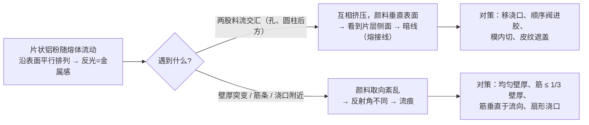

# 免喷涂材料 vs 喷涂：成本、良率与三条硬边界

> [!summary] 一句话概述
> 免喷涂是把金属/珠光颜料预先混进塑料粒子，注塑一次成型就有外观，省掉整条喷涂线。赫兹工业设计给出决策账：单件成本低 15–30%，盈亏平衡约月产 8000–12000 件；金暘新材料（SMARTMolding 专题）和鸿盛新材料则讲清它的结构代价：**片状铝粉在两股料流交汇处会竖起来，熔接线变成一条暗线**，所以结构设计要少开孔、浇口加宽、用顺序阀进胶或模内切，把熔接线「赶」到非外观面。

## 配图

![[附件/spray-free-weldline-mechanism.jpg]]
*图源：[SMARTMolding《細節決定成敗：免噴塗產品解決方案》](https://www.smartmolding.com/20-12b01/)（金暘新材料）圖1；熔接线机理：料流交汇处金属粉垂直取向，光线不反射，看起来发黑*

![[附件/spray-free-in-mold-cut.jpg]]
*图源：同上 圖6；模内切：先把孔做成闭孔、环形进胶消除表面熔接线，射出后切刀动作把孔切出*

![[附件/spray-free-rib-flowmark.jpg]]
*图源：同上 圖7；加强筋方向与流痕：充填方向与筋平行时易产生流痕，垂直时无流痕或较淡*

> 图片版权归原作者所有，仅作个人学习收藏；出处见文末「来源与核实记录」。赫兹原文配图为 Unsplash 场景图，未收录。

## 结构原理

> 本节数字只写来源里给出的；来源没有就写「来源未给出」。

### 堆叠方案

方向：**外观件剖面，从表面到内部**（对比喷涂件与免喷涂件）

| 层级 | 喷涂件 | 免喷涂件 | 厚度/尺寸 | 依据 |
| --- | --- | --- | --- | --- |
| L1 外观层 | 面漆/清漆 | 无单独涂层，靠表层平行排列的片状颜料反光 | 漆膜厚度来源未给出 | SMARTMolding |
| L2 底层 | 底漆 | — | 来源未给出 | — |
| L3 基材 | 普通注塑件（可回用料） | 颜料预分散在 ABS/PP/PC-ABS 等基体中 | 壁厚：要求均匀，变化处渐变 | SMARTMolding；鸿盛；B 站 cv53861483 |
| L4 内部结构 | 筋、柱不受限制 | 筋厚 ≤ 主壁厚 1/3，筋方向尽量不与充填方向平行 | 1/3 | SMARTMolding |

剖面示意（缺陷机理）：

### 零件清单

| 零件/要素 | 数量 | 功能 | 材料 | 依据 |
| --- | --- | --- | --- | --- |
| 免喷涂外观壳体 | 1 | 外观+结构 | 金属色免喷涂料 | 全部来源 |
| 扇形浇口（替代针形浇口） | 按需 | 降低剪切、减少流痕 | — | 鸿盛 |
| 多点针阀式热流道 | 大件 | 顺序进胶，控制熔接线位置 | — | SMARTMolding；鸿盛 |
| 模内切刀 | 每个孔 1 | 先成型闭孔，再切出孔位 | 模具钢 | SMARTMolding |
| 排气系统、冷料井 | 按需 | 减少气纹与冷料 | — | 鸿盛 |
| 急冷急热模温设备 | 高光件 | 注射时模温高于 Tg，结束后快速降到顶出温度 | — | 鸿盛 |

### 装配顺序

> 本案例为选型与开模流程，按来源整理：

1. 先用赫兹五维决策表判断要不要用免喷涂（成本、良率、外观上限、改色灵活度、环保）。
2. 选路线：双色粒/叠模、高光免喷涂、加纤免喷涂（赫兹），或片状颜料与多面体颜料二选一（SMARTMolding；鸿盛）。
3. 结构设计：减少孔洞，取消开孔处台阶，壁厚均匀，筋厚 ≤ 1/3 壁厚并让筋垂直于流向。
4. 模流分析定浇口，把熔接线移到非外观面；大件用顺序阀（鸿盛例子：G1 注射开始即开，G2、G3 在 1.6 s 后开）。
5. 必须开孔的外观面用模内切；剩余痕迹用皮纹、拉丝、图案或贴标遮蔽。
6. 验收标准写明光源和角度（赫兹：加纤件写「指定光源角度下无浮纤」）。

### 受力与运动分析

- **「运动」是熔体流动**：片状颜料像漂在河里的树叶，顺流时平躺（反光），两股水流对撞时被挤立起来（不反光）。所以熔接线的位置完全由浇口位置和孔、柱这些障碍物决定。
- **熔接线会迁移**：SMARTMolding 指出熔接线位置会随工艺变化移动，不能靠固定位置遮盖来解决。
- **力学风险**：熔接线处本身强度较低（行业常识，推断）；鸿盛要求材料兼顾韧性和刚性以通过跌落测试。
- **热循环**：急冷急热工艺把模温先升到玻璃化温度以上，再快速冷却，可消除熔合线、橘皮、气纹（鸿盛）。

## 设计要点与参数

| 要点 | 内容 | 依据 |
| --- | --- | --- |
| 材料溢价 | 免喷涂粒子比普通料贵 8–25 元/kg | 赫兹 |
| 省掉的成本 | 喷涂治具一套 2000–6000 元；漆料与人工每件 3–12 元；喷涂不良率常见 2–8% | 赫兹 |
| 综合成本 | 月产 2 万件以上单件低 15–30%；月产 3000 件以下喷漆更划算；盈亏平衡约月产 8000–12000 件（含治具摊销） | 赫兹项目测算 |
| 双色粒/叠模 | 两条皮纹深度差超过 0.02 mm，分界处出现「白痕带」，只能修模 | 赫兹跟模实测 |
| 高光免喷涂 | 60° 光泽可到 85 以上；熔体前沿温差 ≥ 8 ℃ 出波纹；对角线 > 400 mm 的大件需模温机分区控温 | 赫兹 |
| 加纤免喷涂 | 黑色加纤件在阳光直射下有星点反光 | 赫兹 |
| 加强筋 | 厚度 ≤ 产品厚度 1/3；避免充填方向与筋平行 | SMARTMolding |
| 浇口 | 针形浇口改扇形浇口；增加排气和冷料井 | 鸿盛 |
| 顺序进胶 | 三浇口例：G1 开始即开，G2、G3 注射 1.6 s 后开 | 鸿盛 |
| 颜料替换 | 多面体（钻石银）颜料替代片状颜料：金属感稍弱，熔接线和流痕不明显 | SMARTMolding；鸿盛 |
| 材料要求 | 流动性高、热稳定好（阻燃级尤其要少挥发物）、本身光泽好、韧性与刚性兼顾 | 鸿盛 |
| 合规 | VOC 近零；赫兹称过 RoHS/REACH 的文书量少一半 | 赫兹 |

## 优缺点

**优点**
- 省掉整条喷涂工序，没有喷涂不良，VOC 从源头减少
- 批次外观一致性更容易控制，开发和交付周期缩短（B 站 cv53861483）
- 塑料件可回收（漆层污染回料的问题不存在，推断）

**缺点 / 代价**（赫兹三条硬边界 + 结构限制）
- 做不到真空镀那样的深镜面质感
- 玻纤浮纤压不全，深色件在强光下有星点
- 大件色差窗口比喷漆窄；改色等于换料重验
- 结构自由度下降：孔、柱、筋、壁厚突变都会产生可见缺陷

## 可借鉴点

- **把「熔接线去哪」当作外观件结构设计的输入**：开孔、圆柱、卡扣位置先过一遍模流，再定 ID
- **外观面上的孔优先用模内切**，或者把孔移到非外观面
- **筋垂直于流向布置，筋厚 ≤ 1/3 壁厚**（比普通件常用的 0.5–0.6 倍更严）
- **验收标准写清光源和角度**，避免到货扯皮
- 赫兹建议三类不用免喷涂：手办级深镀外观、户外强光深色大屏件、经常改色的产品；三类主动推：带皮纹的家电壳体、白色或浅灰办公产品、出口欧盟的产品

## 与库中相似案例对比

| 对比项 | 本案例 | [[咬花（晒纹）与拔模角：每 0.025 mm 纹深加 1°]] | [[双色注塑：硬胶先射、软胶后射的结构拆件规则]] |
| --- | --- | --- | --- |
| 外观实现方式 | 颜料混入粒子 | 模具表面纹理 | 两种料分区成型 |
| 主要约束 | 熔接线、流痕位置 | 拔模角 | 拆件厚度、附着结构 |
| 关系 | 皮纹是免喷涂遮盖流痕的主要手段，因此两者经常同时出现 | — | 赫兹的「双色粒/叠模」路线与双色注塑思路相近 |

## 相关案例

- [[咬花（晒纹）与拔模角：每 0.025 mm 纹深加 1°]]
- [[双色注塑：硬胶先射、软胶后射的结构拆件规则]]
- [[注塑螺丝柱（Boss 柱）：壁厚比 0.6 分水岭与自攻底孔公式]]
- 分类索引：[[07-材料与工艺 索引]]

## 来源与核实记录

- 主来源：[免喷涂还是喷漆：一张表看懂省钱在哪、翻车在哪](https://www.hezidesign.com/gongyi/1268.html)（赫兹工业设计，刘也，2026-10-15）
- 补充来源 1：[細節決定成敗：免噴塗產品解決方案](https://www.smartmolding.com/20-12b01/)（ACMT SMARTMolding 2020 年 12 月杂志专题，金暘新材料）
- 补充来源 2：[免喷涂流痕和熔接痕的两个主要改善方案](https://hsplastics.com/newsshow-372-137.html)（中山鸿盛新材料，2018-07-14）
- 补充来源 3：[闪银效果金属色免喷涂材料……铝银效果原理与应用指南](https://www.bilibili.com/read/cv53861483)（B 站专栏，2026-11-11，带鸿盛软文性质，只引用原理部分）
- 核实：2026-11-13 打开全部来源核对。补充来源 1–3 都出自材料厂商，有推销立场；成本与良率数字只有赫兹一家，属单一来源。
