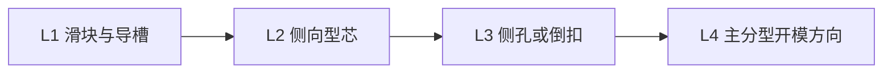

# 压铸侧抽芯：侧孔或倒扣不能沿主开模方向退出时才加滑块

> [!summary] 一句话概述
> 判断侧孔要不要抽芯，先看形成这个孔腔的钢芯能不能顺着主开模方向退出来；只有侧孔、内凹或反向扣位挡住退出时，才需要在侧向滑块、改结构和后加工三条路里选，而不是一看到侧孔就加一套抽芯机构。

## 配图

![[附件/diecast-jhmim-core-pull.png]]
*图源：[JH MIM《压铸设计指南》](https://jhmim.com/zh-CN/design-for-die-casting/) 抽芯相关插图；用于说明避免或减少抽芯的结构方向。*

![[附件/diecast-jhmim-hole-edge.png]]
*图源：同上指南与孔边距离相关的插图；侧孔位置还会影响孔到边缘的壁厚和出模。*

> 图片版权归原作者所有，仅作个人学习收藏；出处见文末「来源与核实记录」。

## 结构原理

> 本节所有数字只写来源里给出的；来源没有就写「来源未给出」，不估算、不编造。

孙杭的判断方法是：把形成孔腔的钢芯想成一块不能穿透铸件的实体，开模时它能不能从零件里直接退出。若侧孔、内凹槽或反向扣位挡住退出，才需要研究其他成形或加工路线。只看孔朝向的照片，识别不了被遮挡的内凹。分型线也不只是外观痕迹：它是模具不同成形部分相接的位置，会影响修边、跨分型尺寸和接口布置。

三条路线的取舍是：

- 设置侧向成形机构：能在侧面形成孔或局部形状，但要评审机构空间、退出距离、动作和维修。
- 调整特征或分型方案：减少挡着钢芯退出的结构，先确认会不会改掉装配接口和外观。
- 留作后加工：让某些孔或精确接口在成形后完成，但要有加工空间和基准。

JH MIM 把「避免或减少抽芯部位」写成结构设计要求，并给出两种减少办法：非重要特征放到后工序；或改进结构，必要时牺牲一点外观来满足功能。Sunrise Metal 则讨论滑块本身：滑块与导槽配合面要有合理滑动精度，表面粗糙度应为 Ra≤1.6 μm；型芯密封段要根据压铸合金选择适当间隙和长度，配合面粗糙度应为 Ra≤0.8 μm。该页还指出，滑块设计不只是有底切时才需要考虑。

这与库中「注塑碰穿与插穿」不同：碰穿是用封胶面成形通孔或侧孔，尽量避免侧抽；本篇面对的是已经无法沿主方向出模的金属压铸侧孔，讨论的是要不要加滑块。已有「压铸壳体」篇只把「先定分型、拔模和侧抽，避免或减少抽芯」作为设计顺序中的一句，没有展开判断方法和滑块配合面。

### 堆叠方案

方向：从主分型开模方向看侧向机构，由外到内。

| 层级 | 零件 | 材料 | 厚度/尺寸 | 固定方式 | 依据 |
| --- | --- | --- | --- | --- | --- |
| L1 | 滑块及其导槽 | 模具钢（牌号来源未给出） | 导槽配合面 Ra≤1.6 μm | 开模后沿侧向抽出 | Sunrise Metal |
| L2 | 侧向型芯 / 成形头 | 模具钢 | 密封段间隙和长度按合金选择；密封配合面 Ra≤0.8 μm | 随滑块进退，成形侧孔或倒扣 | Sunrise Metal |
| L3 | 铸件侧孔、内凹或扣位 | 压铸合金 | 以能阻挡主方向退出为判定（孙杭） | 由侧向型芯成形，或改为后加工 | 孙杭；JH MIM |
| L4 | 主型腔与分型面 | 模具 | 分型位置影响修边和跨分型尺寸 | 主开模方向退出 | 孙杭 |

剖面示意：

### 零件清单

| 零件 | 数量 | 功能 | 材料 | 依据 |
| --- | --- | --- | --- | --- |
| 滑块 | 按侧向特征数量 | 带着型芯侧向进退 | 模具钢 | Sunrise；孙杭 |
| 导槽 | 与滑块成对 | 导向并控制滑动精度 | 模具钢 | Sunrise |
| 侧向型芯 | 按孔或倒扣 | 成形被主方向挡住的形状 | 模具钢 | 孙杭；Sunrise |
| 铸件 | 1 | 带侧孔或扣位的产品 | 压铸合金 | 各来源 |

### 装配顺序

1. 先沿主开模方向检查每个孔腔钢芯能否直接退出（孙杭）。
2. 若被挡住，比较三条路：加侧向机构、改特征或分型、留后加工。JH MIM 建议先避免或减少抽芯。
3. 若采用滑块：设计导槽精度和型芯密封段，并评审退出距离和维修空间。
4. 合模时滑块先到位，再压铸；开模时先抽出侧向型芯，再沿主方向顶出铸件。
5. 需要后加工的孔，在图上留出基准和加工空间。

> 来源是开模与模具动作说明，不是某产品的拆解顺序。

### 受力与运动分析

- **受力路径**：压铸时金属液对侧向型芯有冲击和包紧力；开模时抽芯力沿滑块导轨传递。Sunrise 强调密封段间隙要按合金选择，否则会漏铝或拉伤。
- **运动关系**：滑块相对主型腔做侧向进退；主开模方向与抽芯方向不同。两者的先后顺序必须避免干涉。
- **失效风险**：该抽芯却没抽，会造成强脱、拉伤或无法出模；不必要的滑块增加漏铝、卡死和维护点；分型线靠近重要贴合面却不规定允许痕迹。询价图如果只给侧孔照片、不给剖面和是否相通，容易误判。

## 设计要点与参数

| 要点 | 内容 | 依据 |
| --- | --- | --- |
| 判定条件 | 形成孔腔的钢芯能否沿主开模方向退出；侧孔、内凹槽或反向扣位挡住退出时，才研究其他路线 | 孙杭 |
| 三条路线 | 侧向机构 / 改结构或分型 / 后加工，并同时比较模具复杂度和后加工，不能只比开模费 | 孙杭 |
| 减少抽芯 | 非重要特征放到后工序；或改结构，必要时牺牲外观满足功能 | JH MIM |
| 导槽面 | 滑块与导槽配合面应达到合理滑动精度，表面粗糙度应为 Ra≤1.6 μm | Sunrise Metal |
| 型芯密封段 | 根据压铸合金选择适当间隙和长度，配合面粗糙度应为 Ra≤0.8 μm | Sunrise Metal |
| 图纸 | 主视图标外形，剖面显示孔的走向和是否相通；盲孔说明底部要求；必须保留的接口要明确标记 | 孙杭 |

## 优缺点

**优点**
- 能成形主方向退不出来的侧孔和倒扣，不必全部依赖机加工。
- 先做「能不能退出」的判断，可以避免给每个侧孔都加滑块。

**缺点 / 代价**
- 滑块占用模具空间，增加密封、漏铝、卡滞和维护点。
- 抽芯顺序与主开模干涉时，动作和周期都会变复杂。
- 改结构可能动到接口；后加工则要基准和加工余量。

## 可借鉴点

- 在图上先画主出模方向，把每一个侧孔、槽和扣位问一遍：钢芯怎么退？
- 能改分型或改成通孔、碰穿、后加工的，优先减滑块。
- 真要加滑块，把导槽精度、密封段间隙和退出距离写进模具规格，而不是只画一条箭头。
- 询价图用剖面把孔是否相通、盲孔底部和配合面说清楚。

## 与库中相似案例对比

| 对比项 | 本案例（压铸侧抽芯） | [[注塑碰穿与插穿：用封胶面成型通孔或侧孔，避免侧抽]] | [[压铸壳体：壁厚、拔模与加强筋设计规则]] |
| --- | --- | --- | --- |
| 主角 | 被主方向挡住的侧孔 / 倒扣要不要加滑块 | 用封胶面成形塑料件上的孔，减少侧抽 | 壁厚、内外拔模和筋 |
| 材料与工艺 | 压铸金属，滑块要密封和抗冲击 | 注塑塑料 | 压铸，但几乎不展开抽芯机构 |
| 何时用这篇 | 铝或锌零件侧面有孔、槽、扣位 | 塑料壳体侧孔 | 先把壁和筋做对 |

## 相关案例

- [[压铸壳体：壁厚、拔模与加强筋设计规则]]
- [[注塑碰穿与插穿：用封胶面成型通孔或侧孔，避免侧抽]]
- [[压铸铸孔与自攻底孔：细针易断，小于2mm宜先导后再加工]]
- [[压铸内浇口与横浇道：先定位置和截面积，再保证横浇道向内浇口收缩]]
- 分类索引：[[07-材料与工艺 索引]]

## 来源与核实记录

- 主来源：[《压铸件侧孔与倒扣怎么开模？分型线与抽芯方向怎样判断》](https://www.yycfyz.com/knowledge/parting-line-side-core)（余姚市孙杭模具厂网站编辑整理，更新于 2026-10-29。判定方法、三条路线和图纸要求来自该页。未写入页面上的个人姓名与电话。）
- 交叉来源：[Sunrise Metal，《压铸滑块》](https://www.sunrise-metal.com/zh/%E5%8E%8B%E9%93%B8%E6%BB%91%E5%9D%97)（2026-11-27 打开。导槽 Ra≤1.6 μm 与密封段 Ra≤0.8 μm 来自该页。）
- 交叉来源：[JH MIM《压铸设计指南》「避免或减少抽芯部位」](https://jhmim.com/zh-CN/design-for-die-casting/)（2026-11-27 打开。减少抽芯的两条办法来自该节。壁厚、筋和拔模表仍以「压铸壳体」篇为准。）
- 核实：2026-11-27 打开上述来源。
