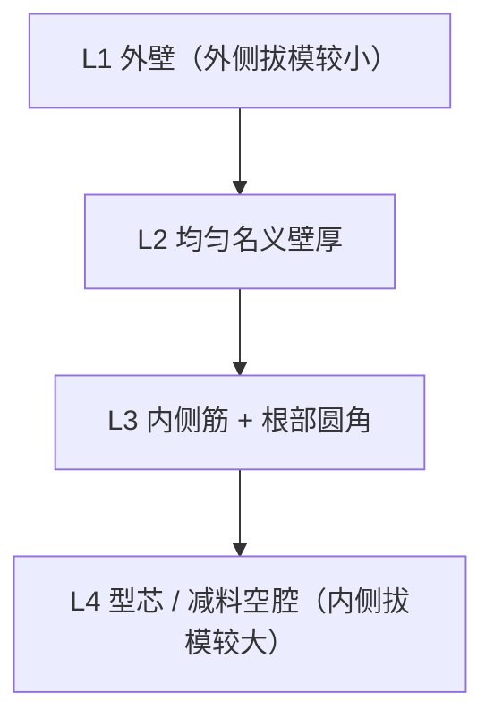

# 压铸壳体：壁厚、拔模与加强筋设计规则

> [!summary] 一句话概述
> 一般铝/锌压铸壳体要把壁厚做薄、做均匀，用加强筋补刚度而不是加厚实心截面，并给内侧比外侧更大的拔模、在壁与筋交接处加圆角，避免厚薄突变和交叉厚节点；这与特斯拉 Giga Press 一类超大型一体压铸车身件不是同一套问题。

## 配图

![[附件/jhmim-diecast-rib-draft.jpg]]
*图源：[JH MIM《压铸设计指南》](https://jhmim.com/zh-CN/design-for-die-casting/)「筋的厚度和斜度」插图；以正常壁厚 S 为基准：S≤3 mm 时筋顶宽 b1=(0.6～1)S、筋根宽 b2=(1～1.3)S；S>3 mm 时 b1=(0.4～0.7)S、b2=(0.6～1)S；高度 h≤5S；圆角 r1≤0.5、r2≥S（图中单位标注为 mm）*

![[附件/jhmim-diecast-wall-strength.jpg]]
*图源：同上页「不同壁厚铝合金压铸件的密度与强度」配图；横轴为压铸壁厚 2.0～6.0 mm。曲线显示锌合金、铝合金与镁合金的相对性能随壁厚增加而下降，用来说明「在保证强度和刚度的前提下应尽可能减小厚度」*

![[附件/nadca-rib-designs-g6-3-21.jpg]]
*图源：[NADCA Product Specification Standards for Die Castings / 2021，Section 6「Ribs and Corners」，G-6-3-21，第 6-5 页](https://www.abdiecasting.com/wp-content/uploads/2024/09/Section-06-Additional-Specification-Guidelines.pdf)；推荐把筋根与壁面圆滑过渡、筋布置在内侧以改善金属分配；不推荐尖角小圆角、少拔模，以及外侧乱加筋造成应力分配不良。图中还提醒：筋与筋之间在模具里形成的 metal saver（减料凸包）过深、过尖、侧面拔模过小，会削弱模具钢*

> 图片版权归原作者所有，仅作个人学习收藏；出处见文末「来源与核实记录」。

## 结构原理

> 本节所有数字只写来源里给出的；来源没有就写「来源未给出」，不估算、不编造。

压铸是把液态或半液态金属在高压、高速下充入型腔并在压力下凝固。JH MIM 指南强调：薄壁铸件致密度较好，强度和抗压性能相对提高；但太薄则充填困难，太厚或壁厚严重不均则容易缩孔、气孔，力学性能明显下降。因此正确做法是把名义壁厚控制在推荐区间，同一铸件上最大与最小壁厚之比不要过大，再用筋来补因减薄而失去的刚度，并作为充型时的辅助流路。

拔模方面，内侧（型芯侧）冷却后包紧型芯，斜度要大于外侧。JH MIM 写：「一般来说，外侧尺寸是内侧尺寸的一半。」Dynacast 则给出更笼统的「每侧 ¼ 至 1 度」。圆角用来让金属流动顺畅、避免锐角裂纹，并减轻模具热节；NADCA 把圆角半径与交接处最薄壁厚 T1 联系起来，而不是随手画一个任意 R。

### 堆叠方案

按壳体壁的局部剖面「从外到内」：最外是带拔模的外壁，向内是名义壁厚，再向内是内侧加强筋及其根部圆角，筋与筋之间是减料形成的空腔（NADCA 所称 metal saver 在模具一侧）。方向以脱模方向为准。

| 层级 | 零件 | 材料 | 厚度/尺寸 | 固定方式 | 依据 |
| --- | --- | --- | --- | --- | --- |
| L1（最外） | 外壳外壁（外观或配合面） | 锌、铝、镁或铜合金 | 按投影面积选最小/正常壁厚，见参数表；JH MIM：压铸件壁厚一般 2～4 mm | 与内壁一体压铸 | JH MIM 壁厚节；CastMold 壁厚表 |
| L2 | 名义壁厚截面 | 同上 | 同一铸件最大壁厚与最小壁厚之比不大于 3：1；铝合金壁厚超过 6 mm 不宜压铸（JH MIM） | 凝固后成为壳体本体 | JH MIM「铸件设计壁厚要求」 |
| L3 | 内侧加强筋与根部圆角 | 同上 | JH MIM 图：h≤5S，筋厚小于壁厚；CastMold：筋底厚 t=(0.6–1)T，H≤5T，θ=1°–3° | 与壁一体成型 | JH MIM 筋图；CastMold 加强筋指南 |
| L4（最内） | 型芯与减料空腔 | 模具钢（来源未给出具体牌号） | NADCA：减料凸包不宜过深、边缘不宜过尖、侧面拔模不宜过小 | 开模时由拔模和顶出脱离 | NADCA G-6-3-21 |

剖面示意：

### 零件清单

| 零件 | 数量 | 功能 | 材料 | 依据 |
| --- | --- | --- | --- | --- |
| 压铸壳体本体 | 来源未给出（按产品） | 提供封闭或半封闭外壳、基本壁厚和外形 | 锌、铝、镁或铜合金 | JH MIM、CastMold 材料分列 |
| 加强筋 | 来源未给出 | 减薄后补刚度、减少收缩变形、兼作充型辅助流路 | 与本体相同 | JH MIM 筋的作用；CastMold、NADCA |
| 圆角 | 来源未给出 | 改善流动与排气，降低铸件和模具应力集中 | 与本体相同 | JH MIM 圆角节；NADCA G-6-2-21 |
| 可选机加工面 | 来源未给出 | 只在配合面留加工余量，尽量减少加工面积 | 同上 | CastMold、JH MIM 加工余量节 |

### 装配顺序

1. 分型面、拔模方向和侧抽位置先定：避免或减少抽芯，交叉抽芯更要避免（JH MIM）。
2. 按铸件外形面积选定最小和正常壁厚，把过厚区域改成筋加均匀壁，厚薄交接用圆角或双半径过渡，而不是台阶。
3. 给内、外表面和孔、筋侧壁加上与脱模方向一致的斜度；配合面斜度可小于非配合面，内侧大于外侧。
4. 各壁与筋交接处加圆角（分型面处除外，NADCA 与 CastMold 都提醒分型线上的圆角会增加修边和模具成本）。
5. 压铸成型、切浇口和修飞边；仅在需要的配合面做少量机加工。

> 来源是设计原则，不是某壳体的拆解顺序。

### 受力与运动分析

- **受力路径**：使用载荷由壳体壁进入，经筋扩散到周围壁面。NADCA 说明：设计正确的筋比同等实心材料更能增加刚度；设计不正确则会在筋边集中应力。壁过厚时，内部缩孔、气孔会削弱截面。
- **运动关系**：成型后壳体为静态结构，无相对运动。唯一的「运动」是开模时铸件沿拔模方向脱离型腔和型芯。
- **失效风险**：壁厚不均导致缩孔、气孔和变形；内侧拔模不足则包紧型芯、拉伤或顶白；交叉厚节点和锐角在铸件和模具上形成热节；筋排得过密会使模具减料凸包过弱。JH MIM 还给出内部质量界限：孔洞最大直径不超过壁厚的 1/8，任一截面孔洞数量不超过 2 个/cm²（在「压铸件内部质量」节）。

## 设计要点与参数

| 要点 | 内容 | 依据 |
| --- | --- | --- |
| 可达到的最小壁厚（工艺极限） | 现代锌合金压铸件最小壁厚可达 0.3 mm，铝合金可达 0.5 mm | JH MIM 开篇「压铸的主要优点」 |
| 一般壁厚与厚薄比 | 压铸件的壁厚一般为 2～4 mm；同一压铸件中最大壁厚与最小壁厚之比不大于 3：1；壁厚超过 6 mm 的铝合金件不宜压铸 | JH MIM「铸件设计壁厚要求」 |
| 按面积推荐的最小 / 正常壁厚 | 面积分档与 JH MIM 表「壁厚 a×b 处的面积（cm²）」对应。首行标签原文作「≤25%」，其余行为「＞25〜100」「＞100〜500」「＞500」。锌：0.5/1.5、1.0/1.8、1.5/2.2、2.0/2.5 mm；铝：0.8/2.0、1.2/2.5、1.8/3.0、2.5/4.0 mm；镁与铝相同；铜：0.8/1.5、1.5/2.0、2.0/2.5、2.5/3.0 mm（均为最低限度 / 正常） | JH MIM 该表 |
| 另一机构同口径表 | CastMold 表头作「墙面面积（平方厘米）」：≤25、25〜100、100〜500、>500。铝镁最小/推荐：0.8/2.0、1.2/2.5、1.8/3.0、2.5/3.5 mm；锌：0.5/1.5、1.0/1.8、1.5/2.2、2.0/2.5 mm。与 JH MIM 锌、铝前三档一致，铝镁最大档推荐壁厚写作 3.5 mm（JH MIM 为 4.0 mm），且无铜合金列 | CastMold「选择合理的壁厚」表 |
| 筋厚、筋高与斜度 | 筋的厚度应小于壁厚，一般取壁厚的 2/3～3/4。图表明细：见封面图。CastMold：t=(0.6–1)T，H≤5T，圆角 t≤R≤1.25t，拔模 θ=1°–3° | JH MIM 正文与「筋的厚度和斜度」图；CastMold 加强筋设计指南 |
| 拔模 | 铝镁合金：配合面外 0°15′、内 0°30′；非配合面外 0°30′、内 1°。锌合金：配合面外 0°10′、内 0°15′；非配合面外 0°15′、内 0°45′。表注：仅适用于腔深或芯高 50 mm、表面粗糙度 Ra0.1 等条件；单面尺寸变化最小 0.03 mm。内侧大于外侧，外侧大约是内侧的一半。Dynacast：通常建议每侧 ¼ 至 1 度 | JH MIM 斜度表与说明；Dynacast「采用拔模斜度」 |
| 圆角 | 铝压铸件圆角半径 R 一般不小于 1 mm，最小 0.5 mm。分合金表：锌 0.5、铝镁 1.0、铝锡 0.5、铜 1.5（单位随原文为圆角半径 R）。CastMold：内半径约等于局部壁厚，外半径 = 内半径 + 壁厚。NADCA：交接处最薄壁厚为 T1 时，推荐圆角约 R1=T1 至 1¼ T1 等（见标准插图），并明确不推荐无圆角 | JH MIM 圆角节与表；CastMold；NADCA G-6-2-21 第 6-4 页 |
| 均匀壁与过渡 | 壁厚应尽量均匀；不可避免的差异要用倒角或平滑半径过渡，CastMold 把双半径过渡列为最好。NADCA：Part wall sections should be of uniform thickness as much as possible；Heavy sections, as well as abrupt changes in sectional thickness, should be avoided | CastMold 壁厚过渡；NADCA Section 6 设计要点 |
| 收缩率（设计放缩，非壁厚公式） | 锌合金 K=(0.4%–0.8%)，一般可选 0.6%；铝合金 K=(0.3%–0.7%)，一般可选 0.5% | JH MIM「压铸件的收缩率」 |

> 来源没有给出的参数一律写「来源未给出」。两家厂商的最大档铝镁推荐壁厚并不相同，按项目与压铸厂确认，不取中间值冒充标准。

## 优缺点

**优点**
- 可以做比砂铸薄得多的复杂壳体，并在薄壁上用筋恢复刚度，避免实心厚壁带来的缩孔。
- 内、外拔模差和圆角规则同时照顾铸件出模和模具寿命。
- 按面积给最小/正常壁厚，便于在方案阶段估算壳体重量和可否压铸。

**缺点 / 代价**
- 壁厚窗口比注塑更受充填和气孔限制，过大的厚薄比或超过 6 mm 的铝壁会被直接判为不适合压铸。
- 内侧必须留更大斜度，深腔、带皮纹或配合面都会把斜度再抬高，外形垂直度受影响。
- 筋过密、交叉节点过厚会反过来损害模具钢和铸件致密性。
- 不同指南在推荐壁厚、筋厚系数上不完全一致，不能只抄一张表。

## 可借鉴点

- 先按外形面积查出最小和正常壁厚，再检查同一件上最大/最小壁厚是否超过 3：1；铝件不要用加厚到 6 mm 以上来换强度，改用筋。
- 筋厚小于壁厚：可先按 2/3～3/4 壁厚或 CastMold 的 (0.6–1)T 画，筋高不超过 5 倍壁厚，根部圆角不要省略。
- 内侧拔模大约按外侧的两倍留；配合面可以更小，但不要为零。
- 壁与壁、壁与筋的交接处加圆角，分型线上尽量不要放圆角。
- 画筋时同时看模具一侧的减料凸包是否过深、过尖、侧面拔模过小。

## 与库中相似案例对比

| 对比项 | 本篇 | [[特斯拉 Giga Press 一体化压铸车身件]] | [[塑料件加强筋设计：厚度、高度与间距比例]] | [[金属注射成型（MIM）：均匀壁厚、烧结支撑面与 5000 件成本拐点]] |
| --- | --- | --- | --- | --- |
| 主角 | 一般电子/产品压铸壳体的壁厚、内外拔模差和筋厚高比 | 超大型一体压铸车身件与巨型压铸单元 | 注塑筋的 0.4–0.6 t、筋高不超过 3 t、间距至少 4 t | MIM 均匀壁厚与烧结支撑 |
| 何时用本篇 | 设计铝或锌的电器盒、支架、小型壳体，需要可压铸的壁和筋 | 讨论车身大型一体铸件、产线与合金体系 | 塑料件筋 | 粉末注射成型小金属件 |
| 规则差异 | 压铸筋常可到 5 倍壁厚，且强调筋厚小于壁厚、内侧拔模更大；壁厚按合金和面积给最小/正常值 | 不是壁厚筋表，不解决常规壳体 DFM | 注塑筋比例不能直接搬到压铸 | MIM 也要求均匀壁厚，但约束来自烧结而非高压充填 |

## 相关案例

- [[特斯拉 Giga Press 一体化压铸车身件]]
- [[塑料件加强筋设计：厚度、高度与间距比例]]
- [[金属注射成型（MIM）：均匀壁厚、烧结支撑面与 5000 件成本拐点]]
- [[钣金折弯件设计规则：最小弯曲半径与预留切口]]
- [[注塑均匀壁厚与厚薄渐变：相邻壁厚比与过渡段长度]]
- 分类索引：[[07-材料与工艺 索引]]

## 来源与核实记录

- 主来源：[JH MIM《压铸设计15个关键点 / 压铸设计指南》](https://jhmim.com/zh-CN/design-for-die-casting/)（打开页面时未见单独署名作者；站点为 jhmim.com。已核对最小壁厚 0.3/0.5 mm、一般壁厚 2～4 mm、最大最小壁厚比 3：1、铝合金 6 mm 上限、按面积的壁厚表、筋厚 2/3～3/4 与「筋的厚度和斜度」图、内外斜度表、圆角表，并下载插图）
- 补充来源：[CastMold《压铸件设计：面向制造和面向成型的14项结构原则》](https://cast-mold.com/zh-CN/blog/die-casting-part-design-14-principles/)（东莞 CastMold 中文博客。已核对按面积的壁厚表、筋参数 t=(0.6–1)T、H≤5T、θ=1°–3°、内外圆角与壁厚关系。文件名含 Gemini_Generated 的插图未采用）
- 补充来源：[Dynacast《压铸设计优化要点》](https://www.dynacast.com/zh-cn/resources/article/design-tips-for-improved-die-casting)（2023-07-19，Dynacast。已核对「每侧 ¼ 至 1 度」拔模及圆角、筋、均匀壁厚的原则表述。该页无壁厚数值表）
- 补充来源：[NADCA Product Specification Standards for Die Castings / 2021，Section 6 Additional Specification Guidelines，G-6-2-21 与 G-6-3-21](https://www.abdiecasting.com/wp-content/uploads/2024/09/Section-06-Additional-Specification-Guidelines.pdf)（已打开预下载 10 页 PDF，提取第 6-4、6-5 页圆角与筋的推荐/不推荐插图，并核对均匀壁厚、避免厚截面突变、fillet 与 rib 的文字规则。本 Section 未给出按合金的推荐壁厚毫米表，壁厚数值不以该手册冒充）
- 核实：2026-11-22 打开上述页面与 PDF。未把未打开的 NADCA 其他分册（如 Draft Tolerances 所在 Section 4）中的数字写入参数表。
