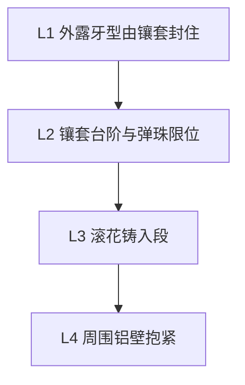

# 压铸螺纹嵌件：先旋入镶套再以弹珠限位，防止铝液进牙（嵌中嵌）

> [!summary] 一句话概述
> 高精度内螺纹如果直接暴露在铝液里，牙缝很容易进铝、磕伤，通规就过不去；广东鸿图的做法是先把钢质螺纹嵌件旋进模具镶套（嵌中嵌），再靠弹珠限位放进压铸模，让镶套和台阶封住牙型，铸件只包住嵌件的滚花段。

## 配图

![[附件/diecast-insert-dcm2170-01.png]]
*图源：[广东鸿图，李振生，《高精度螺纹镶嵌件镶嵌工艺在压铸模具上的应用》](https://www.dcm888.com/news/2170.html)（2013-07-23）；嵌件与相关结构照片之一。*

![[附件/diecast-insert-dcm2170-02.png]]
*图源：同上文；嵌件或镶套单体照片。*

![[附件/diecast-insert-dcm2170-03.png]]
*图源：同上文；镶套嵌件总成或封料相关示意。*

> 图片版权归原作者所有，仅作个人学习收藏；出处见文末「来源与核实记录」。

## 结构原理

> 本节所有数字只写来源里给出的；来源没有就写「来源未给出」，不估算、不编造。

鸿图的课题对象是发动机燃油滤清器端盖：先把规格为 1-14 U.N.S-2A 的螺纹嵌件放入压铸模，再与铝合金铸件铸合。该螺纹是美制统一螺纹，中径公差带只有 0.13 mm；一旦牙面磕伤、拉伤或残留铝屑，通规就不能通过。嵌件光身外露部分最大只有 0.4 mm，按常规镶嵌几乎无法封料，铝液会从牙缝进入。

解决办法是嵌中嵌：先做与嵌件配合的模具镶套，把螺纹嵌件旋入镶套成为总成，再放到压铸模上，并用模具里的弹珠限位精确定位。镶套端面做成台阶，凸起 0.15 mm 做径向封料。嵌件材料为 Y15PB，外表面镀铜，铸入部分制出滚花和凹槽，以增强与压铸合金的结合。镶套与弹珠配合凹槽处要求全周 R0.3 mm 圆角，不允许尖边毛刺。

JH MIM 给出一般嵌件规则：周围母材厚度不应小于 1.5～2 mm（大型铸件还要加厚）；螺纹嵌件铸后外侧留 1.5～2 mm；滚花或网纹的槽宽不小于 2 mm、深度不小于 1.5 mm；嵌件要清洁并预热，预热温度按合金分档；嵌件不宜距浇口太远。Neway 则从接头载荷出发，说明 Zamak 3 上何时用铸态螺纹、何时攻丝、何时才值得放金属镶件，避免只凭外观决定。

这与库中「金属嵌件注塑」不同：这里是高压金属液包覆嵌件，进铝、预热和电化学腐蚀是压铸特有约束。它也不同于后面的「铸态螺纹」篇：本篇的牙型在钢质嵌件上，不靠模具牙芯直接压出。

### 堆叠方案

方向：沿嵌件轴线，从外露牙型到铸件包覆段。

| 层级 | 零件 | 材料 | 厚度/尺寸 | 固定方式 | 依据 |
| --- | --- | --- | --- | --- | --- |
| L1（外露） | 螺纹工作段（被镶套保护） | Y15PB，表面镀铜 | 1-14 U.N.S-2A；中径公差带 0.13 mm；光身外露最大 0.4 mm | 先旋入镶套 | 鸿图 |
| L2 | 模具镶套及 0.15 mm 台阶 | 模具镶套（来源未给出牌号） | 端面凸起 0.15 mm 径向封料；与弹珠槽全周 R0.3 mm | 放入型腔，弹珠限位 | 鸿图 |
| L3 | 铸入段滚花与凹槽 | 同上嵌件 | JH MIM：花纹槽宽 ≥2 mm，深 ≥1.5 mm | 被铝液包覆 | 鸿图；JH MIM |
| L4 | 周围铸件母材 | 铝合金（鸿图实例） | JH MIM：周围壁厚不小于 1.5～2 mm，大型铸件再增加；螺纹嵌件铸后外侧留 1.5～2 mm | 压铸包覆，凝固后抱紧 | JH MIM |

剖面示意：

### 零件清单

| 零件 | 数量 | 功能 | 材料 | 依据 |
| --- | --- | --- | --- | --- |
| 螺纹嵌件 | 鸿图实例为端盖上的该规格嵌件 | 提供高精度、可反复使用的螺纹 | Y15PB，镀铜 | 鸿图 |
| 模具镶套 | 与嵌件成对 | 封住牙型、防止进铝 | 来源未给出 | 鸿图 |
| 弹珠限位 | 模具内置 | 总成定位 | 来源未给出 | 鸿图 |
| 压铸件本体 | 1 | 包覆滚花段并形成端盖 | 铝合金；或 Zamak 3 等 | 鸿图；Neway |

### 装配顺序

1. 清洁嵌件（JH MIM：去油污、灰烬、铁锈）并按合金预热。
2. 把螺纹嵌件旋入镶套，成为镶套嵌件总成（鸿图）。
3. 将总成放入压铸模，用弹珠限位定位。
4. 合模压铸，铝液包覆滚花段，镶套和台阶阻止铝液进入牙缝。
5. 开模取出铸件，卸下镶套，检查通规。

> 鸿图文是工艺说明，不是整机拆解；顺序按正文工序整理。

### 受力与运动分析

- **受力路径**：使用时的拧紧扭矩和拔出力由牙型传到钢质嵌件，再经滚花和凹槽传到周围铸件。Neway 提醒：先问接头要抵抗的是拔出、扭矩、剪切还是反复拆装，而不是先画镶件。
- **运动关系**：成形后嵌件与铸件之间不应松动（JH MIM）。压铸生产中，嵌件随镶套放入和取出。
- **失效风险**：进铝或磕牙导致通规失败；周围壁过薄或有尖角会开裂；嵌件与基体发生电化学腐蚀；铸件再做热处理时，两种金属体积变化不同可能导致嵌件松动（JH MIM）。嵌件离浇口太远会熔接不牢。

## 设计要点与参数

| 要点 | 内容 | 依据 |
| --- | --- | --- |
| 实例螺纹 | 1-14 U.N.S-2A；中径公差带 0.13 mm | 鸿图 |
| 外露与封料 | 光身外露最大 0.4 mm；镶套台阶凸起 0.15 mm 径向封料；弹珠槽全周 R0.3 mm，无尖边 | 鸿图 |
| 周围壁厚 | 镶件周围母材厚度不应小于 1.5～2 mm，大型铸件应增加 | JH MIM |
| 铸后外留 | 采用螺纹嵌件时，嵌后外侧留 1.5～2 mm | JH MIM |
| 滚花 | 直纹、网纹等槽宽不应小于 2 mm，深度不应小于 1.5 mm | JH MIM |
| 预热温度 | 铅、锡合金 60–80；锌合金 150–200；铝、镁合金 200–250；铜合金 250–350（原文表未写单位，按该表所在段的温度叙述，理解为 ℃，但表头只写「预热温度」） | JH MIM 预热表。表头未写 ℃，正文是预热温度分档 |
| 位置 | 嵌件不宜距浇口太远；若必须远，应适当提高浇注温度 | JH MIM |
| 热处理 | 带嵌件的铸件应避免热处理，以免两金属相变不同导致松动 | JH MIM |
| 选择逻辑（锌合金） | Neway：铸态螺纹适合粗牙、易出模、载荷适中；小孔或位置关键时宜攻丝；反复装配、磨损或更高拔出力才值得放金属镶件。先定义载荷，再选路线 | Neway |

> 预热表未在表头标注单位。本篇不把未标明的单位写成已证实的 ℃ 去参与计算，只转述分档数字；实施时按原手册确认。

## 优缺点

**优点**
- 可以把高精度、耐磨的钢螺纹放进压铸件，而不把牙型直接暴露给铝液。
- 嵌中嵌降低了进铝和后道去毛刺。
- 一般规则（壁厚、滚花、预热）可以迁移到其他压铸嵌件，不只是这一个滤清器端盖。

**缺点 / 代价**
- 每模都要放入总成，要为镶套和弹珠留结构和维护时间。
- 嵌件增加材料成本和电化学腐蚀、热处理限制。
- 不是所有螺纹都值得做成镶件；载荷不大时，铸态螺纹或铸后攻丝可能更简单。

## 可借鉴点

- 高精度内螺纹先问能否封住牙型：外露短、公差紧时，优先考虑镶套保护，而不是把嵌件直接插在型腔里。
- 铸入段要有滚花或凹槽，周围留够壁厚，并避开锐边和过远的浇口。
- 先用 Neway 的载荷问题决定「铸态 / 攻丝 / 镶件」，再画嵌件。
- 对照注塑嵌件时，补上预热、进铝和热处理限制，不要只搬塑料的壁厚经验。

## 与库中相似案例对比

| 对比项 | 本案例（压铸螺纹嵌件） | [[金属嵌件注塑：周围壁厚、滚花止转与开裂风险]] | [[压铸铸态螺纹：外螺纹用对开牙或螺纹环，内螺纹芯需带轴向斜度]] |
| --- | --- | --- | --- |
| 基体 | 高压铝或锌等金属液 | 热塑性塑料 | 同一件压铸金属，无单独钢牙套 |
| 主要风险 | 进铝、通规失败、电化学腐蚀、热处理松动 | 收缩差开裂、止转不足 | 错扣、内螺纹芯斜度和长度限制 |
| 何时用这篇 | 牙型精度高、要反复拆装或耐磨，值得放钢质嵌件 | 塑料壳体里的螺母或端子 | 载荷和精度允许直接铸出螺纹 |

## 相关案例

- [[金属嵌件注塑：周围壁厚、滚花止转与开裂风险]]
- [[压铸铸态螺纹：外螺纹用对开牙或螺纹环，内螺纹芯需带轴向斜度]]
- [[压铸铸孔与自攻底孔：细针易断，小于2mm宜先导后再加工]]
- [[压铸壳体：壁厚、拔模与加强筋设计规则]]
- 分类索引：[[07-材料与工艺 索引]]

## 来源与核实记录

- 主来源：[李振生（广东鸿图科技股份有限公司），《高精度螺纹镶嵌件镶嵌工艺在压铸模具上的应用》](https://www.dcm888.com/news/2170.html)（发布时间 2013-07-23，页面转载于 dcm888。螺纹规格、0.13 mm 公差带、0.4 mm 外露、嵌中嵌、0.15 mm 台阶和 R0.3 mm 来自该文。）
- 交叉来源：[JH MIM，《压铸设计指南》嵌件节](https://jhmim.com/zh-CN/design-for-die-casting/)（2026-11-27 打开。周围壁厚、滚花尺寸、预热分档和热处理限制来自该节。该页其他壁厚、拔模和筋的内容已写入「压铸壳体」篇，本篇不重复。）
- 交叉来源：[Neway，《在 Zamak 3 压铸件中，螺纹和镶件应如何设计？》](https://www.newaydiecast.com/zh/services/zinc-die-casting-faq/how-should-threads-and-inserts-be-designed-in-zamak-3-die-castings)（2026-11-27 打开。铸态 / 攻丝 / 镶件的选择逻辑来自该页，未把未给出的凸台尺寸表写入。）
- 核实：2026-11-27 打开上述来源。未把预热表未标明的单位写成计算依据。
