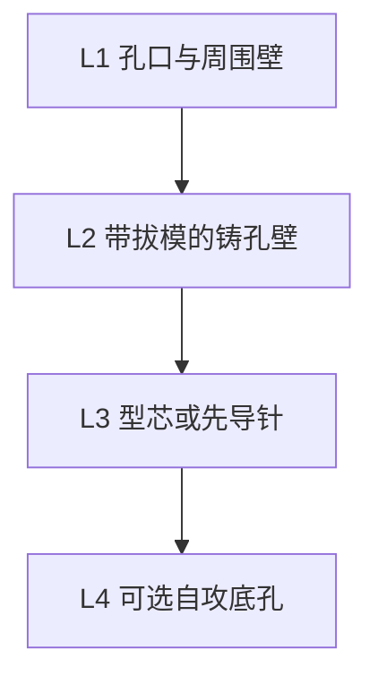

# 压铸铸孔与自攻底孔：细针易断，小于2mm宜先导后再加工

> [!summary] 一句话概述
> 要求不高的孔可以在压铸时用型芯直接铸出，但直径小于 2 mm 的型针很容易弯曲或折断，JH MIM 建议改成先导孔再加工；要气密的孔，NADCA 建议尽量铸出而不是事后钻出来，并且按是否还要机加工来决定铸孔拔模。

## 配图

![[附件/diecast-jhmim-hole-edge.png]]
*图源：[JH MIM《压铸设计指南》](https://jhmim.com/zh-CN/design-for-die-casting/)「铸孔与孔至边缘的最小距离」相关插图。*

![[附件/diecast-nadca-boss-p4.png]]
*图源：[NADCA Product Specification Standards for Die Castings / 2021，Section 6](https://www.abdiecasting.com/wp-content/uploads/2024/09/Section-06-Additional-Specification-Guidelines.pdf) 摘页；该节同时给出筋、圆角、铸孔和顶出等设计指引，本图用于对照孔、凸台一类局部结构，不以未在该页写明的尺寸冒充孔径表。*

![[附件/diecast-jhmim-tapping-hole.png]]
*图源：JH MIM 指南中与自攻底孔或铸孔相关的简图（已保存为附件）。*

> 图片版权归原作者所有，仅作个人学习收藏；出处见文末「来源与核实记录」。

## 结构原理

> 本节所有数字只写来源里给出的；来源没有就写「来源未给出」，不估算、不编造。

JH MIM 第 6 节写：压铸件的孔径及孔深，要求不高的孔可直接压出。但实际生产中，2 mm 以下的针头直径非常容易变形、弯曲和断针，因此建议小于 2 mm 的异形针直接做成先导针，后续加工更有保证。同一节给出自攻螺钉推荐底孔直径表，并规定旋入深度 t≥1.5d。第 7 节补充矩形孔和槽的最小宽度与深度建议，按合金分列。

NADCA Section 6 从质量和飞边出发：需要耐压密封的孔和通道，应铸出以减少气孔，而不是铸后机加工打出；不准备再加工的铸孔和通道要留充足拔模，准备再加工的铸孔则用最小拔模（并指向 Draft Tolerances，该分册本次未打开，不引用其中的角度表）。顶出方面，该节给出大多数压铸件顶杆痕迹可凸出或凹入 0.015 in（0.381 mm），并建议把顶杆放在筋上或设在凸台位置等。

这与「注塑螺丝柱（Boss 柱）」不同：这里讨论的是金属压铸的型芯铸孔和自攻底孔，约束来自型针强度、铸态气孔和拔模，而不是塑料柱的壁厚比。也与「压铸螺纹嵌件」「铸态螺纹」不同：本篇的孔可以是光孔或自攻底孔，不一定带完整牙型。

### 堆叠方案

方向：沿孔轴线，从入口到孔底或通孔另一侧。

| 层级 | 零件 | 材料 | 厚度/尺寸 | 固定方式 | 依据 |
| --- | --- | --- | --- | --- | --- |
| L1 | 孔口与周围壁或凸台 | 压铸合金 | 孔到边缘的最小距离见 JH MIM 该节标题，具体表值在抓取页中未能复制，来源未给出可用数字 | 与铸件一体 | JH MIM |
| L2 | 铸孔壁（带拔模） | 同上 | 不加工的孔要有充足拔模；待加工的孔用最小拔模 | 由型芯成形 | NADCA |
| L3 | 型芯 / 型针或先导针 | 模具钢 | 小于 2 mm 的型针易断，宜做先导针 | 开模时抽出 | JH MIM |
| L4 | 自攻底孔（若用于自攻） | 同上 | 直径按 d2 / d3 表；旋入深度 t≥1.5d | 铸出或先导后加工 | JH MIM |

剖面示意：

### 零件清单

| 零件 | 数量 | 功能 | 材料 | 依据 |
| --- | --- | --- | --- | --- |
| 铸件孔壁 | 按孔数 | 形成光孔、底孔或气密通道 | 压铸合金 | JH MIM；NADCA |
| 型芯 / 型针 | 每孔 1 | 成形孔腔并在开模时退出 | 模具钢 | JH MIM |
| 自攻螺钉（应用时） | 按连接点 | 拧入推荐底孔 | 来源未给出螺钉材料 | JH MIM 底孔表 |

### 装配顺序

1. 区分孔的要求：只做装配通过、要自攻，还是要气密。
2. 要求不高且直径足够时，直接铸孔；小于 2 mm 则先铸导引孔，再加工（JH MIM）。
3. 气密孔优先铸出，并给足或不给足拔模，取决于是否还要机加工（NADCA）。
4. 自攻连接按推荐底孔和 t≥1.5d 设计旋入深度。
5. 布置顶杆时，NADCA 建议可放在筋顶或凸台处，并预估顶杆痕迹高度。

### 受力与运动分析

- **受力路径**：自攻时扭矩由牙型传到孔壁；气密孔要承受内压，铸后钻孔可能把内部气孔切开（NADCA）。
- **运动关系**：成形时型芯沿拔模方向抽出；使用时自攻螺钉旋入。小于 2 mm 的型针在反复生产中容易弯曲、折断。
- **失效风险**：细针折断留在铸件里；气密孔事后钻开后漏气；铸孔拔模不足造成拉伤；自攻底孔过大则咬不住，过小则开裂或滑牙。孔到边缘过近会在孔边拉裂，但该最小距离表本次未能从页面复制，不能编一个倍数。

## 设计要点与参数

| 要点 | 内容 | 依据 |
| --- | --- | --- |
| 细针 | 2 mm 以下针头直径非常容易变形、弯曲、断针；小于 2 mm 的异形针建议做成先导针，后续再加工 | JH MIM |
| 自攻底孔 d2 | M2.5：2.30～2.40；M3：2.75～2.85；M3.5：3.18～3.30；M4：3.63～3.75；M5：4.70～4.85；M6：5.58～5.70；M8：7.45～7.60（单位随该表，与螺纹规格同为 mm） | JH MIM 表 |
| 自攻底孔 d3 | M2.5：2.20～2.30；M3：2.60～2.70；M3.5：3.08～3.20；M4：3.48～3.60；M5：4.38～4.50；M6：5.38～5.50；M8：7.15～7.30 | JH MIM 表。d2 与 d3 的选用条件原文分行列出，本篇分列不合并 |
| 旋入深度 | t≥1.5d | JH MIM |
| 表中 d4 | 原文另列 d4 为百分比（如 M2.5 为 ≤4.2%），该段未解释百分数含义，不转写成孔径 | JH MIM |
| 矩形孔和槽 | 最小宽度 b：铅锡、锌 0.8，铝 1.2，镁 1.0，铜 1.5；最大深度 H 约 10～12（铜约 10）；厚度 h 约 8～12，按合金见表。原文用 ≈，不是精确公差 | JH MIM 第 7 节表，单位与最小宽度同行，按 mm 理解但表头未逐格标注单位 |
| 气密孔 | 需要压力密封的孔和通道应铸出，以减少气孔，而不是事后加工打出 | NADCA Section 6 |
| 铸孔拔模 | 不再加工的铸孔和通道应有充足拔模；还要机加工的铸孔用最小拔模。具体角度见 Draft Tolerances（本次未打开该分册） | NADCA |
| 顶杆痕迹 | 大多数压铸件顶杆痕迹可凸出或凹入 0.015 in（0.381 mm）；凸出痕迹更有利于生产 | NADCA |

## 优缺点

**优点**
- 能一次铸出大量孔，减少钻孔。
- 气密通道铸出后，不容易把内部气孔切开。
- 自攻底孔有可查的推荐直径和旋入深度。

**缺点 / 代价**
- 细型针寿命短，过细的孔几乎必须后加工。
- 铸孔带拔模，未加工的孔不是圆柱理想孔。
- 孔边最小距离等关键表若不能从来源完整读出，就不能假装有数。

## 可借鉴点

- 先按直径和公差决定「直接铸、先导后加工，还是完全机加工」。
- 小于 2 mm 不要坚持用细长型针。
- 气密孔优先铸出，并在图上标注这是铸孔还是加工孔，以便选拔模。
- 自攻按表选 d2 或 d3，并保证 t≥1.5d，不要把塑料自攻底孔公式直接搬过来。

## 与库中相似案例对比

| 对比项 | 本案例（铸孔与自攻底孔） | [[注塑螺丝柱（Boss 柱）：壁厚比 0.6 分水岭与自攻底孔公式]] | [[压铸螺纹嵌件：先旋入镶套再以弹珠限位，防止铝液进牙（嵌中嵌）]] | [[压铸铸态螺纹：外螺纹用对开牙或螺纹环，内螺纹芯需带轴向斜度]] |
| --- | --- | --- | --- | --- |
| 孔的性质 | 铸态光孔或自攻底孔 | 塑料柱内的自攻底孔 | 钢质嵌件上的精密螺纹 | 在铸件金属上直接压出螺纹 |
| 主要约束 | 型针强度、铸孔拔模、气密时不要后钻 | 塑料壁厚比和底孔公式 | 进铝与通规 | 对开牙错扣、内螺纹芯斜度 |
| 何时用这篇 | 铝或锌零件上的孔和自攻点 | 塑料壳体螺丝柱 | 高精度、反复拆装的钢牙 | 允许铸态牙型时 |

## 相关案例

- [[注塑螺丝柱（Boss 柱）：壁厚比 0.6 分水岭与自攻底孔公式]]
- [[压铸螺纹嵌件：先旋入镶套再以弹珠限位，防止铝液进牙（嵌中嵌）]]
- [[压铸铸态螺纹：外螺纹用对开牙或螺纹环，内螺纹芯需带轴向斜度]]
- [[压铸侧抽芯：侧孔或倒扣不能沿主开模方向退出时才加滑块]]
- [[压铸壳体：壁厚、拔模与加强筋设计规则]]
- 分类索引：[[07-材料与工艺 索引]]

## 来源与核实记录

- 主来源：[JH MIM，《压铸设计指南》第 6、7 节](https://jhmim.com/zh-CN/design-for-die-casting/)（2026-11-27 打开。2 mm 细针、自攻底孔表、旋入深度和矩形孔槽表来自这些节。孔径孔深总表未能以可复制数字读出，未编造。壁厚、拔模和筋仍见「压铸壳体」篇。）
- 交叉来源：[NADCA Product Specification Standards for Die Castings / 2021，Section 6 Additional Specification Guidelines](https://www.abdiecasting.com/wp-content/uploads/2024/09/Section-06-Additional-Specification-Guidelines.pdf)（已提取文本。气密孔应铸出、铸孔拔模原则和顶杆痕迹 0.015 in 来自该 Section。Draft Tolerances 所在分册未打开，未引用其中角度。）
- 核实：2026-11-27 打开上述来源。
