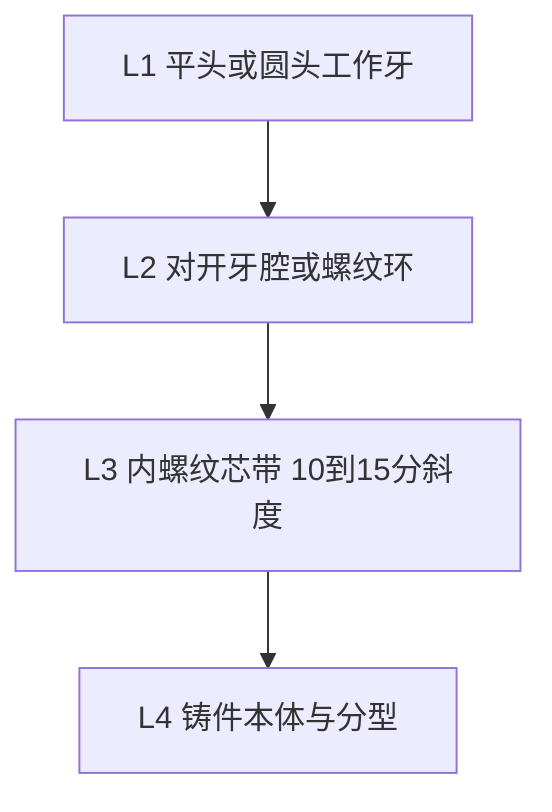

# 压铸铸态螺纹：外螺纹用对开牙或螺纹环，内螺纹芯需带轴向斜度

> [!summary] 一句话概述
> 锌、铝、镁压铸件可以在一定条件下直接压出螺纹：外螺纹常用对开的两半牙腔或螺纹环，内螺纹则靠沿轴线带斜度的螺纹芯成形，而且长度有限；它适合粗牙、出模方向合适、载荷适中的接头，不能把它当成钢质嵌件那样的高精度反复拆装螺纹。

## 配图

![[附件/diecast-jhmim-insert.png]]
*图源：[JH MIM《压铸设计指南》](https://jhmim.com/zh-CN/design-for-die-casting/) 与螺纹或镶件相关的结构图。该图同时出现在指南的螺纹 / 镶件部分，本篇只用它说明铸件上可以做出螺纹特征，不以图上未标注的尺寸充当牙型数据。*

> 图片版权归原作者所有，仅作个人学习收藏；出处见文末「来源与核实记录」。

## 结构原理

> 本节所有数字只写来源里给出的；来源没有就写「来源未给出」，不估算、不编造。

JH MIM 写：在一定工艺条件下，锌、铝、镁合金压铸件可直接压出螺纹；铜合金仅在极少数情况下压铸螺纹。压铸螺纹一般为国家标准规定的 3 级精度，通常多为外螺纹，必要时也可压铸内螺纹。压铸螺纹形状应为平头或圆头。指南还给出最小螺距可达 0.75 mm、最小铸件直径可达 0.7 mm 的工艺能力表述，这是能力上限式的说明，不是每一个零件都要收到这个尺寸。

外螺纹有两种模具做法：

- 两个可分离的半螺纹腔：容易产生错扣，圆度稍差，但能达到精度范围，使用前需简单修整，生产较方便。
- 螺纹环：不会产生错扣，圆度较好，但生产效率低，操作不安全。

内螺纹由螺纹芯成形：螺纹芯沿轴线方向要有斜度，通常为 10′～15′，螺纹长度有限。

Neway 从 Zamak 3 接头出发：当螺纹位于开模方向，或可通过可负担的旋出、滑块机构成形，轮廓能可靠充填，又不需要严格的节径控制时，铸态螺纹才实用；粗牙外螺纹通常比细牙内螺纹更容易成形。拔模、分型线和飞边不得干扰工作牙侧面。需要旋转芯的内螺纹会增加维护、周期和失效模式；年产量不大或螺纹很关键时，预铸导孔再攻丝往往风险更低。

这与「压铸螺纹嵌件」篇的差别是：本篇没有单独的钢质牙套，牙型就是铸件金属本身。与「铸孔与自攻底孔」的差别是：自攻底孔是光孔加螺钉自攻出牙，本篇是模具把牙型直接压出来。

### 堆叠方案

方向：沿螺纹轴线，从牙顶到牙根，再到型芯或对开分型。

| 层级 | 零件 | 材料 | 厚度/尺寸 | 固定方式 | 依据 |
| --- | --- | --- | --- | --- | --- |
| L1 | 工作牙侧面 | 锌、铝或镁等铸件金属 | 一般为 3 级精度；应为平头或圆头，避免尖锐牙端 | 铸态成形 | JH MIM |
| L2 | 外螺纹模具：对开牙腔或螺纹环 | 模具钢 | 对开者可能错扣、圆度稍差；螺纹环则相反但效率低 | 对开随分型打开，或旋出螺纹环 | JH MIM |
| L3 | 内螺纹芯 | 模具钢 | 轴向斜度通常 10′～15′，螺纹长度有限 | 开模时沿轴线抽出或旋出 | JH MIM；Neway |
| L4 | 周围铸件和分型、飞边 | 同铸件 | 分型线和飞边不得干扰工作牙侧面 | 与本体一体 | Neway |

剖面示意：

### 零件清单

| 零件 | 数量 | 功能 | 材料 | 依据 |
| --- | --- | --- | --- | --- |
| 铸态螺纹 | 按连接点 | 直接提供外螺纹或内螺纹 | 锌、铝、镁等 | JH MIM |
| 对开牙腔或螺纹环 | 外螺纹时 | 成形外牙 | 模具钢 | JH MIM |
| 螺纹芯 | 内螺纹时 | 成形内牙并带轴向斜度 | 模具钢 | JH MIM |

### 装配顺序

1. 用 Neway 的问题先判断：载荷、反复拆装和节径要求是否允许铸态螺纹。若不允许，改攻丝或嵌件。
2. 外螺纹选择对开牙腔或螺纹环；内螺纹设计带 10′～15′ 斜度的螺纹芯，并限制长度。
3. 检查分型线和飞边是否落在工作牙侧面上。
4. 压铸成形；对开牙若有错扣，按 JH MIM 做简单修整后再使用。
5. 用通止规检查，不要把 3 级精度理解成钢质嵌件的公差带。

### 受力与运动分析

- **受力路径**：拧紧和轴向载荷直接由铸件金属的牙侧面承担。铸件金属一般比钢质嵌件更软、更不耐反复拆装（Neway 把更高拔出力和反复装配列为改用镶件的理由）。
- **运动关系**：对开牙腔随分型打开；螺纹环或内螺纹芯可能需要旋出。内螺纹芯的轴向斜度是为了出模，也会让牙型沿长度变化。
- **失效风险**：对开错扣和圆度偏差；飞边切伤工作牙；内螺纹芯斜度或长度处理不当造成拉牙或无法抽芯；把铸态细牙内螺纹用在需要严格节径控制的接头上。

## 设计要点与参数

| 要点 | 内容 | 依据 |
| --- | --- | --- |
| 可铸合金 | 锌、铝、镁可在一定工艺条件下直接压出螺纹；铜合金仅在极少数情况下压铸螺纹 | JH MIM |
| 精度与牙端 | 一般为国家标准规定的 3 级精度；牙型应为平头或圆头 | JH MIM |
| 外螺纹两种模具 | 对开半螺纹腔：易错扣、圆度稍差，使用前需简单修整；螺纹环：不错扣、圆度较好，但效率低、操作不安全 | JH MIM |
| 内螺纹芯斜度 | 沿轴线方向通常为 10′～15′，螺纹长度有限 | JH MIM |
| 工艺能力表述 | 最小铸件直径可达 0.7 mm，最小螺距可达 0.75 mm | JH MIM 开篇优点。这是「可达到」的表述，不是推荐把所有螺纹都做到这一档 |
| 何时选用（Zamak 3） | 螺纹在开模方向或可用可负担的旋出 / 滑块成形，能可靠充填，且不需要严格节径控制；粗牙外螺纹通常比细牙内螺纹更容易。飞边和分型不得干扰工作牙侧面。产量不大或螺纹关键时，预铸导孔后攻丝可能风险更低 | Neway |

## 优缺点

**优点**
- 不必放入钢质嵌件，也不必每件都攻丝，适合粗牙、中等载荷的连接。
- 外螺纹的两种模具做法利弊清楚，可以按产量和圆度要求选择。

**缺点 / 代价**
- 精度和耐磨性不如钢质嵌件；内螺纹还有斜度和长度限制。
- 对开牙要接受错扣和修整，螺纹环则牺牲节拍和操作安全性。
- 分型飞边一旦落到工作牙上，整牙报废。

## 可借鉴点

- 先问能不能改成沿开模方向的粗牙外螺纹；细牙内螺纹优先考虑攻丝或嵌件。
- 图上标出分型是否穿过工作牙，以及内螺纹芯的斜度和旋出方式。
- 把「最小螺距 0.75 mm」当成工艺能力，而不是默认设计值。
- 与嵌件篇对照：只有反复拆装、磨损或更高拔出力时，才升级到钢质嵌件。

## 与库中相似案例对比

| 对比项 | 本案例（铸态螺纹） | [[压铸螺纹嵌件：先旋入镶套再以弹珠限位，防止铝液进牙（嵌中嵌）]] | [[压铸铸孔与自攻底孔：细针易断，小于2mm宜先导后再加工]] |
| --- | --- | --- | --- |
| 牙型所在 | 铸件金属本身 | 预埋钢质嵌件 | 多数是光孔，牙由自攻螺钉形成 |
| 精度与寿命 | 约 3 级，反复拆装能力有限 | 可做严格通规和更高耐磨 | 取决于底孔和螺钉 |
| 何时用这篇 | 粗牙、出模方便、载荷适中 | 高精度或频繁拆装 | 只要自攻连接、不必预制完整牙型 |

## 相关案例

- [[压铸螺纹嵌件：先旋入镶套再以弹珠限位，防止铝液进牙（嵌中嵌）]]
- [[压铸铸孔与自攻底孔：细针易断，小于2mm宜先导后再加工]]
- [[压铸侧抽芯：侧孔或倒扣不能沿主开模方向退出时才加滑块]]
- [[压铸壳体：壁厚、拔模与加强筋设计规则]]
- 分类索引：[[07-材料与工艺 索引]]

## 来源与核实记录

- 主来源：[JH MIM，《压铸设计指南》第 8 节「压铸螺纹、齿轮的铸造设计」及开篇能力表述](https://jhmim.com/zh-CN/design-for-die-casting/)（2026-11-27 打开。可铸合金、3 级精度、对开牙与螺纹环、内螺纹芯 10′～15′、平头或圆头，以及 0.75 mm 螺距能力，来自该页。壁厚筋表仍见「压铸壳体」篇。）
- 交叉来源：[Neway，《在 Zamak 3 压铸件中，螺纹和镶件应如何设计？》](https://www.newaydiecast.com/zh/services/zinc-die-casting-faq/how-should-threads-and-inserts-be-designed-in-zamak-3-die-castings)（2026-11-27 打开。何时可以采用铸态螺纹、粗牙外螺纹更易成形，以及飞边不得干扰工作牙，来自该页。）
- 核实：2026-11-27 打开上述来源。仅 1 张可用配图，未把同一文件复制成两张不同图。
