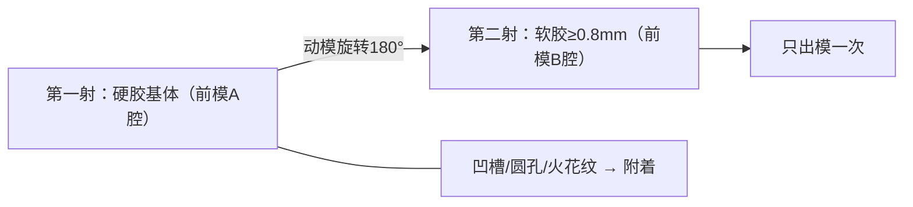

# 双色注塑：硬胶先射、软胶后射的结构拆件规则

> [!summary] 一句话概述
> 双色注塑是两种材料在同一台双色机上分两次成型、只出模一次：B 站专栏《【模具知识】15、双色模与产品结构设计》讲清了为什么必须「第一射硬胶、第二射软胶」、为什么第二射要做在前模、第二色拆件不低于 0.8 mm、以及如何用凹槽/圆孔/火花纹保证两色附着。

## 配图

![[附件/two-shot-molding-process.jpg]]
*图源：B 站专栏 cv12125226（还在上学的rek）；双色注塑示意：两套注射系统分别注入两种材料，动模旋转 180° 后进行第二射*

![[附件/two-shot-molding-part.jpg]]
*图源：同上；双色注塑件实物（文章中的第一色/第二色对比照之一）*

> 图片版权归原作者所有，仅作个人学习收藏；出处见文末「来源与核实记录」。

## 结构原理

> 本节数字只写来源里给出的；来源没有就写「来源未给出」。

### 堆叠方案

方向：**从基体到表层**（零件截面）

| 层级 | 零件/区域 | 材料 | 厚度/尺寸 | 固定方式 | 依据 |
| --- | --- | --- | --- | --- | --- |
| L1 | 第一射：硬胶基体 | 硬胶（熔融温度一般高于软胶） | 壁厚需保证不缩水，防止二射溢料跑毛边 | 第一次注塑 | 「模具特点」5、6；「拆件要点」2 |
| L2 | 附着结构：凹槽、圆孔、表面火花纹 | 硬胶上成型 | 来源未给出 | 机械咬合 + 表面附着 | 「拆件要点」4 |
| L3 | 第二射：软胶层 | 软胶 | 不低于 0.8 mm | 第二次注塑，包覆在硬胶上 | 「拆件要点」1 |

剖面示意：

### 零件清单

| 零件/模具要素 | 数量 | 功能 | 材料 | 依据 |
| --- | --- | --- | --- | --- |
| 双色注塑机（两料斗、两喷嘴） | 1 | 两种材料分别注射 | — | 「双色模具」段 |
| 前模型腔 | 2（形状不同） | 第一色、第二色成型 | 模具钢（来源未写牌号） | 「模具特点」3 |
| 后模型芯 | 2（形状相同） | 承载产品旋转 | — | 「模具特点」3 |
| 热流道 | 基本都用 | 第二射前不能有水口料 | — | 「模具特点」2 |

### 装配顺序

成型顺序（来源描述）：
1. 第一射注塑硬胶部分。
2. 动模（后模）带着第一射产品旋转 180°（也有不旋转、用机械手抓取放置的做法）。
3. 第二射在前模另一型腔注塑软胶部分。
4. 一次出模。

### 受力与运动分析

- **受力路径**：使用中软胶层的剥离力由两色界面附着 + 凹槽/圆孔的机械咬合承担。
- **运动关系**：模具层面——后模绕中心旋转 180° 后前后模必须吻合；产品本身无相对运动。
- **失效风险**（来源）：
  - 第一射若是软胶，第二射的压力和温度会把软胶压变形，外观不齐；
  - 二次料熔融温度若不低于一次料，两色交界处会熔胶、边界模糊；
  - 两种料缩水率不一致会产生断差；
  - 二射肉厚太薄会缺料、出现熔接痕；
  - 第二色有部分在后模时，需做前模滑块出倒扣，产生合模线。

## 设计要点与参数

| 要点 | 内容 | 依据 |
| --- | --- | --- |
| 射序 | 第一射硬胶、第二射软胶 | 模具特点 5 |
| 熔融温度 | 二次料熔融温度原则上低于一次料 | 模具特点 6 |
| 缩水率 | 取决于第一色材料，第二色取相同缩水率 | 模具特点 7 |
| 第二色厚度 | 不低于 0.8 mm | 拆件要点 1 |
| 第二色位置 | 以分型线为界做在前模 | 拆件要点 3；模具特点 3 |
| 附着设计 | 第一射上设计凹槽、圆孔、表面火花纹 | 拆件要点 4 |
| 模具 | 两套模具高度一致；前、后模旋转 180° 后必须吻合 | 模具特点 1、4 |
| 包胶对比 | 包胶属于二次出模；固态硅胶包胶用压模硫化（在涂过胶水的 PA、ABS、金属上），液态硅胶多用注塑 | 「PS」段 |
| 具体材料牌号、附着力数值 | 来源未给出 | — |

## 优缺点

**优点**
- 两种材料一次出模，比两次注塑（包胶/二次料）效率高、质量好（来源称是趋势）
- 软胶可直接做握持、密封、缓冲面

**缺点 / 代价**
- 需要专门的双色注塑机和旋转模具，模具成本高（推断）
- 对材料匹配（熔融温度、缩水率）要求严格

## 可借鉴点

- 拆件时先定射序：硬胶为骨架先射，软胶后包
- 第二色厚度 ≥ 0.8 mm，并全部放在前模侧
- 在硬胶上主动设计机械咬合（槽、孔、纹理），不要只依赖材料相容性
- 两种材料选型时同步核对熔融温度与缩水率

## 相关案例

- [[GoPro Hero4 Session 免外壳防水机身]]（包胶外壳）
- [[注塑倒扣脱模：强脱、斜顶还是滑块]]
- [[塑料件加强筋设计：厚度、高度与间距比例]]
- 分类索引：[[07-材料与工艺 索引]]

## 来源与核实记录

- 主来源：[【模具知识】15、双色模与产品结构设计](https://www.bilibili.com/read/cv12125226)（B 站专栏，2021-07-12，还在上学的rek，作者声明原创、为个人理解）
- 核实：2026-11-13 打开专栏原文核对模具特点 1–7、拆件要点 1–4 与包胶说明；文中两个示例视频（腾讯视频牙刷、杯子）未打开。
