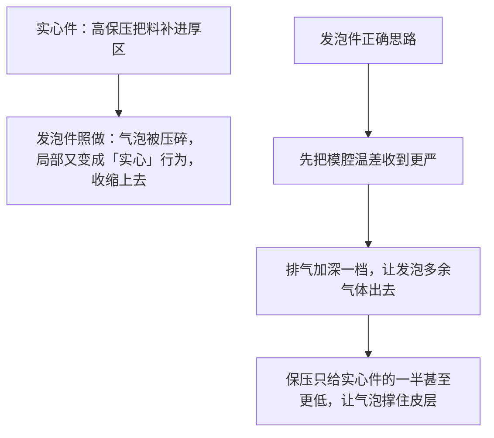

# 发泡件缩水：模温、排气与保压和实心件相反

> [!summary] 一句话概述
> 发泡件整体收缩往往小于实心件，但皮层只有薄薄一层、底下是气泡，局部凹陷有时更狠。现场不要先减发泡剂，先查模温均匀性和排气；保压思路也和实心件相反——发泡件靠控温控压让气泡撑住，而不是靠高保压把料补进厚区。

## 配图

![[附件/foam-mucell-process-sequence.jpg]]
*图源：[Plastics Engineering《MuCell Designer’s Guide》一文配图](https://www.plasticsengineering.org/2025/10/mucell-designers-guide-mastering-microcellular-injection-molding-009910/)（Courtesy of Green Molding）；超临界流体与熔体混合成单相溶液后，压力下降再形成微孔结构——后续「填充/保压」不再完全等于实心注塑的螺杆补缩*

![[附件/foam-mucell-cell-morphology.jpg]]
*图源：同上（Courtesy of Advances in microcellular injection moulding.）；微孔形貌。Trexel 指南指出：常规注塑厚区会出现缩痕或真空泡，MuCell 厚区则更常见「出模后芯部继续膨胀」的 post blow，首选仍是把厚区减胶*

> 图片版权归原作者所有，仅作个人学习收藏；出处见文末「来源与核实记录」。

## 结构原理

> 本节所有数字只写来源里给出的；来源没有就写「来源未给出」。

### 堆叠方案

方向：**从制件表面皮层到芯层气泡（发泡件剖面）**

| 层级 | 零件 | 材料 | 厚度/尺寸 | 固定方式 | 依据 |
| --- | --- | --- | --- | --- | --- |
| L1（最外） | 致密皮层 | 与基体树脂相同 | 赫兹：发泡件皮层 0.3–0.8 mm，抗凹陷能力比实心件弱 | 成型过程自然形成 | 赫兹 1221 |
| L2 | 芯层气泡 | 气体 + 树脂 | 密度低于实心；气泡在保压结束后仍可能继续冷却塌陷，把皮层吸出坑 | 发泡 | 赫兹 1221 |
| L3 | 模具型腔侧：水路、排气槽、浇口 | 模具钢 | 模腔温差建议收到 ±5℃（实心件 ±10℃ 通常可接受）；排气槽常见 0.04–0.06 mm，宽 3–5 mm（普通注塑常见 0.02–0.03 mm） | 模具设计 | 赫兹 1221 |

剖面示意：

### 零件清单

| 零件 | 数量 | 功能 | 材料 | 依据 |
| --- | --- | --- | --- | --- |
| 发泡制件（皮芯结构） | 1 | 减重，同时要管住局部凹陷和整体尺寸 | 如 PP 微发泡 | 赫兹 1221 案例 |
| 冷却水路 | 按型腔 | 把模腔温差控制住；深腔和筋位密集区要单独一路 | — | 赫兹：水道离型腔面一般 10–15 mm，间距 30–40 mm |
| 排气槽 | 料流末端、筋槽尽头 | 排出比实心注塑更多的气体 | — | 赫兹 |
| 浇口 | 1 或多点 | 太小会在进胶口附近提前发泡 | — | 赫兹：点浇口直径比同尺寸实心件放大 20%–30% |

### 装配顺序

这是试模/调机顺序，不是整机装配。赫兹给出的排查顺序是 **模温 → 排气 → 保压**，不要一上来动料：

1. 用接触式测温仪打模腔九个点（前后左右加中心）。温差超过 5℃，缩水位置基本跟着温度低的一侧走。赫兹电池包下壳案例：四腔中两腔筋位凹陷，浇口侧和远端差了 12℃，调水路后同样的料和倍率，凹陷消失。
2. 检查排气槽是否仍按 0.02 mm 的实心模在开；发泡建议 0.04–0.06 mm，宽 3–5 mm。开深了会飞边，分型面贴合精度要一起提高。
3. 再降保压。赫兹：平时 PP 实心件保压给到 60 MPa 以上很常见；发泡件给这么高，气泡会被压碎压小，局部密度被抬上去，反而变成实心件的收缩行为。发泡保压通常只给实心件的一半甚至更低，倍率越高保压越轻。
4. 尺寸按脱模 24 小时后再量，再定开模用的收缩率。

### 受力与运动分析

- **受力路径**：整体尺寸变化来自整件线性收缩；局部缩水是某一小块皮层被下方冷却塌陷拽下去。发泡件这两项常常「反过来」：整体收缩更小，局部凹陷风险更高。
- **运动关系**：无机构运动；芯层气体在出模后仍可能缓慢逸出，尺寸继续变（赫兹）。Trexel 对 MuCell 的对应描述是：厚区芯部出模后仍热、继续膨胀，表现为 post blow，而不是经典缩痕。
- **失效风险**：把发泡缩水当成「发泡剂加少了」；用实心件高保压思路把泡压死；排气不足在筋槽底、boss 周围困气，表现为发亮、发暗或塌陷；缩水位置固定是结构问题，随模次漂移是模温/水路问题，四腔中固定某几腔坏是流道平衡问题（赫兹判据）。

关于与 Trexel 的差异（必须分开写，不编成同一套数）：
- 赫兹 1221 针对其讨论的发泡件：强调模温均匀、排气加深、**降低保压**。
- Trexel MuCell 指南：发泡在较低压力下完成充填和 packing，型腔若排气不良，未排出的气体压力会「打败」发泡，减重幅度可被切掉多达 50%；建议可把锁模力降低最多 50% 以改善排气。厚区问题首选减胶；若不能改模，再降工艺温度和 SCF 用量，并先从降低模温开始。指南还写：因发泡塑料导热差，改模温对 post blow「效果很小」。
- Plastics Engineering 对 MuCell Designer’s Guide 的导读：内部气体压力可抵消收缩、改善尺寸稳定性；厚壁件周期有时最多快约 40%，锁模力常降 25–50%。

两套工艺都反对「把发泡件完全按实心件的高保压去补缩」，但 MuCell 厚区的典型缺陷表述是 post blow，赫兹 1221 的典型缺陷表述是皮层被吸坑。引用时不要混成一句。

## 设计要点与参数

| 要点 | 内容 | 依据 |
| --- | --- | --- |
| 收缩率取值 | 发泡件表观收缩率通常按同材料实心件的 60%–80% 估，必须试模实测。PP 实心常见 1.5%–2.5%，发泡后大致 1%–1.8% | 赫兹 1221 及 FAQ |
| 皮层 | 0.3–0.8 mm | 赫兹 |
| 模腔温差 | 建议 ±5℃ 以内 | 赫兹 |
| 排气槽 | 0.04–0.06 mm 深，宽 3–5 mm；普通注塑常见 0.02–0.03 mm | 赫兹 |
| 冷却 | 气泡隔热，冷却时间按实心的 1.3–1.5 倍估 | 赫兹 |
| 水路 | 离型腔面一般 10–15 mm，间距 30–40 mm；筋位密集区单独一进一出 | 赫兹 |
| 浇口 | 点浇口直径比同尺寸实心件放大 20%–30%。举例：实心小件 1.0–1.2 mm，发泡常从 1.5 mm 起 | 赫兹 |
| 保压 | 通常只给实心件一半甚至更低；PP 实心「60 MPa 以上很正常」这一对比来自赫兹经验表述 | 赫兹 |
| 筋（发泡件） | 筋厚取主壁厚 0.6–0.7 倍（实心件一般 0.5–0.6）；筋根至少 R0.5 mm | 赫兹 1221（与实心筋专篇不同，勿混用） |
| 脱模斜度 | 加大 0.5–1°；深腔件赫兹一般给到 1.5° 以上 | 赫兹 1221 |
| 顶针 | 避开薄皮大平面，落到筋、柱、翻边；直径适当放大 | 赫兹 |
| 尺寸测量 | 脱模 24 小时后再量；同一副模至少打三组不同倍率，放置 24 小时以上再统一量 | 赫兹 |
| MuCell 排气/锁模 | 排气不良可使减重幅度减少多达 50%；可尝试把锁模力降低最多 50% | Trexel 指南 |
| MuCell 厚区 | 首选减胶；不能改模时先降模温，再降熔体温度和 SCF 用量 | Trexel 指南 |

## 优缺点

**优点**
- 整体收缩较小、有机会减重；按赫兹说法先改模温和排气，往往不必先改配方
- 正确的低压/发泡 packing 可以减轻对螺杆高保压的依赖（MuCell 文献侧）

**缺点 / 代价**
- 皮层薄，局部凹陷有时比实心件更明显
- 排气加深与分型面精度必须配套，否则飞边
- 出模后尺寸还会变，不能按刚下线的数开模
- 不同发泡路线（化学发泡 vs MuCell）的缺陷形态不完全一样，不能把一份工艺单通用

## 可借鉴点

- **拿到发泡缩水，先量九个点模温，再看排气槽是不是还按实心模开**
- **保压先往下调，而不是往上加**：把泡压死会让收缩回到实心件行为
- **图纸不要照搬实心件**：筋可略放宽，但筋根要有 R；斜度加大；顶针避开薄皮
- **收缩率按 24 小时后的实测**，并至少对比几组倍率
- 厚区能减胶就减胶（与实心缩痕篇、Trexel 建议一致）

## 与库中相似案例对比

| 对比项 | 本案例 | [[注塑缩痕：厚壁背面凹陷、减胶坑与保压边界]] | [[安全帽 EPS 与 EPP 缓冲内衬：珠粒模压与硬壳堆叠]] |
| --- | --- | --- | --- |
| 工艺 | 注塑发泡 / 微发泡 | 实心注塑 | 珠粒蒸汽模压（EPP/EPS） |
| 保压 | 往往要低于实心件 | 靠保压补缩 | 不适用注塑保压逻辑 |
| 缩水 | 整体更小、局部可能更狠 | 厚区背后凹陷 | 赫兹 833 另给 EPP 收缩率 1.5–3%，与本篇微发泡不要混用 |

## 相关案例

- [[注塑缩痕：厚壁背面凹陷、减胶坑与保压边界]]
- [[安全帽 EPS 与 EPP 缓冲内衬：珠粒模压与硬壳堆叠]]
- [[气体辅助注塑（GAIM）：用气道掏空厚筋消缩痕]]
- 分类索引：[[07-材料与工艺 索引]]

## 来源与核实记录

- 主来源：[发泡件缩水比实心件狠，模具上要改哪几处](https://www.hezidesign.com/gongyi/1221.html)（赫兹工业设计，作者刘也；2026-11-15 打开核对表、案例与 FAQ）。文中另外两张配图为 Unsplash 场景图，按任务要求未采用；第一张「模具外观」图实为无关设备效果图，也未采用。
- 补充来源 1：Trexel《A Guide to the MuCell® Microcellular Foam Injection Molding Process – T Series》（通过 Wayback Machine 打开原 PDF：<https://trexel.com/wp-content/uploads/2023/03/MuCell-Processing-Guide-Complete-082015-V2.1-new-logo.pdf>；直连 2026-11-15 返回 403，故用存档核对排气、锁模力与厚区 post blow 表述）
- 补充来源 2：[MuCell Designer’s Guide: Mastering Microcellular Injection Molding](https://www.plasticsengineering.org/2025/10/mucell-designers-guide-mastering-microcellular-injection-molding-009910/)（Plastics Engineering，2025-10）——导读性转述，配图用于说明微孔形成，不是赫兹那套模温差/排气槽深度的来源
- 补充来源 3：[发泡成型工艺：从 EPP 到结构发泡](https://www.hezidesign.com/gongyi/833.html)（同一机构，仅作工艺背景，不作为第二独立来源）
- 核实：2026-11-15 打开上述页面/PDF。赫兹与 Trexel 对「厚区表面出了什么问题、改模温有没有用」的表述不一致，文中已分开标注。
