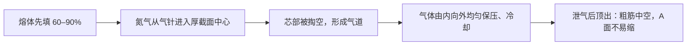

# 气体辅助注塑（GAIM）：用气道掏空厚筋消缩痕

> [!summary] 一句话概述
> 气体辅助注塑先把型腔注到约 60%–90% 满，再注入氮气把厚截面芯部掏空，并由气体在内部均匀保压。把气道布置在需要消缩痕的粗筋上，整体壁厚可以减薄，粗筋不再靠实心堆料——这和「减胶坑 + 螺杆保压」是一条不同的工艺路径。

## 配图

![[附件/gaim-four-process-stages.jpg]]
*图源：[Hank Tsai / Effinno，Ten Part-Design Rules for Gas-assisted Injection Molding Process，Figure 1](https://www.injectionmoldingdivision.org/2021/06/29/ten-part-design-rules-for-gas-assisted-injection-molding-process/)；四阶段：注塑充填 → 气体充填掏空 → 气体保压冷却 → 泄气或回收*

![[附件/gaim-thin-wall-thicken-channel.jpg]]
*图源：同上 Figure 6（对应 Rule 4）；整体减薄名义壁厚，只在气道处局部加厚，气道同时充当粗筋*

![[附件/gaim-fingering-effect.jpg]]
*图源：同上 Figure 8（对应 Rule 6）；气道截面过小，气体窜入邻壁，形成 fingering，削弱表面结构*

> 图片版权归原作者所有，仅作个人学习收藏；出处见文末「来源与核实记录」。

## 结构原理

> 本节所有数字只写来源里给出的；来源没有就写「来源未给出」。

### 堆叠方案

方向：**沿制件截面，从外表皮层到气体掏空的芯部**

| 层级 | 零件 | 材料 | 厚度/尺寸 | 固定方式 | 依据 |
| --- | --- | --- | --- | --- | --- |
| L1（最外） | 制件皮层 / 名义壁 | 热塑性塑料 | 可比传统注塑更薄（Effinno Rule 4）；具体名义壁厚来源未给出单一推荐值 | 注塑 | Effinno |
| L2 | 局部加厚的气道截面 | 同料，中空 | Effinno：作为起点，气道高度（不含制件壁厚）取邻壁厚度的 1.5 倍。CN Mould：气道尺寸通常为壁厚的 2–4 倍，截面接近圆形（高宽比 ≈ 1） | 模具上做出的加厚筋/槽，再被气体掏空 | Effinno Rule 6；CN Mould 第 6 条 |
| L3（最内） | 气体通道（通常氮气） | 氮气 | 先注 60%–90% 的熔体，剩余空间由气体推进并掏空；气道总体积 CN Mould 建议一般小于制件体积的 10% | 气针或喷嘴注入，冷却后泄放或回收 | Effinno 过程介绍；CN Mould |

剖面示意：

### 零件清单

| 零件 | 数量 | 功能 | 材料 | 依据 |
| --- | --- | --- | --- | --- |
| 制件（把手类或平板类） | 1 | 原先的实心厚件或带粗筋的面板 | 热塑性塑料 | Effinno 两类应用 |
| 气道（中空筋） | 按布局 | 充模时当流动先导体，然后当内部保压源，最后当抗翘曲的厚筋 | 同料 + 内腔气体 | Effinno Rule 4 |
| 浇口 | 1 或多点 | 决定熔体充填模式，从而决定气体该往哪走 | — | Effinno Rule 8–10 |
| 气针 / 气体入口 | 1 或多点 | 进气。应远离熔体最后充满处 | — | Effinno Rule 9；CN Mould |
| 气体控制单元 | 1 | 注入、保压、回收 | 氮气系统 | Effinno Figure 1 |

### 装配顺序

这是成型循环，不是整机装配。Effinno 的四阶段：

1. **注塑充填**：熔体注入型腔，约填到型腔容积的 60%–90%，比例取决于设计要掏空多少。
2. **气体充填**：通常注入氮气，把熔体推向未填满区域并掏空厚截面中心。
3. **保压、持压与冷却**：由气体从内部向外、较均匀地加压，而不是让螺杆压力走很长一段粘弹性熔体。同时冷却。
4. **泄气**：制件凝固后，在开模顶出前把气体放出或回收。

CN Mould 补充的进气位置：经喷嘴（与浇口同位置进入）；直接进制件（熔体入口和气针都放在厚壁区，绝不放在流动末端，气针尽量远离最后充满点）；经流道（一只气针至少离浇口 20 mm，也可用多气针）。

### 受力与运动分析

- **受力路径**：传统注塑靠螺杆从喷嘴、流道、浇口把保压传到厚筋，路径长、压降大，厚筋容易缩痕或翘曲。气辅把压力源放进制件内部的气道里，压差更小（Effinno）。
- **运动关系**：气体总是走阻力最小的路径，对温度、壁厚、分支极敏感。分支气道很难真正对等分流，未走气的实心段会留下缩痕风险（Rule 2）。闭环形气道两端熔体相遇后会留下一段走不进气的实心区（Rule 7）。
- **失效风险**：气道截面过大，充模时成为过强的流动先导，邻区形成困气（Rule 4/Figure 7）；截面过小则 fingering，气体窜入邻壁（Rule 6）；气针放在最后充满端附近，靠近气针的气道段反而掏不空（Rule 9）；改了浇口或壁厚却不改气道。CN Mould：气道太大可能带来熔接痕和气辅凹陷，太小则失去气体控制。

本篇与 [[注塑缩痕：厚壁背面凹陷、减胶坑与保压边界]] 的分工：缩痕篇讲减胶坑和螺杆保压；本篇讲在保留粗筋刚度的前提下用气体把芯部掏空，并给出气道布局约束。

## 设计要点与参数

| 要点 | 内容 | 依据 |
| --- | --- | --- |
| 预填量 | 熔体先填型腔容积约 60%–90% | Effinno 过程介绍 |
| Rule 1 | 先按目的布置气道：掏空、省料、加强、抗翘曲，或只为局部消缩痕 | Effinno |
| Rule 2 | 气道路径必须明确，避免分支。两支看似对称也很难得到相同阻力，未充气段有高缩痕风险 | Effinno |
| Rule 3 | 平板类要把气道布满整个制件，并尽量对称，以便内部保压均匀 | Effinno |
| Rule 4 | 整体减薄，只在气道处局部加厚。气道先当流动先导体，再当保压源，最后当抗翘曲的厚筋 | Effinno |
| Rule 6（起点尺寸） | 气道高度（不含制件壁厚）先按邻壁厚度的 1.5 倍设计，以避免 fingering | Effinno |
| Rule 7 | 不要做闭环形气道 | Effinno；CN Mould 第 2 条同样要求不要闭环 |
| Rule 8 | 气道要延伸到熔体最后充满的区域 | Effinno |
| Rule 9 | 进气点要远离熔体最后充满处 | Effinno |
| Rule 10 | 用局部调整气道截面，微调充填模式和气体穿透长度；建议用 CAE | Effinno |
| 气道截面（CN Mould） | 通常为壁厚的 2–4 倍；过大 → 熔接痕和气辅凹陷；过小 → 失去控制。截面宜圆或近圆，高宽比 ≈ 1；转角用大圆角；沿主流向布置 | CN Mould 第 5–9 条 |
| 气道总体积 | 一般小于制件体积的 10% | CN Mould 第 3 条 |
| 气针距浇口 | 经流道进气时，一只气针至少离浇口 20 mm | CN Mould |
| 两类典型件 | 把手类：用气辅代替对开的两半薄壁件再二次接合。平板类：用气道代替为抗翘曲而做的复杂粗筋和多浇口 | Effinno |

> Effinno 的「1.5 倍壁厚（不含壁厚）」和 CN Mould 的「2–4 倍壁厚」不是同一口径，不能合成一个数。作为起点时写明采用哪一条，并用试模或 CAE 修正。

## 优缺点

**优点**
- 厚筋可以保留刚度又减轻缩痕，不必拆成两半再焊接
- 内部气体保压更均匀，有利于尺寸和翘曲
- 冷却的实心体积减小，周期可比实心厚件更短（Effinno 定性描述；未给出统一百分比）

**缺点 / 代价**
- 气道、浇口、气针必须一起设计，改一处往往要改另一处
- 分支、闭环、截面过大或过小都会留下难以在同一副模里挽救的实心段或 fingering
- 需要气体设备和气针，模具比普通注塑复杂
- 起始拟用的 Cinpres 厂商页和 PlasticsToday 工具设计文本次未能打开，部分工艺窗口来源仍有缺口

## 可借鉴点

- **先画气体要走的唯一路径**，再画浇口；不要先密密麻麻分支
- **气针远离最后充满点，气道一直铺到最后充满点**
- **整体减薄、只在气道局部加厚**，让气道身兼流动先导、保压源和结构筋
- 截面按所选规范取起点（1.5 倍或 2–4 倍），近圆形，转角加大 R，避免闭环
- 厚区消缩痕：能减胶用减胶坑；必须保留粗筋刚度时再上气辅

## 与库中相似案例对比

| 对比项 | 本案例 | [[注塑缩痕：厚壁背面凹陷、减胶坑与保压边界]] | [[发泡件缩水：模温、排气与保压和实心件相反]] |
| --- | --- | --- | --- |
| 掏空方式 | 氮气把厚筋芯部掏空 | 模具型芯减胶 | 气泡分布于芯层 |
| 保压 | 气体在内部 | 螺杆保压 | 发泡件往往要降低保压 |
| 适用 | 把手、带粗筋的平板件 | 一般实心件 | 发泡件 |

## 相关案例

- [[注塑缩痕：厚壁背面凹陷、减胶坑与保压边界]]
- [[发泡件缩水：模温、排气与保压和实心件相反]]
- 分类索引：[[07-材料与工艺 索引]]

## 来源与核实记录

- 主来源：[Ten Part-Design Rules for Gas-assisted Injection Molding Process](https://www.injectionmoldingdivision.org/2021/06/29/ten-part-design-rules-for-gas-assisted-injection-molding-process/)（Hank Tsai，Effinno Technologies；刊登于 SPE Injection Molding Division 网站，页面日期 2021-06-29）。2026-11-15 打开全文并下载配图。
- 补充来源：[Gas-Assisted Injection Molding: How to Design Gas Inlets & Gas Channels](https://www.cnmouldplastic.com/gas-assisted-injection-molding-how-to-design-gas-inlets-gas-channels.html)（CN Mould & Plastic Limited）——进气位置、气道 2–4 倍壁厚、体积 <10%、气针距浇口 ≥20 mm
- 未能打开：<https://www.cinpres.com/processes/gas-assisted-moulding/>（curl 无响应）；<https://www.plasticstoday.com/plastics-processing/avoid-these-7-tool-design-violations-in-gas-assist>（403）。未引用这两页。
- 核实：2026-11-15 核对十规则和 CN Mould 13 条中被引用的数字。两文截面规则口径不同，未折中。
