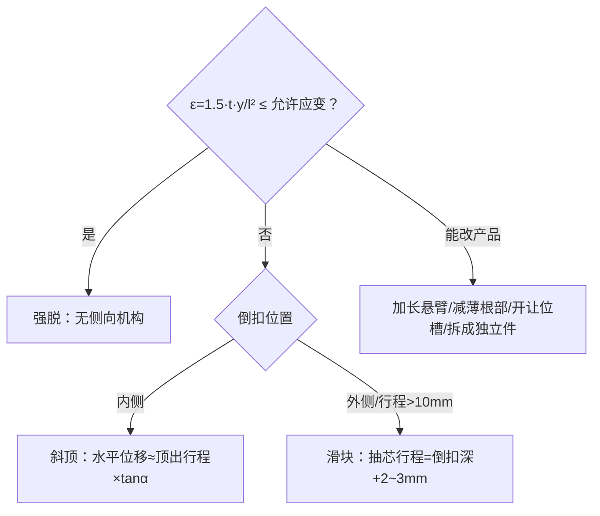

# 注塑倒扣脱模：强脱、斜顶还是滑块

> [!summary] 一句话概述
> 卡扣等倒扣结构决定了模具要不要加侧向机构：深圳维亚达科技给出三步判断——先用悬臂梁应变公式 ε = 1.5·t·y / l² 判断能否强脱，再按倒扣在外侧（滑块）还是内侧（斜顶）选机构，最后按全生命周期（模具增量 + 周期 + 维护）比成本，并给出各材料强脱应变表和滑块/斜顶关键参数。

> [!note] 与已收录案例的区别
> [[卡扣三种基本形式：悬臂、环形、扭转]] 讲产品侧的卡扣形式；本篇讲**同一个卡扣在模具侧怎么出模**以及它对成本的影响，是卡扣设计的工艺约束面。

## 配图

来源文章无结构示意图（页面图片均为厂商产品照），本篇不配图。

## 结构原理

> 本节数字只写来源里给出的；来源没有就写「来源未给出」。

### 堆叠方案

方向：**从产品到模具**（倒扣部位的出模关系）

| 层级 | 零件/机构 | 材料 | 关键尺寸 | 动作 | 依据 |
| --- | --- | --- | --- | --- | --- |
| L1 | 产品倒扣（悬臂卡扣 / 环形倒扣） | 塑料 | 悬臂长 l、根厚 t、倒扣深 y；环形直径 D、单边倒扣 δ | 强脱时自身弹性变形 | 第一节 |
| L2a | 强脱：倒扣处镶件 | 718H 或 S136，氮化 | 型面 Ra0.2 以下；入口 30°–45° 导入斜面、R0.5 以上圆角 | 顶出时硬挤过倒扣 | 第一、四节 |
| L2b | 斜顶（内侧倒扣） | 来源未给出 | 角度通常 3°–12° | 顶出时斜向让位，水平位移 ≈ 顶出行程 × tanα | 第二节 |
| L2c | 滑块抽芯（外侧倒扣） | 来源未给出 | 斜导柱 15°–22°；楔紧角比斜导柱大 2°–3° | 开模时横向抽芯，再顶出 | 第二节 |

剖面示意：

### 零件清单

| 零件/机构 | 数量 | 功能 | 材料 | 依据 |
| --- | --- | --- | --- | --- |
| 倒扣镶件 | 按倒扣数 | 强脱型面，可换 | 718H 或 S136，氮化 | 第四节 |
| 斜顶杆 | 按内侧倒扣数 | 内侧倒扣让位 | 来源未给出 | 第二节 |
| 滑块 + 斜导柱/油缸 + 楔紧块 + 耐磨板 | 按外侧倒扣数 | 外侧抽芯并承受侧向力 | 来源未给出 | 第二、三节 |

### 装配顺序

模具动作顺序（来源描述）：
1. 合模：楔紧块先锁紧滑块（楔紧角大于斜导柱角）。
2. 注塑、冷却。
3. 开模：斜导柱或油缸先把滑块横向抽开；滑块与顶针要有先后顺序，避免顶针撞滑块。
4. 顶出：斜顶边顶出边斜向让位；强脱件在顶出时变形越过倒扣。

### 受力与运动分析

- **受力路径**：注塑时型腔压力作用在滑块上形成侧向力 F = p × A（例：40 MPa × 1500 mm² ≈ 60 kN），由楔紧块承担；强脱时倒扣根部承受弯曲应变。
- **运动关系**：滑块横向抽芯（行程自由、力大）；斜顶斜向顶出（结构简单、占空间小，行程受注塑机顶出行程限制）。
- **失效风险**：强脱应变超限 → 顶白、拉伤、保持力下降；斜顶截面小、散热差，长时间生产易咬死；滑块面磨损、飞边、卡滞，分型线夹线。

## 设计要点与参数

| 要点 | 内容 | 依据 |
| --- | --- | --- |
| 强脱判据（悬臂） | ε = 1.5·t·y / l² | 第一节 |
| 算例 | PP：l = 12、t = 1.5、按 3% → y ≈ 1.9 mm；PC：l = 8、t = 2.0、按 2% → y ≈ 0.43 mm | 第一节 |
| 强脱判据（环形） | ε ≈ δ / D；D = 40 mm 的 PP 件按 4% → 单边约 1.6 mm 内 | 第一节 |
| 单次装配参考应变 / 强脱建议值 | PP/PE 5–7% / 3–5%；PA6、PA66 4% / 2–3%；POM 3% / 2%；ABS 2–2.5% / 1.5%；PC 2% / 1–1.5%；PS 1.5% / 不建议强脱 | 第一节表 |
| 安全系数 | 实际取表值的 0.5–0.7 倍；30% 玻纤牌号取值减半 | 第一节 |
| 型面 | Ra1.6 几百模即拉伤；Ra0.2 以下 + 30°–45° 导入斜面 + R0.5 以上圆角 | 第一节 |
| 滑块 | 抽芯行程 = 倒扣深度 + 2–3 mm；斜导柱 15°–22°（> 25° 磨损加快）；楔紧角大 2°–3° | 第二节 |
| 斜顶 | 角度 3°–12°；例：顶出 40 mm、8° → 水平位移约 5.6 mm | 第二节 |
| 选型界限 | 让位需求超过 10 mm 一般选滑块 | 常见问题 |
| 周期成本 | 两侧油缸各 0.6 s → 每模多 1.2 s，20 s 周期产能降约 6%；10 万模多约 33 小时机时 | 第三节 |
| 验证 | 首件：3 种顶出速度 × 2 种模温各 20 模；功能：10 件测插拔/保持力，插拔 5 次看衰减，公差 ±0.05 mm；量产：5000–10000 模，每 1000 模查镶件磨损 | 第五节 |
| 顶白先调工艺 | 模温提高 10–15 ℃、延长冷却、降顶出速度各打一组 | 常见问题 |

## 优缺点

**优点**
- 把「卡扣能不能做、要多少模具钱」变成可算的问题
- 给出改产品而不加机构的路径（加长悬臂、减薄根部、开让位槽、拆件）

**缺点 / 代价**
- 应变表为通用资料值，具体牌号仍需查 TDS（来源也如此建议）
- 厂商文章带推广性质，成本数字（如 80 元/小时）仅作量级参考

## 可借鉴点

- 画卡扣时同步算 ε = 1.5·t·y / l²，超标就先改悬臂长度/根厚，而不是直接上滑块
- 内侧倒扣优先斜顶，外侧倒扣用滑块；让位 > 10 mm 用滑块
- 强脱件把倒扣做成可换镶件，型面抛到 Ra0.2 以下
- 评估模具方案时把周期增加折算到全生命周期

## 相关案例

- [[卡扣三种基本形式：悬臂、环形、扭转]]
- [[塑料外壳止口与扣位：间隙参数与三个翻车案例]]
- [[双色注塑：硬胶先射、软胶后射的结构拆件规则]]
- 分类索引：[[07-材料与工艺 索引]]

## 来源与核实记录

- 主来源：[倒扣脱模怎么选：滑块、斜顶还是强脱](https://weiyadakeji.com/xwdt/changjianwenti/1414.html)（深圳市维亚达科技有限公司官网，2026-11-06）
- 核实：2026-11-13 打开原文核对公式、两个算例（复算一致）、应变表、滑块/斜顶参数、成本与验证步骤。
