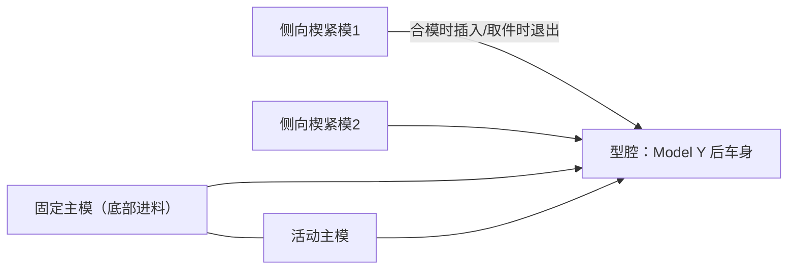

# 特斯拉 Giga Press 一体化压铸车身件

> [!summary] 一句话概述
> 特斯拉用锁模力 55,000–61,000 kN 的 Idra Giga Press，把 Model Y 后车身（及后来的前车身）做成一次高压压铸成型的一体化铸件：80 kg 铝液以 10 m/s 射入真空模腔，周期约 80–90 秒；铸件再经淬火、修边、X 光查气孔、CNC 加工——这是「零件合并」思路在压铸工艺上的极端案例。

## 配图

![[附件/giga-casting-tesla-frame.jpg]]
*图源：Wikimedia Commons「Part of the Tesla frame.jpg」（Votpuske，CC BY 4.0）；一体化压铸的特斯拉车架部件*

![[附件/giga-press-diagram.png]]
*图源：Wikimedia Commons「20200924-giga-press-fremont-die-casting-machine-2-traced-diagram-open.svg」（Paul Sladen，CC BY 3.0）；Fremont 2 号压铸机开模状态示意*

## 结构原理

> 本节数字只写来源里给出的；来源没有就写「来源未给出」。

### 堆叠方案

方向：**按工艺流程**（从熔炼到成品；这是工艺链而非零件层叠）

| 层级 | 环节/设备 | 材料 | 关键参数 | 作用 | 依据 |
| --- | --- | --- | --- | --- | --- |
| P1 | 熔化炉（StrikoMelter） | 铝锭 + 回炉料 | 850 °C，天然气 | 熔化，机械去除氧化铝渣 | Operation 段 |
| P2 | 保温炉 | 铝液 | 750–850 °C，400 kW 电加热，氮气覆盖；氩气旋转除气 + SiC 过滤（> 25 μm） | 防氧化、除杂、减气孔 | Operation 段 |
| P3 | 模具准备 | 大豆油脱模剂 | 每半模喷 35 mL；抽真空至 50 mbar（4000 L 真空罐） | 脱模、减卷气 | Operation、Components 段 |
| P4 | 压射 | 铝液 | 每次 80 kg，750 °C，10 m/s；另加 8 mL 润滑 | 充型 | 概述、Operation 段 |
| P5 | 取件 + 淬火 | 铸件 | 400 °C 取出 → 淬火到 50 °C | 冷却定形 | Operation 段 |
| P6 | 后处理 | 铸件 | 机械修边 → X 光查气孔 → 激光/等离子修边 → 钻孔攻丝 → 激光扫描 CMM → 装紧固件 | 尺寸与质量 | Operation、Components 段 |

剖面示意（模具结构）：

### 零件清单

| 零件/设备 | 数量 | 功能 | 材料 | 依据 |
| --- | --- | --- | --- | --- |
| 主模（竖直布置） | 2 | 主型面，固定侧底部进料 | 来源未给出 | Die structure 段 |
| 侧向楔紧模 | 2（前车身可能还有第 5 块在下方） | 侧向型面，注射时插入、取件时退出 | 来源未给出 | Die structure 段 |
| Giga Press 压铸机 | 1 | 锁模与压射 | — | 概述 |
| 真空系统（Fondarex 4000 L 罐） | 1 | 型腔抽真空 | — | Components 段 |

### 装配顺序

工艺顺序（来源描述）：
1. 机器人喷脱模油 → 合模 → 抽真空 50 mbar。
2. 定量铝液压射入型腔。
3. 开模，400 °C 取件，放入淬火槽冷却至 50 °C。
4. 机械修边（余料回炉）→ X 光检测内部 → 激光修边 → 钻孔攻丝 → 计算机测量。
5. 模具冷却到 185 °C 并由机器人清理，1–2 分钟后开始下一循环。

### 受力与运动分析

- **受力路径**：压射时型腔压力由 55,000–61,000 kN 锁模力平衡；侧向型面由侧向楔紧模承担。
- **运动关系**：主模开合；两块侧模在注射前插入、取件前退出。
- **失效风险**（来源提到）：气孔（因此做真空、除气、过滤和 X 光检测）；2021-03-11 Fremont 一台压铸机发生火灾，起因是铝液点燃液压油；模具迭代昂贵（一套大型金属模具约 150 万美元，常需多轮修改）。

## 设计要点与参数

| 要点 | 内容 | 依据 |
| --- | --- | --- |
| 锁模力 | 55,000–61,000 kN（Model Y 机型）；后有 9,000 吨力机用于 Cybertruck 后部 | 概述、History |
| 设备重量 | 410–430 吨 | 概述 |
| 单次铝量 / 速度 | 80 kg / 10 m/s | 概述 |
| 周期 / 产能 | 约 80–90 s；初期 40–45 件/小时，约 1000 件/天 | 概述 |
| 合金 | 约 Al 89.5% + Si 8.5% + 微量元素，属 AA 386（Sandy Munro 2021 分析） | Metal alloy 段 |
| 模具成本 | 一套大型金属模具约 150 万美元；用砂型 3D 打印做铸件原型以降低迭代成本 | 2.0 段 |
| 壁厚、拔模角、筋位设计 | 来源未给出 | — |

## 优缺点

**优点**
- 零件合并：车身大件一次铸出（来源引用特斯拉高管说法，目标是「像做玩具车那样造整车」；合并前的零件数来源未给出）
- 废料闭环回收（余料直接回炉）
- 节拍稳定：约 1000 件/天

**缺点 / 代价**
- 设备与模具投资巨大，模具改一次代价高
- 需要严格的气孔控制与 100% X 光检测
- 铸件损坏后维修性差（推断，来源未讨论）

## 可借鉴点

- 零件合并时同步考虑工艺链：熔炼—真空—检测—二次加工都要配套
- 大型件模具用「主模 + 侧向楔紧模」处理侧向特征，与注塑件的滑块同理
- 昂贵模具迭代前，用快速工艺（砂型 3D 打印）做原型验证

## 相关案例

- [[注塑倒扣脱模：强脱、斜顶还是滑块]]（侧向抽芯的同类思路）
- [[钣金折弯件设计规则：最小弯曲半径与预留切口]]（车身的另一种主流工艺）
- 分类索引：[[07-材料与工艺 索引]]

## 来源与核实记录

- 主来源：[Giga Press – Wikipedia](https://en.wikipedia.org/wiki/Giga_Press)（英文维基百科，读取时最新修订 2026-10-11）
- 核实：2026-11-13 通过 Wikipedia API 读取全文，核对锁模力、工艺参数、模具结构、合金、历史事件；配图取自词条引用的 Wikimedia Commons 文件并核对作者与许可。
