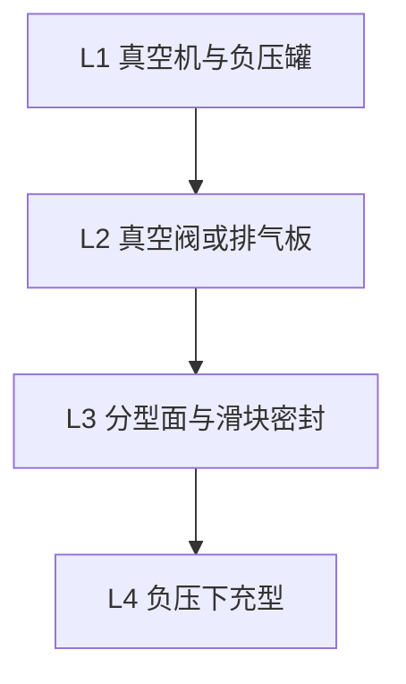

# 真空压铸：合模后抽出型腔气体，再在负压下充型以减少卷气

> [!summary] 一句话概述
> 真空压铸是在金属液充填前，先把型腔（以及部分系统里的压室）里的气体抽出，再在负压下充型，从而减少高速充型时的卷气和气孔；它要靠合模密封、抽气时机和真空阀关闭与压射同步，而不是只在浇口旁边多开几条排气槽。

## 配图

![[附件/diecast-vacuum-dcm10590-01.jpg]]
*图源：[《八挡自动变速器主壳体压铸工艺优化》](https://dcm888.com/news/10590.html)；铸件或工艺方案相关插图之一。*

![[附件/diecast-vacuum-dcm10590-02.jpg]]
*图源：同上文；浇注、排溢或真空相关插图。*

![[附件/diecast-vacuum-dcm10590-03.jpg]]
*图源：同上文；另一张工艺或铸件插图。*

> 图片版权归原作者所有，仅作个人学习收藏；出处见文末「来源与核实记录」。

## 结构原理

> 本节所有数字只写来源里给出的；来源没有就写「来源未给出」，不估算、不编造。

压铸网的理论分析把传统压铸写成：型腔气体被金属液被动驱赶，来不及排出的气体被卷入，凝固后成为气孔。真空压铸则是在压头封闭浇口、压室与型腔形成密闭容积后打开真空阀，把气体抽到负压罐；当压头到达规定位置时关闭真空阀并密封，金属液继续充型。该文把型腔内绝对压力达到 8 kPa 以下称为高真空压铸。

达屹把真空对象写成模具型腔以及料筒（压室）内的空气和不良气体，并列出三类气孔来源：脱模剂残留引起的水蒸气爆炸（对策：合模完成后模具表面温度维持在 130 ℃ 以上）、型腔内气体的断热压缩和氧化（对策：对型腔抽真空）、料筒内气体造成的射出减速（对策：对料筒抽真空）。该页还给出真空阀或波浪排气板应在低速转高速之前开始抽气的时间，以及分型面相关的 0.03–0.08 mm 数值（按该页确认项使用，不改写成未说明对象的通用公差）。

八挡自动变速器主壳体一文给出一个完整应用：材料 ADC12，轮廓 515 mm × 371 mm × 267 mm，质量 10.04 kg，一般壁厚 3.7 mm，最大壁厚 21.42 mm。气密要求包括：非压力区域在 50 kPa 下泄漏量小于 6 cm³/min，压力区域在 300 kPa 下小于 4 cm³/min。工艺上除优化浇注和排溢外，对高压油道等区域做局部挤压补缩，并采用真空压铸减少大型复杂件的卷气。试模后合格率达到 90% 以上。

这与已有「特斯拉 Giga Press」篇不同：那篇讲超大型一体铸件，只把真空当作工艺标签之一；本篇写真空通道、阀的动作和气密考核。它也替代不了浇注系统设计：壳体文仍然要布置内浇道和末端溢流槽。

### 堆叠方案

方向：从真空系统到型腔，再进入铸件。

| 层级 | 零件 | 材料 | 厚度/尺寸 | 固定方式 | 依据 |
| --- | --- | --- | --- | --- | --- |
| L1 | 真空机、负压罐与管路 | 真空设备 | 来源未给出泵的抽速规格 | 在压头封闭后与型腔接通 | 压铸网；达屹 |
| L2 | 真空阀或波浪排气板及抽气通道 | 模具排气元件 | 达屹：真空阀在低速转高速的 0.4 s 前开始吸引；波浪排气板在 0.5 s 前开始吸引 | 充型结束前关闭，防止金属反吸 | 达屹；压铸网 |
| L3 | 密封的分型面、滑块和顶针间隙 | 模具 | 达屹确认项中出现 0.03–0.08 mm；须按原页对象使用 | 合模后形成密闭容积 | 达屹 |
| L4 | 型腔与压室中的金属液 | ADC12 等 | 壳体实例见参数表 | 在负压下充填，再增压补缩 | 压铸网；壳体文 |

剖面示意：

### 零件清单

| 零件 | 数量 | 功能 | 材料 | 依据 |
| --- | --- | --- | --- | --- |
| 真空系统 | 1 套 | 在充型前抽出气体 | 真空泵、罐、阀 | 压铸网；达屹 |
| 排气元件 | 真空阀或波浪排气板 | 连接型腔与真空系统，并在充型时关闭 | 模具元件 | 达屹 |
| 密封面 | 分型面、滑块、顶针等 | 形成可抽真空的密闭容积 | 模具 | 达屹 |
| 铸件（实例） | 1 | 8AT 主壳体 | ADC12 | 壳体文 |

### 装配顺序

1. 合模，确认分型面、滑块和顶针处能够密封（达屹；壳体文也依赖模具密封）。
2. 压头封闭浇口后启动抽真空（压铸网）。
3. 按达屹：真空阀或波浪排气板须在低速转高速之前开始吸引。
4. 在真空环境下高速充填，再增压补缩；需要时对厚壁或油道做局部挤压（壳体文）。
5. 到达规定位置或由金属液关闭真空阀，防止反吸。
6. 冷却、开模、切浇口，并按气密要求做泄漏检查。

### 受力与运动分析

- **受力路径**：传统压铸里，未排出的气体被卷入并在压力下压缩，形成气孔，破坏致密性和气密。真空把大部分气体预先抽走，金属液主要对型壁和尚未排出的残气做功。
- **运动关系**：抽气、慢速封浇口、快速充填、关阀必须按时间或位置连锁；关阀过早则真空不足，过晚则金属液进入真空通道。
- **失效风险**：分型面漏气导致真空度不够；模具过冷、脱模剂过湿引起水蒸气（达屹：合模后模面维持 130 ℃ 以上）；只抽型腔不抽压室，料筒气体仍会减速和卷气。壳体文还说明，大型复杂件仅靠浇注系统仍可能卷气，所以要加真空，厚壁油道还要局部挤压，真空不是唯一手段。

## 设计要点与参数

| 要点 | 内容 | 依据 |
| --- | --- | --- |
| 高真空定义（压铸网） | 型腔内绝对压力达到 8 kPa 以下称为高真空压铸 | 压铸网 2011 文 |
| 抽气开始时机（达屹） | 真空阀在低速转高速的 0.4 s 前开始真空吸引；波浪排气板在 0.5 s 前开始 | 达屹确认表 |
| 模温（脱模剂水分） | 合模完成后模具表面温度维持在 130 ℃ 以上 | 达屹 |
| 8AT 壳体尺寸与质量 | 515 mm × 371 mm × 267 mm，体积 3718.5 cm³，质量 10.04 kg，一般壁厚 3.7 mm，最大壁厚 21.42 mm，材料 ADC12，毛坯精度 CT5 级 | 壳体文。原文另写「最大投影面积为 1343 cm³」，单位与面积量纲不一致，本篇照录原文，不把它换算成面积 |
| 气密考核 | 非压力区 50 kPa 下泄漏量小于 6 cm³/min；压力区 300 kPa 下小于 4 cm³/min | 壳体文 |
| 浇注配合（壳体方案摘录） | 方案 2：10 个分流道，内浇道厚度 3 mm，截面积 790 mm²，轴承孔末端溢流口厚度 1.5 mm。方案 1 曾用内浇口厚度 2.5 mm，但存在偏心。最终还要结合方案 3 的优化，不以单一方案冒充量产最终值 | 壳体文 |
| 结果 | 结合局部挤压与真空，试模后合格率达到 90% 以上，气密性符合技术要求 | 壳体文 |

## 优缺点

**优点**
- 能明显降低卷气和气孔，提高气密和致密，适合后续机加工面不允许外露气孔的零件。
- 与浇注、排溢、局部挤压可以组合，而不是互相替代。

**缺点 / 代价**
- 模具必须能够密封，还要增加真空阀或排气板、管路和维护。
- 抽气与压射必须连锁，时序不对会抽不足或反吸。
- 解决不了厚壁缩松本身，壳体文对油道仍用局部挤压。
- 不同来源的「高真空」阈值并不用同一套单位表述，引用时要写明是绝对压力还是表压。

## 可借鉴点

- 先保证分型面、滑块和顶针能够密封，再谈真空度。
- 把真空阀关闭点写进压射曲线，而不是只写「加一套真空机」。
- 气密零件同时检查浇口是否过早封排气道、厚壁是否还要局部挤压。
- 验收用泄漏量、压力和区域，而不是用「零气孔」这种宣传语。

## 与库中相似案例对比

| 对比项 | 本案例（真空压铸） | [[特斯拉 Giga Press 一体化压铸车身件]] | [[压铸内浇口与横浇道：先定位置和截面积，再保证横浇道向内浇口收缩]] |
| --- | --- | --- | --- |
| 主角 | 充型前抽走型腔和压室气体 | 超大型一体铸件与压铸单元 | 浇口位置和横浇道收缩 |
| 是否代替浇注设计 | 否，壳体文仍要优化浇注和排溢 | 不是浇注教程 | 本篇的前置条件之一 |
| 何时用这篇 | 气孔或气密成为主要风险 | 讨论巨型一体化铸件 | 布置进浇通道 |

## 相关案例

- [[特斯拉 Giga Press 一体化压铸车身件]]
- [[压铸内浇口与横浇道：先定位置和截面积，再保证横浇道向内浇口收缩]]
- [[压铸壳体：壁厚、拔模与加强筋设计规则]]
- 分类索引：[[07-材料与工艺 索引]]

## 来源与核实记录

- 主来源：[《八挡自动变速器主壳体压铸工艺优化》](https://dcm888.com/news/10590.html)（压铸杂志，刊于 dcm888，页面可见发布于 2022 年段。ADC12 壳体尺寸、泄漏标准和真空加局部挤压的工艺结果来自该文。）
- 交叉来源：[达屹真空股份公司，《什么是真空压铸？》](https://die-eg.com/cn/die-casting/)（2026-11-27 打开。型腔与料筒抽真空、130 ℃、0.4 s / 0.5 s 时序来自该页。）
- 交叉来源：[《真空压铸的型腔气体排气理论分析》](https://yzw.cc/news/201110/31/49631.html)（压铸网，2011-10-31。被动排气与主动抽气的对比，以及绝对压力 8 kPa 以下为高真空压铸，来自该文。）
- 核实：2026-11-27 打开上述来源。未把「零气孔」或投影面积那处可疑单位改写成已换算值。
