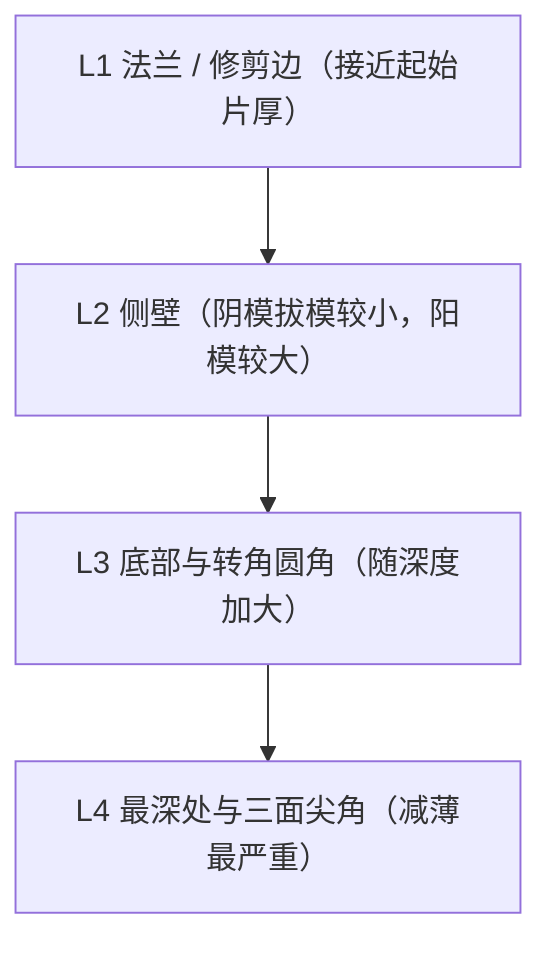

# 真空吸塑与压力成型外壳：拔模、圆角与拉伸减薄

> [!summary] 一句话概述
> 真空吸塑和压力成型是把加热片材拉伸到模具上，壁厚会随拉伸重新分配：要用零件表面积与投影面积之比估算减薄，给阴模、阳模留下不同的拔模，并把深度方向的圆角做够，避免三面尖角把底部拉破。这和注塑按纹深加拔模不是同一套规则。

## 配图

![[附件/cwthomas-draw-ratio.jpg]]
*图源：[CW Thomas Design Guide](https://cwthomas.com/wp-content/uploads/2023/08/Design-Guide.pdf) 第 25 页 Draw Ratio & Plug Assists；拉伸比 = 零件表面积 / 零件投影面积（footprint）。算例：14″×12″、深 6″ 的零件，表面积 480 in²、投影 168 in²，拉伸比 2.86；若希望成品壁厚 0.125″，则最小起始片厚 ≈ 2.86×0.125″=0.358″（前提是材料分配理想）。右侧示意图标出片材从 0.358 拉伸后局部减薄到 0.125*

![[附件/tonghou-thermoform-tray.jpg]]
*图源：[温州通厚《吸塑件设计要点：脱模角、筋位与圆角》](https://tonghoupack.com/zh/guides/thermoforming-design-features/) 页内实物图，原文说明为「公司提供的透明多腔成型托盘实物」；可见多穴、侧壁斜度、穴底圆角、防滑纹理和中心凸点。这类结构用筋位、台阶和形状补刚性，穴越深、圆角越小，底部和角落分到的材料越少*

> 图片版权归原作者所有，仅作个人学习收藏；出处见文末「来源与核实记录」。

## 结构原理

> 本节所有数字只写来源里给出的；来源没有就写「来源未给出」，不估算、不编造。

热成型先把片材加热到可拉伸状态，再靠真空或真空加压缩空气把它拉到模具表面。CW Thomas 写明：所有热成型本质上都是拉伸过程，平板变成更大的表面积，原始厚度会减薄，而且减薄通常不均匀。真空成型用真空把片材吸附到模面；压力成型额外用 10 到 120 PSI 的压缩空气从片材另一侧加压，细节更清晰，也可减少某些部位的过度减薄。

拉伸比（draw ratio）把减薄变成可估算的数：零件表面积除以投影面积。这个值用来反推起始片厚：最小起始片厚 ≈ 拉伸比 × 希望得到的成品壁厚。CW Thomas 同时警告：深而窄的特征、深的尖角会在局部以更快的速率减薄，平均拉伸比估计不到这些角落；深度超过截面 75% 时，通常需要辅助塞模把材料先推向深处。

拔模在热成型里还和收缩方向有关。片材在阴模里冷却时趋向离开侧壁，拔模可以较小；在阳模里则包紧模具，拔模要更大。带皮纹的阴模，CW Thomas 要求在 1 度基础上按纹深再加拔模——这与注塑「按纹深加角度」形式上相似，但对象是单面成型的片材，不是注塑件的型腔/型芯两侧。

### 堆叠方案

按成型后的壳体剖面「从口部法兰到拉伸最深处」观察，材料来自同一张片材。

| 层级 | 零件 | 材料 | 厚度/尺寸 | 固定方式 | 依据 |
| --- | --- | --- | --- | --- | --- |
| L1（口部，通常最厚） | 法兰或修剪边 | 热塑性片材 | 接近起始片厚（来源未给出该处的固定比例）；通厚指出片材初始厚度、穴距和翻边宽度都会影响材料分配 | 与侧壁一体成型，后段裁切 | CW Thomas 拉伸概述；通厚「拉伸深度」节 |
| L2 | 带拔模的侧壁 | 同上 | 阴模、阳模拔模不同，见参数表；造峯：一般外形从 3–5 度起评估，深腔、有纹理或要稳定连产时提到 5–7 度以上 | 冷却收缩后脱离模具 | CW Thomas 第 27 页；造峯 Q1 |
| L3 | 转角与底部圆角 | 同上 | 圆角随深度加大：深 0–3″ 用 0.015″–0.125″，3–6″ 用 0.125″–0.250″，6″ 及以上最小 0.250″ | 与侧壁、底一体 | CW Thomas 第 28 页 Depth/Radii |
| L4（最深，通常最薄） | 底部与三面角落 | 同上 | 由拉伸比和局部特征决定；平均估算法假定理想分配，深尖角会更薄甚至撕裂 | 无额外固定 | CW Thomas 第 25–26、28 页；造峯 Q2；通厚 |

剖面示意：

### 零件清单

| 零件 | 数量 | 功能 | 材料 | 依据 |
| --- | --- | --- | --- | --- |
| 热成型壳体或托盘 | 来源未给出（按产品） | 由一张片材拉伸出外形、侧壁和底部 | 热塑性片材 | CW Thomas、通厚、造峯 |
| 法兰或修剪边 | 来源未给出 | 固定片材、提供后段裁切基准，有时用于装配 | 与片材相同 | 通厚；CW Thomas 倒扣/法兰讨论 |
| 真空或压力成型模具（阴模或阳模） | 1 套 | 提供型面、拔模、圆角和排气孔 | 造峯文讨论 3D 打印母模等；金属模来源未在本篇展开 | 造峯全文；CW Thomas 工艺节 |
| 可选：辅助塞模 | 来源未给出 | 在真空作用前或同时把材料推向深腔，改善壁厚，并减少相邻凸起之间的网皱 | 文中举例 syntactic foam、hardwood 或 Ren，表面常覆毡 | CW Thomas 第 26 页 Plug Assist |

### 装配顺序

1. 按零件表面积和投影面积计算拉伸比，再用「拉伸比 × 目标成品壁厚」估计最小起始片厚；深而窄或三面尖角要额外加片厚或改几何，不能只看平均值。
2. 选择阴模还是阳模：外观细节、皮纹多在阴模上；包紧力和拔模在阳模上更大。
3. 给侧壁留下与模具类型、深度和皮纹相称的拔模，并把底部和角落的圆角按深度做到指南范围，避免三面尖角。
4. 深拉伸或相邻凸起过近时考虑辅助塞模、预吹或加大开口、减小深度。
5. 加热片材 → 成型（真空或加压）→ 冷却 → 脱模 → 裁切法兰和孔。需要精确装配的孔，造峯建议放在平面或低拉伸区，并用治具控制后加工位置。

> 来源是设计指南，不是某外壳的拆解顺序。

### 受力与运动分析

- **受力路径**：使用载荷由法兰或侧壁进入，传向已经被拉薄的底部和角落。通厚与造峯都指出：最深区域和内侧尖角先变薄，若该处还要承碰撞或锁附，应改深度、加大圆角或把受力点移走。
- **运动关系**：成品一般为静态罩壳或托盘。脱模时沿拔模方向离开模具；阴模中收缩帮助脱离侧壁，阳模中收缩使零件包得更紧。
- **失效风险**：角落拉破或透光（CW Thomas 建议对光检查角落是否过薄）；侧壁拉伤、粘模；网皱；深腔发白或雾化（造峯，尤其透明材料）；垂直侧壁在打样时勉强能取件、进入批次后脱模力明显上升。

## 设计要点与参数

| 要点 | 内容 | 依据 |
| --- | --- | --- |
| 拉伸比定义 | Draw Ratio = 零件表面积 / 零件投影面积 | CW Thomas 第 25 页 |
| 起始片厚估算 | 最小起始片厚 = 拉伸比 × 希望的成品壁厚。算例 1：14″×12″×6″ 深，拉伸比 2.86，目标 0.125″ → 0.358″。算例 2：8″×11″×5″ 深，拉伸比 3.16，目标 0.100″ → 0.316″。均假定理想分配 | CW Thomas 第 25–26 页 |
| 深窄特征 | 把零件或局部设计成「比高度更窄」会以更快速率减薄。深度超过截面的 75% 时，在常规条件下塑料会急剧减薄，常用辅助塞模 | CW Thomas 第 25–26 页 |
| 阴模 / 阳模拔模 | 阳模至少 2 度；带皮纹的阴模：1 度再加「每 0.001″ 纹深加 1 度」。阴模中零件收缩离开侧壁，拔模需求较小；阳模中零件包紧模具，拔模需求更大。皮纹相当于一连串倒扣 | CW Thomas 第 27 页 |
| 另一机构的评估起点 | 一般外形可从 3 至 5 度开始评估；高度较深、表面有纹理、收缩较明显，或需要连续生产稳定性时，通常要提高到 5 至 7 度以上。文中强调这不是可照抄的规范数字 | 造峯 Q1 与正文「约 3–5 度起评估」「约 5–7 度以上」 |
| 圆角与深度 | 尽量避免三面尖角。底部圆角最重要，零件越深圆角或倒角越大。Depth/Radii：0″–3″ 对应 0.015″–0.125″；3″–6″ 对应 0.125″–0.250″；6″ 及以上最小 0.250″ | CW Thomas 第 28 页 |
| 压力成型压力 | 压力箱向片材表面提供 10 到 120 PSI 的压缩空气，同时真空抽走残留空气 | CW Thomas 压力成型节 |
| 公差（若涉及外形尺寸） | 真空成型 ±0.015″（0.4 mm），12″（305 mm）之后每英寸再加 0.001″（0.025 mm）；压力成型 ±0.010″（0.3 mm），同样在 12″ 之后每英寸加 0.001″ | CW Thomas 公差节 |
| 通厚的设计检查项 | 脱模角同时影响取件和壁厚均匀；筋位、台阶补大平面刚性；内侧尖角既拉薄又集中应力。通厚明确：不在不同设计间照抄脱模角，PP 也没有通用最小脱模角，要用样件测量底部、侧壁、角落和边缘厚度 | 通厚全文与 FAQ |

> 英寸数字保持来源原文，不换算成看似更精确的毫米值。造峯的 3–5 度、5–7 度是评估起点，与 CW Thomas 的阴/阳模规则一并列出，不合并成一条「标准拔模」。

## 优缺点

**优点**
- 适合中小批、相对大尺寸的罩壳和托盘，模具费用通常低于注塑。
- 用拉伸比可以在方案阶段估算片厚和成本，再用圆角、拔模和塞模控制局部减薄。
- 阴模收缩有利于脱模，皮纹和细节可以用压力成型加强。

**缺点 / 代价**
- 壁厚天然不均匀，最深处和三面角落最薄，不能把名义片厚当成成品壁厚。
- 阳模和深皮纹需要更大拔模，垂直外观面往往做不到。
- 平均拉伸比估计不到尖角局部减薄，报价有时要准备两种片厚。
- 精确孔位常常要后加工，不适合放在高拉伸区。

## 可借鉴点

- 先算表面积/投影面积，再反推片厚；深而窄的口袋单独评估，不要只用平均值。
- 阴模和阳模拔模分开给：阳模至少 2 度；阴模看皮纹深度。深腔、连产再按造峯的 5–7 度方向加大，并用样件验证。
- 底部和三面角落的圆角按深度给到指南范围，宁可倒角，也不要留下尖的三面交线。
- 深度超过开口很多时，提前考虑辅助塞模或改几何，而不是只加片厚。
- 验收时测量底部、侧壁、角落和边缘，不要只用名义片厚；对光检查角落是否过薄。

## 与库中相似案例对比

| 对比项 | 本篇 | [[咬花（晒纹）与拔模角：每 0.025 mm 纹深加 1°]] | [[注塑均匀壁厚与厚薄渐变：相邻壁厚比与过渡段长度]] | [[钣金折弯件设计规则：最小弯曲半径与预留切口]] |
| --- | --- | --- | --- | --- |
| 主角 | 片材热成型的拉伸减薄、阴/阳模拔模差和随深度变化的圆角 | 注塑件按咬花纹深增加拔模 | 注塑件相邻壁厚比与过渡 | 金属板折弯 |
| 何时用本篇 | 外壳或托盘用吸塑、压力成型，而不是注塑 | 注塑外观件做皮纹 | 注塑件壁厚设计 | 钣金外壳 |
| 关键差异 | 壁厚由拉伸重新分配，不是由型腔间隙决定；阳模因包紧需要更大拔模。CW Thomas 对阴模皮纹也有「每 0.001″ 纹深加 1 度」，不要把它写成注塑那条 0.025 mm 规则的复制 | 对象是注塑件留在哪一侧、纹深与斜度 | 注塑可以通过模具直接规定壁厚，吸塑不能 | 折弯半径规则不适用于片材拉伸 |

## 相关案例

- [[咬花（晒纹）与拔模角：每 0.025 mm 纹深加 1°]]
- [[注塑均匀壁厚与厚薄渐变：相邻壁厚比与过渡段长度]]
- [[注塑倒扣脱模：强脱、斜顶还是滑块]]
- [[钣金折弯件设计规则：最小弯曲半径与预留切口]]
- 分类索引：[[07-材料与工艺 索引]]

## 来源与核实记录

- 主来源：[CW Thomas Design Guide](https://cwthomas.com/wp-content/uploads/2023/08/Design-Guide.pdf)（PDF 元数据：Microsoft Word - Design Guide.docx，作者栏 rdailey，创建时间 2015-07-24；文件由该 2023-08 网址提供。已提取第 25–28 页拉伸比公式与两个算例、塞模与 75% 深度、阴/阳模拔模和皮纹规则、Depth/Radii 表，以及压力成型 10–120 PSI、尺寸公差。页面页脚含公司地址与电话，未写入正文）
- 补充来源：[造峯工藝《如何設計真空成形母模｜拔模角與排氣》](https://www.zaofeng.com.tw/how-to-design-vacuum-forming-master-mold)（高雄造峯工藝中文页。已核对 3–5 度、5–7 度评估起点，以及深腔减薄、孔位宜放在低拉伸区等叙述。该站配图观感接近同一场景的渲染或后期照片，本文不以它们作为尺寸证据，只采用已核对的文字规则）
- 补充来源：[温州通厚《吸塑件设计要点：脱模角、筋位与圆角》](https://tonghoupack.com/zh/guides/thermoforming-design-features/)（首发 2026-08-22，更新 2026-10-11。已核对脱模角、筋位、圆角与拉伸深度的检查逻辑，并下载透明多腔托盘实物图。该文明确拒绝给出可照抄的通用最小脱模角或壁厚变化百分比，本文亦不编造）
- 放弃线索：https://www.sh-yongyi.com/xisucpsjyd.html 两次请求失败（无响应或 500）；https://www.hiner-pack.com/mobile/xinwenxq.aspx?id=97&view=893 打开后正文过短且无结构插图，不作为独立依据。
- 核实：2026-11-22 打开上述 PDF 与页面。
