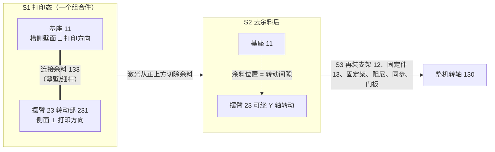

# 荣耀金属 3D 打印免组装转轴专利：连接余料与垂直打印方向的切割面

> [!summary] 一句话概述
> 折叠屏转轴有轴盖、支架、摆臂、阻尼、同步、门板等几十个零件。荣耀专利 CN121952969A（申请日 2024-10-29）把其中会相对运动的零件，例如基座和摆臂，用金属 3D 打印**一次打成一个组合件**，彼此之间用薄壁或细杆状的「连接余料」临时连住；打完用激光切掉余料，原来余料占的位置就变成转动间隙。关键规则是**所有与余料相连的面都垂直于打印方向**，让余料像一面立着的薄墙，切割时不被零件挡住；台阶处统一用 135° 斜面自支撑。

## 配图

![[附件/honor-3dp-hinge-base-swingarm.png]]
*图源：专利 CN121952969A 图 9（经 [B 站专栏 cv50057386](https://www.bilibili.com/read/cv50057386) 转载）；基座 11 与第一摆臂 23、第二摆臂 24 一体打印后的局部，115 为限位槽，239 为凸台，231 为第一转动部*

![[附件/honor-3dp-hinge-exploded.png]]
*图源：同上，专利图 5；转轴机构 130 分解图：基座组件 10、连接组件 20、阻尼组件 30、同步组件 40、门板组件 50（51/52）*

> 图片版权归原作者所有，仅作个人学习收藏；出处见文末「来源与核实记录」。

## 结构原理

> 本节数字只写来源里给出的；来源没有就写「来源未给出」。

### 堆叠方案

方向：**沿 Y 轴（转轴长度方向，即 3D 打印方向 Y 轴负向）看基座与第一摆臂的配合**（按专利第一种实施方式整理）

| 层级 | 零件/区域 | 材料 | 厚度/尺寸 | 固定方式 | 依据 |
| --- | --- | --- | --- | --- | --- |
| L1 | 基座 11（轴盖部 14 + 支架部 15 一体） | 金属 3D 打印 | 来源未给出 | 一体打印 | 专利 |
| L2 | 第一转动槽 111：第一槽侧壁面 1112、第二槽侧壁面 1113（均垂直于打印方向） | 同上 | 弧形槽，中心轴平行 Y；第三槽侧壁面 1114 与槽底夹角 135° | — | 专利 |
| L3 | 连接余料 133（4 段：1331–1334） | 同上 | 薄壁或细杆，厚度来源未给出（间隙大小与打印精度直接相关） | 打印后激光去除 | 专利；cv50057386 |
| L4 | 第一摆臂 23 的第一转动部 231：第五、六侧面 2311/2312（垂直打印方向） | 同上 | 来源未给出 | 余料去除后可转动 | 专利 |
| L5 | 限位块 113 穿入摆臂限位孔 236；凸台 239 在限位槽 115 内转动 | 同上 | 限位块侧面、凸台侧面与相邻面夹角均 135° | — | 专利 |

剖面示意：

### 零件清单

| 零件 | 数量 | 功能 | 材料 | 依据 |
| --- | --- | --- | --- | --- |
| 基座 11（轴盖部 14 + 支架部 15） | 1 | 承载转动槽、限位块 | 金属 3D 打印 | 专利 |
| 支架 12 / 固定件 13（螺钉或螺母） | 各 3（示例） | 支架固定到基座 | — | 专利 |
| 连接组件 20：第一/第二固定架 21/22、第一/第二摆臂 23/24、第一/第二转轴 25/26 | 3 组（示例） | 壳体与基座的转动连接 | — | 专利 |
| 阻尼组件 30：阻尼轴 31/32/33、阻尼支架 34/35、阻尼摆臂 36/37、弹性件 38/39/30a | 3 组（示例） | 提供阻尼手感 | 弹簧不适合打印 | 专利 |
| 同步组件 40：同步轴 41、同步支架 42/43、同步齿轮 44/45/46 | 2 组（示例） | 两侧同步转动 | — | 专利 |
| 门板组件 50：第一/第二门板 51/52 | 1 组 | 支撑屏幕弯折区 | — | 专利 |
| 连接余料 132/133 | 每对运动副若干段 | 打印、清粉、运输时把零件连成整体 | 同打印材料 | 专利；cv50057386 |

### 装配顺序

1. **S1**：沿 Y 轴负向打印组合件 130a，其中基座 11、第一摆臂 23、第二摆臂 24 处于展开位置，由连接余料相连（专利）。
2. **S2**：用激光去除连接余料，使结构件分离、可相对运动（专利示例为激光；cv50057386 提到激光或刀具）。
3. **S3**：再把支架 12、固定件 13、第一/第二固定架、阻尼组件、同步组件、门板组件装上，得到转轴 130（专利）。
4. 专利其他实施方式：阻尼轴与阻尼摆臂一体打印后，弹簧靠挤压套装；整轴全打印时阻尼要改用非弹簧结构；同步滑块带双螺旋凸起，注塑或 MIM 无法出模，用 3D 打印直接解决（专利）。

### 受力与运动分析

- **运动副**：摆臂转动部 231 在弧形转动槽 111 内绕 Y 向轴转动；第一凸块 116、第二凸块 117 嵌在摆臂的第一、第二凹槽 234/235 中导向；凸台 239 在限位槽 115 内转动（专利）。
- **限位（取代独立止位件）**：展开时限位块 113 穿过摆臂限位孔 236，摆臂底面 231a 抵住基座，阻止继续转；折叠时凸台底面 2393 抵住限位槽壁（专利）。专利称因此省掉螺钉/螺母和止位块在 X、Z 方向占的空间。
- **打印可行性**：每个台阶之间都用钝角（示例 135°）斜面连接，作为打印时的「支撑面」，等价于把悬垂角控制在 45°（推断：135° 夹角即与打印方向成 45°）。
- **风险**（推断）：间隙由打印精度决定，专利与媒体均未给出数值；切割面质量和清粉会直接影响转动手感；B 站文章作者认为精密转轴可能仍需少许抛光。

## 设计要点与参数

| 要点 | 内容 | 依据 |
| --- | --- | --- |
| 专利号 / 状态 | CN121952969A；申请 CN202411524012.4A，2024-10-29 提交，2026-05-01 公开待审 | Google Patents |
| 发明人 | 龚文强、黄圣贤、张洪（荣耀终端） | Google Patents |
| 打印工艺 | 包括但不限于 DMLS、SLM、EBM | 专利 |
| 打印方向 | Y 轴负向（沿转轴长度） | 专利 |
| 连接面规则 | 所有与余料相连的面垂直于打印方向（权利要求 2） | 专利 |
| 自支撑斜面 | 台阶间斜面与台阶面夹角为钝角，示例 135°（权利要求 5–8） | 专利 |
| 「垂直/平行」的容差 | 专利定义垂直指 80°–100°，平行指 0°–10° | 专利 |
| 一体化范围 | 从基座+两摆臂，到阻尼、同步、门板，最多整轴全部打印（13 种实施方式） | 专利 |
| 附加 | 轴盖外表面可另打一层可替换外观膜；结构件表面可设带微观结构的吸能层 | 专利 |
| 间隙大小 | 来源未给出（「与 3D 打印精度直接相关」） | cv50057386 |
| 行业背景 | IDC：2025 年我国折叠手机出货超 1000 万台，同比 +9.2% | cv50057386 转引 |

## 优缺点

**优点**
- 去掉运动副之间的装配、对位和锁固，公差不再叠加（cv50057386）
- 省掉螺钉、止位块，转轴在 X、Z 方向更薄（专利）
- 能做出注塑或 MIM 无法出模的形状（双螺旋同步滑块）

**缺点 / 代价**
- 弹簧等弹性件仍不能打印，需要后装或改结构
- 间隙精度完全取决于打印机，专利没给出可达到的数值
- 金属打印的单件成本和节拍来源未给出；专利仍处于待审状态

## 可借鉴点

- **「临时连接 + 后切除」思路可以迁移到 FDM/光固化**：FDM 一体打印靠空气间隙（见 [[FDM 一体打印活动件（Print-in-Place）：XY 每边 0.3 mm、Z 两整层的间隙规则]]），金属粉末床因为要清粉、运输，改成用余料先连住
- **切割面全部垂直于打印方向**，让后处理刀具/激光从一个方向直达
- **所有台阶用 45° 斜面过渡**，省掉支撑
- **把限位做成运动副自身的形状**（限位孔、凸台），不另加止位件

## 与库中相似案例对比

| 对比项 | 本案例 | [[三星 Galaxy Fold 一代铰链与屏幕支撑结构]] | [[FDM 一体打印活动件（Print-in-Place）：XY 每边 0.3 mm、Z 两整层的间隙规则]] |
| --- | --- | --- | --- |
| 零件制造 | 金属 3D 打印，运动副一次成型 | 传统分体零件 + 装配（齿轮同步） | FDM 塑料一体打印 |
| 间隙怎么来 | 切掉连接余料 | 装配公差 | 建模时留空气间隙 |
| 同步机构 | 齿轮或双螺旋滑块（可打印） | 齿轮 | — |
| 成熟度 | 专利（待审） | 量产 | 爱好者常用 |

## 相关案例

- [[三星 Galaxy Fold 一代铰链与屏幕支撑结构]]
- [[三星 Galaxy Z Flip 铰链与尼龙防尘刷]]
- [[FDM 一体打印活动件（Print-in-Place）：XY 每边 0.3 mm、Z 两整层的间隙规则]]
- [[特斯拉 Giga Press 一体化压铸车身件]]（同为「用新工艺减少零件数」）
- 分类索引：[[07-材料与工艺 索引]]

## 来源与核实记录

- 主来源：[CN121952969A 转轴机构的制备方法、转轴机构和电子设备](https://patents.google.com/patent/CN121952969A/zh)（Google Patents，荣耀终端股份有限公司，全文与权利要求）
- 补充来源：[荣耀发布金属3D打印免组装、可相对运动转轴专利](https://www.bilibili.com/read/cv50057386)（B 站专栏「3D打印技术参考」，2026-06-04）
- 核实：2026-11-13 打开专利全文核对结构、编号和 135° 等数值；B 站文章中的行业数据为其转引，未另行核实。专利编号 CN121952969A 来自检索结果，并经 Google Patents 页面确认。
