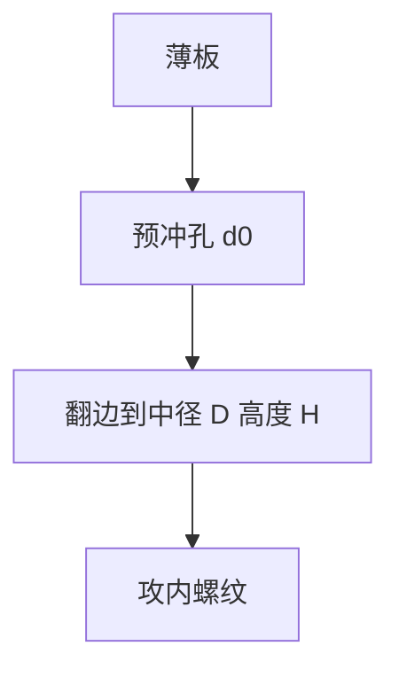

# 薄板抽孔翻边攻牙：预冲孔翻起后再攻内螺纹（对照压铆螺母）

> [!summary] 一句话概述
> 薄板上要攻内螺纹时，可以先按更小的预冲孔把孔壁翻起来，增加可攻牙的高度和牙数，再攻丝；这是板料自身翻出的螺纹筒，不是压入的压铆螺母。

## 配图

![[附件/sheet-aam-hole-expansion-p12.png]]
*图源：[European Aluminium, Manufacturing – Forming](https://european-aluminium.eu/wp-content/uploads/2022/11/aam-manufacturing-3-forming.pdf) 第 12 页 Hole expansion；原 PDF 页，用来对照「预冲小孔再把孔壁翻开」的几何。该页讲的是铝板扩孔成形，不是攻丝规格，螺纹尺寸以正文表格为准。*

![[附件/sheet-bead-mechtool.png]]
*图源：[机械设计实用手册，冲压件结构设计的基本参数](https://www.mechtool.cn/partstructure/partstructure_formedparts.html) 页内「成形件」插图所在页的结构要素图；翻边系数与高度公式见该页表格。*

> 图片版权归原作者所有，仅作个人学习收藏；出处见文末「来源与核实记录」。第二张图所在页同时还有加强筋表，本篇只引用翻边部分。

## 结构原理

> 本节所有数字只写来源里给出的；来源没有就写「来源未给出」，不估算、不编造。

机械设计实用手册把内孔一次翻边的关键量写成翻边系数 K＝d0/D（预冲孔 d0 与翻边后中径 D 之比），并给出翻边高度公式 H＝(D/2)(1−K)+0.43R+0.72t。翻边后孔壁会减薄；高度不够时，手册建议改用拉深与翻边的复合工艺，而不是一次翻得过高。

钣金汇把「抽孔 / 抽牙」说成：薄板抽孔翻边后再攻丝，牙数比直接在板厚上攻丝多；表面去毛刺，用无屑丝锥。预冲孔随板厚变化，并给出 M3–M5 的常用起点，同时写明「现场以厂家样本为准」。

### 堆叠方案

方向：沿翻孔轴线，从预冲孔到翻起的孔壁再到螺纹。

| 层级 | 零件 | 材料 | 厚度/尺寸 | 固定方式 | 依据 |
| --- | --- | --- | --- | --- | --- |
| L1 板件 | 薄板本体 | 软钢 / 黄铜 H62 / 铝（手册分列） | 板厚 t | 一体 | 机械设计实用手册 |
| L2 预冲孔 | 翻边前的底孔 d0 | 同板材 | 见下表；K＝d0/D | 冲孔 | 手册；钣金汇 |
| L3 翻边孔壁 | 翻起的圆筒 | 同板材，壁厚减薄 | 圆角 R≥1+1.5t；高度见公式或对照表 | 翻边成形 | 手册 |
| L4 内螺纹 | 在翻边孔壁上攻出 | 同板材 | 钣金汇给出 M3–M5 常用组合 | 攻丝（建议无屑丝锥） | 钣金汇 |

剖面示意：

### 零件清单

| 零件 | 数量 | 功能 | 材料 | 依据 |
| --- | --- | --- | --- | --- |
| 翻边螺纹筒 | 每孔 1 | 用板料自身提供攻牙高度 | 同板材 | 两处来源 |
| 独立螺母或压铆螺母 | 0（本方案不使用） | 对照件：板很薄或要反复拆装时改用压母 | — | 钣金汇备注「薄板代替压母」「板薄时优先压母」 |

### 装配顺序

按拆解/工艺顺序反推：预冲孔 → 翻边 → 去毛刺 → 攻丝。手册注明若一次翻边高度不够，改为先拉深再翻边。

### 受力与运动分析

- **受力路径**：螺钉轴向力和拧紧扭矩由翻边孔壁上的螺纹承担。孔壁已经减薄，反复拆装或过拧时比金属螺母更容易滑牙。
- **运动关系**：成形后无相对运动。
- **失效风险**：K 过小（预冲孔太小、变形过大）会开裂；翻边过高一次不成；攻丝前不去毛刺或用错丝锥会烂牙。钣金汇对较薄的 M5 写「板薄时优先压母」。

## 设计要点与参数

手册「内孔一次翻边的参考尺寸」：

| 要点 | 内容 | 依据 |
| --- | --- | --- |
| 翻边系数 K＝d0/D | 软钢 K≥0.70；黄铜 H62（t=0.5～6）K≥0.68；铝（t=0.5～5）K≥0.70 | 机械设计实用手册 |
| 翻边圆角 | R≥1+1.5t | 同上 |
| 翻边高度 | H＝(D/2)(1−K)+0.43R+0.72t | 同上 |
| 孔至外缘 | a＞(7～8)t | 同上 |
| 减薄 | 翻边后孔壁减薄，有特殊要求时应注明 | 同上 |

钣金汇常用起点（文中写「国产常用参考值，现场以厂家样本为准」）：

| 规格 | 板厚 | 预冲孔 | 翻边高约 | 备注（原文） |
| --- | --- | --- | --- | --- |
| M3 | T=0.8 | φ1.8 | 1.4～1.8 | 薄板代替压母 |
| M3 | T=1.0 | φ1.6 | 1.6～2.0 | 预冲随模具微调 |
| M3 | T=1.5 | φ1.5 | 2.0～2.4 | 牙数更稳 |
| M4 | T=1.0 | φ2.4 | 1.8～2.2 | 常用 |
| M4 | T=1.5 | φ2.1 | 2.2～2.6 | 预冲约 2.1～2.4 |
| M5 | T=1.2～1.5 | φ2.6 | 2.4～3.0 | 板薄时优先压母 |

## 优缺点

**优点**
- 不增加单独螺母，螺纹从板料翻出，适合轻载、少拆的连接点
- 翻边后可攻牙高度大于原板厚，牙数比直接攻通孔多

**缺点 / 代价**
- 孔壁减薄，强度和反复拆装能力不如压铆螺母或焊接螺母
- 预冲孔对模具和板厚敏感，对照表只是起点
- 翻边要留出到板边的距离 a＞(7～8)t，太靠边会变形

## 可借鉴点

- 先用手册的 K 和 H 判断一次翻边能否达到需要的牙高，不够就改拉深+翻边，或改压铆螺母。
- 不要把钣金汇的预冲孔当成所有厂家的法规值；它自己写了要以样本为准。
- 薄板、大规格或要反复拆装，优先压母，不要为了少一个外购件而在 1 mm 板上抽 M5。
- 对照已有[[钣金压铆螺母（PEM S-CLS）：孔径、最小板厚、边距与板材硬度上限]]：一个是翻板攻牙，一个是压入金属螺母。

## 与库中相似案例对比

| 对比项 | 本案例（抽孔翻边攻牙） | [[钣金压铆螺母（PEM S-CLS）：孔径、最小板厚、边距与板材硬度上限]] | [[钣金曲线翻边：伸展翻边拉裂与压缩翻边起皱]] |
| --- | --- | --- | --- |
| 螺纹从哪来 | 板料翻起的孔壁上攻丝 | 压入的独立螺母 | 不提供螺纹 |
| 变形性质 | 内孔翻边（孔壁被拉长、减薄） | 冷挤压把螺母锚在板里 | 外缘曲线翻边 |
| 何时用这篇 | 轻载、少拆、想少一个外购螺母 | 要可靠螺纹、反复拆装或板太薄 | 要处理窗洞外缘的伸展/压缩，不是攻牙 |

## 相关案例

- [[钣金压铆螺母（PEM S-CLS）：孔径、最小板厚、边距与板材硬度上限]]
- [[钣金压铆螺钉（PEM FH 平头螺柱）：孔径、最小板厚、边距与板材硬度上限]]
- [[凸焊螺母：在薄板上投影焊接螺纹，对照压铆螺母与攻丝]]
- [[钣金曲线翻边：伸展翻边拉裂与压缩翻边起皱]]
- 分类索引：[[07-材料与工艺 索引]]

## 来源与核实记录

- 主来源：[机械设计实用手册，《冲压件结构设计的基本参数·成形件》](https://www.mechtool.cn/partstructure/partstructure_formedparts.html)（2026-11-27 打开。内孔一次翻边的 K、R、H、a 及减薄说明来自该页表格与注。）
- 交叉来源：[钣金汇，《抽孔（翻边 / 抽牙攻丝）规格与底孔尺寸对照表》](https://banjinquan.com/qa/extrude)（2026-11-27 打开并保存页面。M3–M5 预冲孔与翻边高来自该表。该页页脚含站点联系方式，未写入本篇。）
- 配图补充：European Aluminium 手册第 12 页扩孔图仅用来对照「预冲小孔再翻开」的几何，不把其中铝板参数当作攻丝抽孔数据。
- 核实：2026-11-27 打开上述来源。未把本篇写成压铆螺母或外缘曲线翻边。
