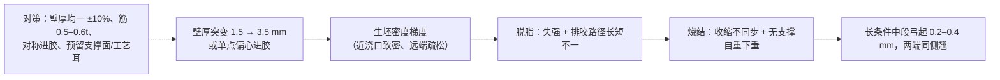

# 金属注射成型（MIM）：均匀壁厚、烧结支撑面与 5000 件成本拐点

> [!summary] 一句话概述
> MIM 是把金属粉和粘结剂混成喂料，像塑料一样注塑出「生坯」，再脱掉粘结剂、高温烧结成致密金属件，线收缩 12%–20%（316L 约 15%–18%）。赫兹工业设计给出两条硬规则：**翘曲多半在开模前就注定了**，要做到壁厚 1–4 mm 且同件壁厚差 ±10% 以内、进胶对称、留出烧结支撑面；**成本拐点 =（MIM 模具投入 − CNC 编程夹具投入）÷（CNC 单件 − MIM 单件）**，再乘 1.5–2 作为起订量，小件大多落在 5000–3 万件。德国 MIMplus 的设计指南从工厂角度给出同样的原则：最小壁厚 0.3–0.5 mm、尽量避免截面 > 5 mm、拔模 1°、需要尽量平的烧结接触面，以及按尺寸分档的公差表。

## 配图

![[附件/mimplus-sintering-support.png]]
*图源：[MIMplus Process Guide](https://mimplus.de/media/pages/metal-injection-molding-mim/eb197c1825-1754577192/process-guide_mimplus.pdf) 图 4、图 5；左：异形件在陶瓷承烧板上用支撑块（红色）垫平；右：易倾倒件用支撑结构稳住*

![[附件/mimplus-uniform-wall.png]]
*图源：同上 图 8；把 L 形厚截面改成均匀壁厚：先加圆角过渡，再掏空厚区*

> 图片版权归原作者所有，仅作个人学习收藏；出处见文末「来源与核实记录」。赫兹原文配图为通用场景图，未收录。

## 结构原理

> 本节数字只写来源里给出的；来源没有就写「来源未给出」。

### 堆叠方案

方向：**按工艺流程，从喂料到成品**（每一步的尺寸状态）

| 阶段 | 状态 | 关键参数 | 对结构的要求 | 依据 |
| --- | --- | --- | --- | --- |
| 1 注射 | 生坯：密度约为理论密度 60%–65% | 型腔按缩放系数整体放大 | 浇口靠近厚壁区（MIMplus）；进胶对称、双点或扇形（赫兹）；浇口不在外观面 | 赫兹 1253；MIMplus |
| 2 溶剂脱脂 | 去掉大部分低分子蜡 | 来源未给出 | — | 赫兹 1253 |
| 3 热脱脂 | 约一半粘结剂被带走，强度只剩压制态的一小部分 | 排胶关键区间升温 0.5–1 ℃/min（默认 2–3 ℃/min 易鼓包分层） | 厚壁区加排气通道；壁厚均匀 | 赫兹 1253 |
| 4 烧结 | 颗粒焊合，接近软态，自重会下垂 | 线收缩 12%–20%；316L 15%–18% | 留出平整支撑面（非 A 面）或工艺耳 | 赫兹 1253；MIMplus |
| 5 后处理 | 去浇口、喷砂、整形 | 精度约 ±0.3%（赫兹）；关键配合位留余量后加工或整形 | — | 赫兹 1225 |

剖面示意：

### 零件清单

| 零件/工装 | 数量 | 功能 | 材料 | 依据 |
| --- | --- | --- | --- | --- |
| 注射模 | 1 副（4/16/32 穴） | 成型生坯；穴数决定单件成本 | 模具钢 | 赫兹 1225 |
| 承烧板 | 按炉 | 脱脂烧结时承托零件 | 氧化铝 / 氧化锆陶瓷 | 赫兹 1253 |
| 支撑块/支撑结构 | 按件 | 防止烧结下垂、防倾倒 | 来源未给出 | MIMplus |
| 工艺耳 | 按需 | 曲面件无平面时作支撑，烧结后切除 | 同材质 | 赫兹 1253 |
| 整形模 | 0/1 | 关键尺寸整形 | — | 赫兹 1225 |

### 装配顺序

> 本案例为工艺流程，按赫兹的「翘曲现场排查四步」整理：

1. **量尺寸**：所有尺寸同方向同比例偏差 → 缩放系数与装粉量没对齐，改工艺、不动模具；有正有负或弓曲 → 往下查。
2. **切断面**：沿变形方向切开变形最大的废件，看是否近浇口致密、远端疏松，或壁厚过渡处有密度分界线。
3. **查脱脂升温速率**：变形只出现在热脱脂之后 → 把排胶关键段压到 1 ℃/min 以内。
4. **查烧结支撑**：圆角、薄边塌陷或平面中段下凹 → 设计阶段预留平整支撑面。

### 受力与运动分析

- **变形来源是「不同步收缩」**：厚区装粉多、排胶慢、收缩大；薄区相反，两边把零件拉弯（赫兹 1253）。
- **烧结时零件接近软态**，自重即可造成下垂，所以要「小而平」的支撑接触面：避免线接触留压痕，也避免大面积贴合导致排气不畅（赫兹 1253）。
- **矫形不是好办法**：矫形件内应力大，放几天会回弹（赫兹 1253）。
- **细长型芯**：注射压力会冲弯细型芯，孔长径比控制在 3 以内比较稳，超出改盲孔后加工（赫兹 1225）。
- **尖角**：圆角改善充填、减少喂料偏析，也降低生坯和烧结件的缺口效应（MIMplus）。

## 设计要点与参数

| 要点 | 内容 | 依据 |
| --- | --- | --- |
| 壁厚 | 赫兹：1–4 mm，同件壁厚差 ±10% 以内；MIMplus：最小 0.3–0.5 mm，尽量避免截面 > 5 mm | 赫兹 1253；MIMplus |
| 筋 | 主壁厚的 0.5–0.6 倍 | 赫兹 1253 |
| 拔模 | 通常建议 1°，极小几何可省略 | MIMplus |
| 公差（MIMplus） | 3–6 mm：±0.06；6–15 mm：±0.075；15–30 mm：±0.15；30–60 mm：±0.25；> 60 mm：±0.5% | MIMplus 表 1 |
| 公差（赫兹） | 一般按 ±0.3% 控制 | 赫兹 1225 |
| 件重 | MIMplus 主做平均 0.01–50 g，最大约 100 g；赫兹：单件超过 100 g，炉装载量少，成本优势衰减 | MIMplus；赫兹 1225 |
| 成本拐点算例 | 316L 小件 8 g：MIM 模具 8 万元、单件 3.5 元；CNC 编程夹具 3000 元、单件 18 元 → 拐点 ≈ 5300 件 → 起订量按 8000–1 万件谈 | 赫兹 1225 |
| 经济区间 | 小件 5000–3 万件；低于 3000 件 CNC 或冲压更划算；高于 50 万件传统粉末压制、冷镦更便宜 | 赫兹 1225 |
| 复杂度影响 | 简单回转/2.5D：拐点几万件，先考虑冷镦或冲压；中等复杂：万件级；多向孔、内腔：几千件 | 赫兹 1225 |

> 两种公差口径对比（推断换算）：按赫兹 ±0.3%，20 mm 尺寸约 ±0.06 mm；MIMplus 表中 15–30 mm 给 ±0.15 mm。两者相差一倍以上，说明 ±0.3% 更接近「能做到」的精度，MIMplus 表更接近「标准报价」公差；设计时以供应商实际能力为准。

## 优缺点

**优点**
- 形状自由度接近精密铸造，成本接近粉末压制（赫兹 1225）
- 斜孔、异形槽、内腔直接在模具里成型，不额外加钱
- 材料接近净成形，比 CNC 切削 316L、钛合金省料

**缺点 / 代价**
- 线收缩 12%–20%，尺寸靠缩放系数和工艺控制
- 翘曲风险大，结构必须围绕「均匀壁厚 + 支撑面」设计
- 模具费高，几千件以下不划算

## 可借鉴点

- **开模前先算成本拐点并乘 1.5–2**，避免报价返工
- **要供应商给带穴数的报价**：4 穴、16 穴并排比
- **刚性靠翻边和筋，不靠堆厚料**（赫兹 1253）
- **非 A 面预留烧结支撑面**；全曲面件用工艺耳
- **列出四个数判断能不能做 MIM**：单重、最大壁厚、最小孔径、有无多向特征（赫兹 1225）

## 与库中相似案例对比

| 对比项 | 本案例 | [[特斯拉 Giga Press 一体化压铸车身件]] | [[荣耀金属 3D 打印免组装转轴专利：连接余料与垂直打印方向的切割面]] |
| --- | --- | --- | --- |
| 工艺 | 粉末注射 + 烧结 | 铝合金高压压铸 | 粉末床金属 3D 打印 |
| 零件尺度 | 几克到 100 g | 大型车身件 | 转轴零件 |
| 主要风险 | 烧结收缩不均、翘曲 | 见该案例 | 间隙精度、余料去除 |
| 关系 | 荣耀专利提到传统铰链先用 MIM 做大量零件再组装，3D 打印是替代方向 | — | — |

## 相关案例

- [[荣耀金属 3D 打印免组装转轴专利：连接余料与垂直打印方向的切割面]]
- [[特斯拉 Giga Press 一体化压铸车身件]]
- [[塑料件加强筋设计：厚度、高度与间距比例]]
- [[免喷涂材料 vs 喷涂：成本、良率与三条硬边界]]（同为赫兹的成本账）
- 分类索引：[[07-材料与工艺 索引]]

## 来源与核实记录

- 主来源：[MIM件烧结后翘曲，先分清是缩率还是支撑的锅](https://www.hezidesign.com/gongyi/1253.html)（赫兹工业设计，王然）
- 补充来源 1：[金属注射成型：几千件以下开模就是亏](https://www.hezidesign.com/gongyi/1225.html)（赫兹工业设计，邓铮；与主来源同一公司，不计作独立来源）
- 补充来源 2：[MIMplus Metal Injection Molding Process Guide](https://mimplus.de/media/pages/metal-injection-molding-mim/eb197c1825-1754577192/process-guide_mimplus.pdf)（MIMplus Technologies，2 页 PDF；独立来源）
- 核实：2026-11-13 打开全部来源核对。荣耀专利解读中提到「先采用 MIM 工艺制造出大量零件，再组装」出自 B 站 cv50057386。
