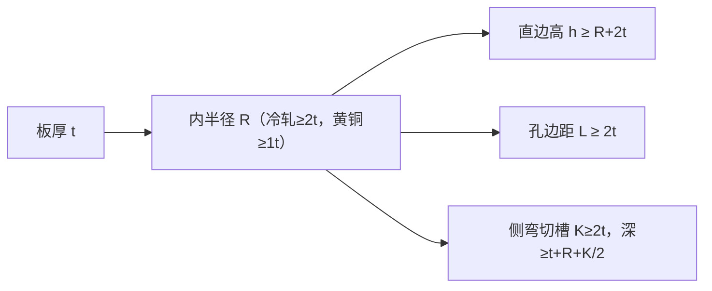

# 钣金折弯件设计规则：最小弯曲半径与预留切口

> [!summary] 一句话概述
> 钣金折弯的大部分缺陷（外侧开裂、回弹、孔变形、角部起皱、单边偏移）都能在设计阶段用几条比例规则避免：B 站专栏《钣金折弯件的结构设计原则》给出最小弯曲半径表（冷轧/镀锌板 R ≥ 2t、黄铜 R ≥ 1t）、直边高度 h ≥ R + 2t、孔边距 L ≥ 2t、侧弯切槽 K ≥ 2t 等 14 条规则。

## 配图

![[附件/sheet-metal-min-bend-radius.png]]
*图源：B 站专栏 cv10590863（潇洒教育，图带「资料网」水印）；4.1-3 表 最小弯曲半径（铝合金板一栏数值被水印遮挡，无法核实）*

![[附件/sheet-metal-min-flange.png]]
*图源：同上；4.1-5 图 弯曲直边高度 h、半径 R、板厚 t*

![[附件/sheet-metal-bend-relief.png]]
*图源：同上；4.1-10a 图 室外机侧板上端圆角处的预留切口（图注 ≥ 2t、60°，B 与盖板厚度 t 相等）*

> 图片版权归原作者所有，仅作个人学习收藏；出处见文末「来源与核实记录」。

## 结构原理

> 本节数字只写来源里给出的；来源没有就写「来源未给出」。

### 堆叠方案

方向：**沿折弯截面，从内圆角到直边**（单件钣金的几何关系）

| 层级 | 特征 | 材料 | 尺寸规则 | 作用 | 依据 |
| --- | --- | --- | --- | --- | --- |
| G1 | 弯曲内半径 R | 板材 | 冷轧/电镀锌/镀锌板 R ≥ 2t；黄铜板 R ≥ 1t；铝合金板见原表 | 防外表面开裂，又不因 R 过大而回弹失准 | 第 1 条、4.1-3 表 |
| G2 | 弯曲直边高度 h | — | h ≥ R + 2t | 保证足够弯矩，形状准确 | 第 2 条 |
| G3 | 弯曲边上的孔 | — | 孔边到弯曲半径 R 中心距离 L ≥ 2t；另一处写孔边距（至底根部）A ≥ 4 | 防止孔变形 | 第 3、14 条 |
| G4 | 侧面（梯形）弯曲的预留切槽 | — | 槽宽 K ≥ 2t，槽深 L ≥ t + R + K/2，或根部改阶梯形 | 防裂纹或畸形 | 第 6 条 |

剖面示意：

### 零件清单

| 特征 | 数量 | 功能 | 材料 | 依据 |
| --- | --- | --- | --- | --- |
| 工艺定位孔 | 按需 | U 形件两边不等长时防偏移；防一边向内收缩 | 同板材 | 第 5、11 条 |
| 预留切口/切槽 | 按需 | 防角部挤料起皱、直角两侧褶皱、回弹、冲孔后折弯开裂 | 同板材 | 第 6–10 条 |
| 让开阶梯线的弯曲线或切口 | 按需 | 凸部弯曲防根部开裂 | 同板材 | 第 13 条 |

### 装配顺序

单件成形，无装配；加工顺序上，来源提到冲孔后再折弯时要预留防裂切口（第 10 条）。

### 受力与运动分析

- **受力路径**：折弯时外层受拉、内层受压；R 过小外表面开裂，R 过大回弹大（第 1 条）。
- **运动关系**：U 形件两边不等长时，折弯时会向一边移位（第 5 条）。
- **失效风险**：外侧裂纹、孔变形、残余圆弧（a < R 时，第 4 条）、角部起皱、单边收缩。补充来源指出：硬铝等脆性材料或硬态板材折弯易外圆角开裂；提高刚度不能靠换高强度同类材料，要改形状或换弹性模量更高的材料。

## 设计要点与参数

| 要点 | 内容 | 依据 |
| --- | --- | --- |
| 最小弯曲半径 | 冷轧板、电镀锌板、镀锌板 R ≥ 2t；黄铜板 R ≥ 1t；铝合金板数值被水印遮挡 | 4.1-3 表 |
| 直边高度 | h ≥ R + 2t | 第 2 条 |
| 孔到弯曲中心 | L ≥ 2t | 第 3 条 |
| 残余圆弧 | a ≥ R | 第 4 条 |
| U 形件 | 两边最好等长，否则加工艺定位孔 | 第 5 条 |
| 侧弯切槽 | K ≥ 2t，L ≥ t + R + K/2 | 第 6 条 |
| 孔边距（至底根部） | A ≥ 4（单位按原文，未写明） | 第 14 条 |
| 选材原则（补充） | 减少材料品种和板厚规格；需折弯的件要求足够塑性、较低屈服极限；硬铝 2A06 不能折弯 | 补充来源 1.1.1、1.1.2.2、1.1.3.2 |
| 最小翻边、K 因子、展开计算 | 来源未给出 | — |

## 优缺点

**优点**
- 规则全部以板厚 t 的倍数给出，可直接写进设计检查表
- 每条规则都对应一种具体缺陷，便于排查

**缺点 / 代价**
- 文章为规则汇编，未给出实测或出处；图片疑为转载
- 铝合金等材料数据不完整（被水印遮挡）

## 可借鉴点

- 钣金检查清单：R、h ≥ R + 2t、孔距 ≥ 2t、a ≥ R、侧弯切槽、U 形件对称
- 角部、凸部、冲孔后折弯处默认加工艺切口
- 硬态/脆性材料要放大弯曲半径或换状态，不要硬折

## 相关案例

- [[特斯拉 Giga Press 一体化压铸车身件]]
- [[Mac Pro 2019 旋转把手外壳锁与免工具模块锁]]
- 分类索引：[[07-材料与工艺 索引]]

## 来源与核实记录

- 主来源：[钣金折弯件的结构设计原则](https://www.bilibili.com/read/cv10590863)（B 站专栏，2021-04-02，潇洒教育）
- 补充来源：[钣金结构设计工艺手册1.1](https://www.bilibili.com/read/cv16802986)（B 站专栏，2022-05-26，可口可乐要加冰ice）
- 核实：2026-11-13 打开两篇专栏原文核对 14 条规则与 4.1-3 表；表中铝合金一栏被图片水印遮挡，未录入数值。
