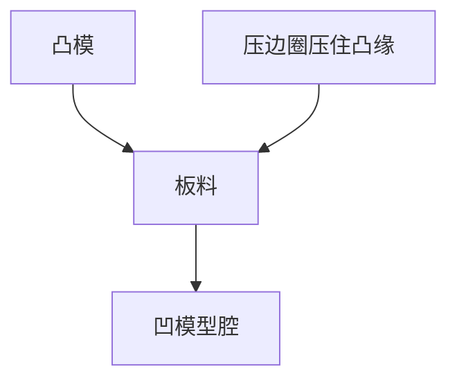

# 钣金拉深：拉深比、压边力与起皱拉裂

> [!summary] 一句话概述
> 拉深是用凸模把平板压入凹模、在压边圈控制下把板料拉成杯形或盒形；压边力太小或拉深比过大，凸缘会起皱，压边力过大、圆角过小或润滑不足则容易在壁部或圆角处拉裂。

## 配图

![[附件/sheet-deepdraw-balford.png]]
*图源：[Balford，《如何防止深拉伸中的起皱》](https://balford.net/zh/how-do-you-prevent-wrinkles-in-a-deep-drawing-parts/) 文内配图；对照压边与进料对起皱的影响。*

![[附件/sheet-aam-drawing-p6.png]]
*图源：[European Aluminium, Manufacturing – Forming](https://european-aluminium.eu/wp-content/uploads/2022/11/aam-manufacturing-3-forming.pdf) 第 6 页 Drawing，含单动拉深模具示意（Single acting drawing tool setup）。原 PDF 页。*

> 图片版权归原作者所有，仅作个人学习收藏；出处见文末「来源与核实记录」。

## 结构原理

> 本节所有数字只写来源里给出的；来源没有就写「来源未给出」，不估算、不编造。

European Aluminium 手册把 Drawing / deepdrawing 写成：用模具把形状冲压进板料。该节提醒可用展开毛坯减轻成形和回弹问题，并用拉延筋（drawbeads）控制材料流动；同时警告不要在后续还要做翻边的区域引入过大应变。

Balford 把起皱的主要原因分成：压边力、拉深比、凹模与凸模圆角、材料各向异性、润滑、板厚、毛坯几何和拉深速度。压边力用来抑制凸缘起皱，但过大又会阻碍进料、增加拉裂风险。

### 堆叠方案

方向：沿拉深件轴线，从上模到压边圈再到凹模。

| 层级 | 零件 | 材料 | 厚度/尺寸 | 固定方式 | 依据 |
| --- | --- | --- | --- | --- | --- |
| L1 凸模 | 把板料压入型腔 | 来源未给出模具钢号 | 凸模圆角影响开裂；具体数值来源未给出统一表 | 压力机驱动 | Balford；AAM 第 6 页示意 |
| L2 压边圈 / 压边 | 压住凸缘，控制进料 | 来源未给出 | 压边力是关键工艺量，来源未给出通用牛顿公式 | 压边缸或弹簧 | Balford；AAM |
| L3 板料 / 毛坯 | 被拉入的平板 | 拉深板、铝板等 | 板厚影响抗皱与拉裂；各向异性会导致凸耳 | 被压边约束 | Balford |
| L4 凹模 | 提供型腔和凹模圆角 | 来源未给出 | 凹模圆角过小易拉裂，过大易起皱（Balford 定性） | 固定在下模 | Balford；AAM |

剖面示意：

### 零件清单

| 零件 | 数量 | 功能 | 材料 | 依据 |
| --- | --- | --- | --- | --- |
| 凸模、凹模、压边圈 | 各 1 套 | 拉深成形与控制进料 | 来源未给出 | AAM 第 6 页；Balford |
| 拉延筋 | 按需 | 控制材料流动 | 做在压边或凹模上 | AAM：Drawbeads can be used to control material flow |
| 展开毛坯 | 1 | 减少多余变形和回弹 | 同板材 | AAM：developed blank |

### 装配顺序

单件成形。AAM 给出单动拉深的模具布置。工艺上先放毛坯、压边，再由凸模拉入。深度太大时需多次拉深；手册未在已提取页给出具体的最大一次拉深比数值，故不编造。

### 受力与运动分析

- **受力路径**：凸模拉力经壁部和圆角传到凸缘；凸缘在压边下径向内流。压边不足，凸缘失稳起皱；进料受阻或圆角过小，壁部或圆角拉裂。
- **运动关系**：板料相对凹模孔口流动，厚度和周向长度都在变化。
- **失效风险**：起皱、拉裂、凸耳（各向异性）。后续翻边区如果在拉深阶段已经应变过大，翻边会更难（AAM）。

## 设计要点与参数

| 要点 | 内容 | 依据 |
| --- | --- | --- |
| 压边力 | 太小起皱，太大阻碍进料并增加拉裂；需按零件调整，来源未给出通用公式 | Balford「压边力」 |
| 拉深比 | 拉深比过大会加重起皱和开裂风险；具体极限值来源未给出单一数字 | Balford「拉深比」 |
| 凸模/凹模圆角 | 过小易裂，过大易皱，需与材料一起试模 | Balford |
| 拉延筋与展开毛坯 | 用拉延筋控制流动；用展开毛坯减轻成形和回弹问题 | AAM 第 6 页 |
| 后续翻边 | 不要在以后还要翻边的区域引入过大应变 | AAM |
| 拉深件圆角 | 机械设计实用手册另有「拉深件圆角半径（JB/T4378.1-1999）」表，设计具体零件时应打开该表核对，本篇不转抄未在本次完整核线的每一个格值 | 机械设计实用手册拉深件结构要素 |

## 优缺点

**优点**
- 用一块板拉出空腔，焊缝少，适合杯形、盒形壳体
- 压边、拉延筋和毛坯形状可以调节进料，适应不同深度

**缺点 / 代价**
- 起皱和拉裂的窗口窄，工艺参数要配套
- 深件往往要多次拉深，模具和工序增加
- 各向异性和润滑会使同一副模具表现波动

## 可借鉴点

- 先看毛坯和压边能不能把凸缘「喂进去又不失稳」，再谈一次能否拉到位。
- 后续还要翻边或包边的区域，拉深阶段就要留下变形余量。
- 起皱不要只加压边力，同时检查拉深比、圆角和润滑。
- 本篇不是翻边，也不是卷边。

## 与库中相似案例对比

| 对比项 | 本案例（拉深） | [[钣金曲线翻边：伸展翻边拉裂与压缩翻边起皱]] | [[真空吸塑与压力成型外壳：拔模、圆角与拉伸减薄]] |
| --- | --- | --- | --- |
| 变形方式 | 平板在压边下被拉入凹模成杯、盒 | 已有板边沿曲线翻起 | 塑料片材加热后吸塑或压力成型 |
| 主要失效 | 凸缘起皱、壁部或圆角拉裂 | 伸展开裂、压缩起皱 | 拉伸减薄、拔模不足 |
| 何时用这篇 | 金属板拉深壳体 | 金属板窗洞或外缘翻边 | 塑料吸塑件，不是金属拉深 |

## 相关案例

- [[钣金曲线翻边：伸展翻边拉裂与压缩翻边起皱]]
- [[钣金折弯件设计规则：最小弯曲半径与预留切口]]
- [[真空吸塑与压力成型外壳：拔模、圆角与拉伸减薄]]
- 分类索引：[[07-材料与工艺 索引]]

## 来源与核实记录

- 主来源：[Balford，《如何防止深拉伸中的起皱》](https://balford.net/zh/how-do-you-prevent-wrinkles-in-a-deep-drawing-parts/)（2026-11-27 打开。压边力、拉深比、圆角、各向异性、润滑、板厚、毛坯和速度等起皱原因来自该文。该文未给出通用的压边力计算公式，本篇不编造。）
- 交叉来源：[European Aluminium，《Manufacturing – Forming》](https://european-aluminium.eu/wp-content/uploads/2022/11/aam-manufacturing-3-forming.pdf)（2026-11-27 下载。拉深定义、展开毛坯、拉延筋及「勿在后续翻边区引入过大应变」来自该手册第 6 页及前后节。）
- 交叉来源：[机械设计实用手册，冷冲压件结构要素·拉深件](https://www.mechtool.cn/structuraldesignandassembly/structuraldesignandassembly_structuralelementsofcoldstampingparts.html)（2026-11-27 打开，确认该页含拉深件圆角半径等 JB/T 要素。具体表格数值如需用于某零件，应回到该页逐项核对。）
- 核实：2026-11-27 打开上述来源。未编造一次拉深比极限值。
