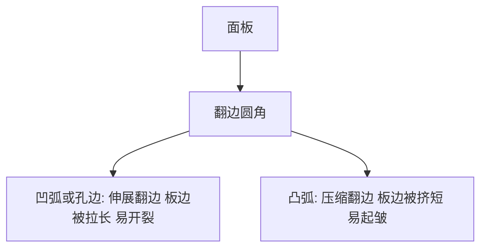

# 钣金曲线翻边：伸展翻边拉裂与压缩翻边起皱

> [!summary] 一句话概述
> 曲线翻边不是简单的直角折边：凹弧一侧板边被拉长（伸展翻边）容易开裂，凸弧一侧板边被挤短（压缩翻边）容易起皱；European Aluminium 手册把这两类与直线翻边、扩孔分开讨论，并给出后续还要 180° 包边时应变会再加倍的提醒。

## 配图

![[附件/sheet-aam-stretch-flange-p10.png]]
*图源：[European Aluminium, Manufacturing – Forming](https://european-aluminium.eu/wp-content/uploads/2022/11/aam-manufacturing-3-forming.pdf) 第 10 页 Stretch flanging；原 PDF 页，说明伸展翻边在（部分）孔周围进行。*

![[附件/sheet-aam-shrink-flange-p11.png]]
*图源：同上 PDF 第 11 页 Shrink flanging；原 PDF 页，讨论压缩翻边与起皱。*

![[附件/sheet-stretch-flange-fabricator.jpg]]
*图源：[The Fabricator, Solving stretch flange problems (Part I)](https://www.thefabricator.com/thefabricator/article/bending/solving-stretch-flange-problems-part-i-) 文内配图；配合正文说明伸展翻边的定义。*

> 图片版权归原作者所有，仅作个人学习收藏；出处见文末「来源与核实记录」。

## 结构原理

> 本节所有数字只写来源里给出的；来源没有就写「来源未给出」，不估算、不编造。

European Aluminium 手册把翻边（Flanging）定义为用冲压把面板边缘弯成翻边。直线翻边之外，曲线上有两种完全不同的应变：

- 伸展翻边（stretch flanging）：手册写明是在（部分）孔上做翻边，板边被拉长。The Fabricator 也把它定义为边缘受拉的翻边。
- 压缩翻边（shrink flanging）：板边被压缩，主要风险是起皱。

若翻边之后还要做 180° 包边，手册提醒最终应变会再加倍，因此更要限制翻边阶段已经用掉的变形能力。对准备包边的下翻边，手册建议下翻边半径小于 2·t。

### 堆叠方案

方向：沿翻边截面，从内圆角到翻边直边。

| 层级 | 零件 | 材料 | 厚度/尺寸 | 固定方式 | 依据 |
| --- | --- | --- | --- | --- | --- |
| G1 面板 | 待翻边的板件 | 手册针对汽车铝合金板；其他材料需另校核 | 板厚 t（手册用 t 表示） | 一体成形 | AAM 第 9–11 页 |
| G2 翻边圆角 | 下翻或上翻的弯曲区 | 同板材 | 若后续要 180° 包边，下翻边半径小于 2·t | 冲压成形 | AAM 第 9 页 downflange radius |
| G3 翻边直边 | 被拉长或被压缩的边缘 | 同板材 | 来源未给出统一的最大翻边高度公式；应变需按材料延伸率控制 | 与面板一体 | AAM；The Fabricator |

剖面示意：

### 零件清单

| 零件 | 数量 | 功能 | 材料 | 依据 |
| --- | --- | --- | --- | --- |
| 面板与翻边 | 一体 | 形成装配边、包边准备边或窗口翻边 | 铝合金等 | AAM |
| 切边轮廓 | 1 | The Fabricator 强调切口质量会影响随后的伸展翻边 | 同板材 | The Fabricator, The Effects of Cutting |

### 装配顺序

单件成形。典型顺序（按手册与 The Fabricator 的工艺叙述）：先落料或切出窗洞/外形 → 再翻边。The Fabricator 指出，切边留下的硬化和微裂纹会降低伸展翻边时的可用变形能力。若还要包边，应把翻边和后续 180° 卷边的应变一起考虑（AAM）。

### 受力与运动分析

- **受力路径**：伸展翻边时边缘受拉，破裂通常从切边或孔边开始；压缩翻边时边缘受压，材料堆积后起皱。
- **运动关系**：成形时翻边相对面板转动并伴随切向伸长或缩短；使用后无相对运动。
- **失效风险**：伸展侧开裂、压缩侧起皱；后续再包边会使应变加倍（AAM）。The Fabricator 还提到材料延伸率和切边状态会改变同一几何是否能翻过。

## 设计要点与参数

| 要点 | 内容 | 依据 |
| --- | --- | --- |
| 分类 | 直线翻边、伸展翻边、压缩翻边、扩孔要分开看，不要用同一条折弯半径规则套所有曲线翻边 | AAM 第 9–12 页 |
| 后续包边 | 若还要 180° 包边，最终应变约为翻边阶段的两倍 | AAM Stretch flanging |
| 下翻边半径 | 若面板随后要 180° 包边，下翻边半径小于 2·t | AAM 第 9 页 |
| 切边 | 切口质量影响伸展翻边，不能只按成品几何判断 | The Fabricator |
| 材料 | 手册针对铝板成形；其他材料的许用边缘应变，来源未给出通用数，需按该材料延伸率校核 | AAM；The Fabricator Material Effects |

## 优缺点

**优点**
- 把平面板边变成可搭接、可包边或可装配的翻边，不必另加型材
- 分清伸展与压缩后，可以用「加大曲率半径、降低翻边高度、改善切边」对症处理

**缺点 / 代价**
- 曲线翻边的应变沿边缘变化，直线折弯的 R/t 规则不够用
- 要包边的翻边会把应变用两次，材料窗口更窄
- 切边和材料批次会改变同一副模具是否开裂或起皱

## 可借鉴点

- 在图纸上标清这段翻边是凹弧（伸展）还是凸弧（压缩），检查项不同：一边防裂，一边防皱。
- 计划做卷边的覆盖件，翻边阶段就要按「应变还要再翻一倍」留余量，并核对下翻边半径是否小于 2t。
- 伸展翻边出问题先查切边质量和材料延伸率，不要只加大压边力。
- 本篇不是普通 90° 折弯，也不是板边折回自身的卷边。

## 与库中相似案例对比

| 对比项 | 本案例（曲线翻边） | [[钣金折弯件设计规则：最小弯曲半径与预留切口]] | [[钣金卷边（Hemming）：把板边折回自身，做成封闭、开口、泪滴或绳状包边]] |
| --- | --- | --- | --- |
| 核心问题 | 沿曲线的切向拉伸或压缩 | 弯曲区外层开裂、孔变形、工艺切口 | 把返回边压向板面 |
| 何时用这篇 | 窗洞、轮罩、覆盖件的曲线翻边 | 直线或折角折弯的 R 和切口 | 已经翻好边之后做包边，或单独做安全边 |

## 相关案例

- [[钣金折弯件设计规则：最小弯曲半径与预留切口]]
- [[钣金卷边（Hemming）：把板边折回自身，做成封闭、开口、泪滴或绳状包边]]
- [[薄板抽孔翻边攻牙：预冲孔翻起后再攻内螺纹（对照压铆螺母）]]
- 分类索引：[[07-材料与工艺 索引]]

## 来源与核实记录

- 主来源：[European Aluminium Association，《Manufacturing – Forming》（AAM）](https://european-aluminium.eu/wp-content/uploads/2022/11/aam-manufacturing-3-forming.pdf)（PDF 标注 Version 2002。2026-11-27 下载并提取第 9–12 页。直线翻边、伸展翻边、压缩翻边、扩孔的分类，以及后续 180° 包边时应变加倍、下翻边半径小于 2·t，均来自该 PDF。）
- 交叉来源：[Art Hedrick, The Fabricator，《Die Science: Solving stretch flange problems (Part I)》](https://www.thefabricator.com/thefabricator/article/bending/solving-stretch-flange-problems-part-i-)（2026-11-27 打开。独立第二机构。伸展翻边定义、材料影响和切边对随后翻边的影响来自该文。）
- 核实：2026-11-27 打开上述两处。未引用中文转载页上未核清的经验公式。未把本篇写成普通折弯或卷边。
