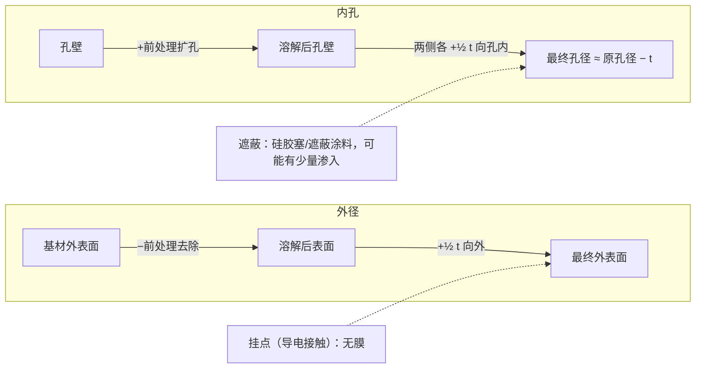

# 铝件阳极氧化的尺寸链：膜厚一半向外、遮蔽螺纹与挂点

> [!summary] 一句话概述
> 阳极氧化膜是从铝基体「长出来」的转化膜，不是镀上去的。两家来源都用**「约一半向内、一半向外」**做初步估算：25 μm 硬质膜外表面偏移 12.5 μm，内孔缩小一整个膜厚（Five Flute）。仲德精密补上两件经常被忘的事：**前处理（碱蚀、化学梨地）会先溶掉基材**；加上膜厚公差后，阳极前的加工窗口反而比成品公差更窄（Ø50 H8 + 30 ± 5 μm 硬质膜，阳极前孔径须控制在 Ø50.035–50.064 mm）。严公差只有三条路：预补偿、遮蔽、氧化后精加工。挂点（导电接触点）没有膜，必须由设计师在图纸上指定。

## 配图

![[附件/anodize-size-growth.png]]
*图源：[Five Flute](https://www.fiveflute.com/guide/how-to-design-and-manufacture-anodized-aluminum-parts/)「Impact of anodizing on part size growth」：铝体积减小，外形增大，膜一部分向内一部分向外*

![[附件/anodize-sharp-corner.png]]
*图源：同上「Impact of part geometry on anodized coating uniformity」：膜垂直表面生长，尖角处膜层不连续；倒角或圆角可改善*

![[附件/anodize-drawing-callouts.png]]
*图源：同上「Example of anodizing callouts」：图纸标注遮蔽孔、遮蔽端面、轴承孔两侧遮蔽、膜层规范（MIL-A-8625 Type II Class 1）和零件表面积*

> 图片版权归原作者所有，仅作个人学习收藏；出处见文末「来源与核实记录」。仲德原文配图为工艺示意照，未收录。

## 结构原理

> 本节数字只写来源里给出的；来源没有就写「来源未给出」。

### 堆叠方案

方向：**从铝基体到最外表面（单边）**

| 层 | 内容 | 厚度/变化 | 对尺寸的影响 | 依据 |
| --- | --- | --- | --- | --- |
| 0 | CNC 后的基材表面 | 加工目标尺寸 | 起点 | 仲德 |
| −1 | 前处理溶解层（碱蚀、除灰、化学梨地） | 去除量由供应商工艺决定，来源未给出通用值 | 外形变小、孔变大 | 仲德 |
| 1 | 向内转化部分 | 约 1/2 膜厚（初步估算） | 不改变外形 | 仲德；Five Flute |
| 2 | 向外生长部分（多孔柱状 Al₂O₃） | 约 1/2 膜厚 | 外形变大、孔变小、槽变窄 | 仲德；Five Flute |
| 3 | 染色 + 封孔 | 不应当作尺寸补偿 | — | 仲德 |

**膜厚范围（Five Flute 引 MIL-A-8625 等）**：I 型（铬酸）0.5–7.5 μm；II 型（硫酸）1.8–25.4 μm；III 型（硬质）> 25 μm。

剖面示意：

### 零件清单

| 要素 | 功能 | 设计要求 | 依据 |
| --- | --- | --- | --- |
| 挂点（导电接触位） | 整个过程中保持可靠导电 | 接触位无膜；放在非功能、非外观面并在图纸指定，否则厂家自己选 | Five Flute；仲德 |
| 硅胶塞/套 | 遮蔽通孔、螺纹孔、销孔、规则密封槽 | 通用孔可用标准塞；异形需专用工装 | 仲德 |
| 遮蔽涂料 | 遮蔽曲面、异形区、试样 | 手工作业，边界一致性要管 | 仲德 |
| 导电/接地面 | 电气接触 | 阳极膜绝缘，必须遮蔽或氧化后去膜 | 仲德 |
| 图纸标注 | 告诉厂家规范、遮蔽、挂点、表面积 | 写明膜层规范 + 厚度 + 颜色 + 封孔；写零件表面积，方便算电流密度 | Five Flute |

### 装配顺序

> 本案例为工艺流程：设计 → CNC → 表面处理 → 检验（按两家来源整理）：

1. **定义最终尺寸状态**：图纸写「除另有标注外，尺寸均按阳极氧化及封闭完成后的最终状态验收」（仲德）。
2. **逐特征选路线**：开放面用预补偿；螺纹、导电面、密封槽用遮蔽；轴承孔、精密销孔用氧化后精镗或铰（仲德表）。
3. **算阳极前目标**：用膜厚上下限反推（见下方 H8 复算），并向供应商确认前处理去除量。
4. **CNC 首件**：确认补偿逻辑；批量时监控孔、槽、螺纹趋势。
5. **表面处理**：清洗 → 前处理 → 阳极 → 染色（可选）→ 封孔（Five Flute）；时间按「312 规则」：分钟 = 膜厚 μm × 3.12 ÷ 电流密度 A/dm²。
6. **阳极后检验**：尺寸、膜厚、螺纹规、配合规、导电、密封分项验收；小孔、深孔、盲孔的膜厚不一定和开放平面一致（仲德）。

### 受力与运动分析

- **配合**：H8 孔 Ø50（0 ~ +0.039 mm），硬质膜 30 ± 5 μm，按一半向外估算孔径缩小 25–35 μm。阳极前孔径需 ≥ 50.000 + 0.035 = 50.035，且 ≤ 50.039 + 0.025 = 50.064 → **Ø50.035–50.064 mm**（我按原文条件复算，与仲德给出的结果一致）。成品公差 39 μm，阳极前窗口只剩 29 μm。
- **疲劳**：Five Flute 引用 6000 系铝高周疲劳论文：膜厚 10 μm 时疲劳强度下降 8%，40 μm 时下降 50%。机理有两条：膜厚相当于初始裂纹长度；膜内存在拉伸残余应力。**受交变载荷的件不要无脑上硬质厚膜。**
- **尖角**：膜垂直表面生长，尖角处膜层不连续（Five Flute 图）。所有棱边倒角或倒圆。
- **铝对铝**：阳极膜可防止铝对铝接触面咬死（galling）；封孔时可加 PTFE，用于轻载衬套（Five Flute）。

## 设计要点与参数

| 要点 | 参数/规则 | 依据 |
| --- | --- | --- |
| 尺寸增长估算 | 外表面 +½t；外径 +t；内孔 −t；双侧槽宽 −t | 仲德；Five Flute |
| 30 μm 示例 | 单边向外约 15 μm；外径约 +30 μm；内孔约 −30 μm | 仲德 |
| H8 算例 | Ø50 H8 + 30 ± 5 μm → 阳极前 Ø50.035–50.064 mm | 仲德（已复算） |
| 螺纹遮蔽 | III 型：所有螺纹孔遮蔽；II 型：M8×1（3/8-16）以下按配合等级遮蔽 | Five Flute |
| 返工头号原因 | 遮蔽不当 | Five Flute |
| 遮蔽 ≠ 零膜 | 电解液渗入、塞子压缩不一、孔口不规则边界 | 仲德 |
| 疲劳折减 | 10 μm：−8%；40 μm：−50%（6000 系） | Five Flute 引论文 |
| 312 规则 | 分钟 = μm × 3.12 ÷ A/dm² | Five Flute |
| 色差 | 批次间色相会漂移；多零件必须同色时极难（iPod 分档配色传闻，原文标注 anecdotal） | Five Flute |
| 供应商责任 | 阳极厂通常只保证膜厚和过程，最终尺寸要写清谁负责 | 仲德 |

## 优缺点

**优点**
- 耐腐蚀、提高表面硬度、可染色，表面多孔利于胶粘和喷漆（Five Flute）
- 膜与基体一体，不像喷涂那样起皮（仲德）

**缺点 / 代价**
- 尺寸要在设计阶段算进去，严公差件要加遮蔽或后加工
- 膜绝缘，接地面要特殊处理
- 厚膜明显降低疲劳强度
- 多零件同色难

## 可借鉴点

- **图纸写四层**：最终功能尺寸 / 阳极前加工目标 / 膜层与前处理 / 局部例外区域（仲德）
- **挂点自己指定**，放在非外观、非功能面
- **图纸写零件表面积**，供应商可以直接算电流密度和报价（Five Flute）
- **所有棱边倒角**，避免尖角膜层不连续
- **螺纹三选一**：允许成膜、遮蔽、氧化后攻牙；返牙会去掉牙侧膜，要写明是否允许
- **检验分阳极前后两段**，单件合格还要做整机装配验证

## 与库中相似案例对比

| 对比项 | 本案例 | [[免喷涂材料 vs 喷涂：成本、良率与三条硬边界]] | [[钣金折弯件设计规则：最小弯曲半径与预留切口]] |
| --- | --- | --- | --- |
| 基材 | CNC 铝 | 塑料 | 钣金 |
| 表面层与尺寸 | 膜一半在外，改变配合 | 免喷涂无涂层；喷涂有膜厚 | 见该案例 |
| 关键风险 | 尺寸、遮蔽、挂点、疲劳 | 熔接痕、流痕、色差 | 弯曲开裂 |
| 共同点 | 「表面处理要进尺寸链和图纸」 | 色差窗口 | — |

## 相关案例

- [[免喷涂材料 vs 喷涂：成本、良率与三条硬边界]]
- [[金属注射成型（MIM）：均匀壁厚、烧结支撑面与 5000 件成本拐点]]
- [[钣金折弯件设计规则：最小弯曲半径与预留切口]]
- [[O 形圈密封槽设计：填充率、压缩率与挤出间隙的五个数]]（阳极后密封槽尺寸会变）
- 分类索引：[[07-材料与工艺 索引]]

## 来源与核实记录

- 主来源：[阳极氧化前后尺寸怎么控制：膜厚、公差、遮蔽、螺纹与配合面](https://www.zdpmt.com/zh/resources/anodizing-dimension-control-before-after-finishing/)（仲德精密 ZHONGDE PRECISION，2026-08-06；厂商文章，原文多处注明数值只适用于案例条件）
- 补充来源：[How to Design and Manufacture Anodized Aluminum Parts](https://www.fiveflute.com/guide/how-to-design-and-manufacture-anodized-aluminum-parts/)（Five Flute，William Burke；独立来源）
- 核实：2026-11-13 打开两篇正文核对；H8 算例按原文条件复算一致。疲劳折减数据为 Five Flute 转引 Winter & Lampke, Adv. Eng. Mater. 2023, 25, 2300394，论文原文未打开。
