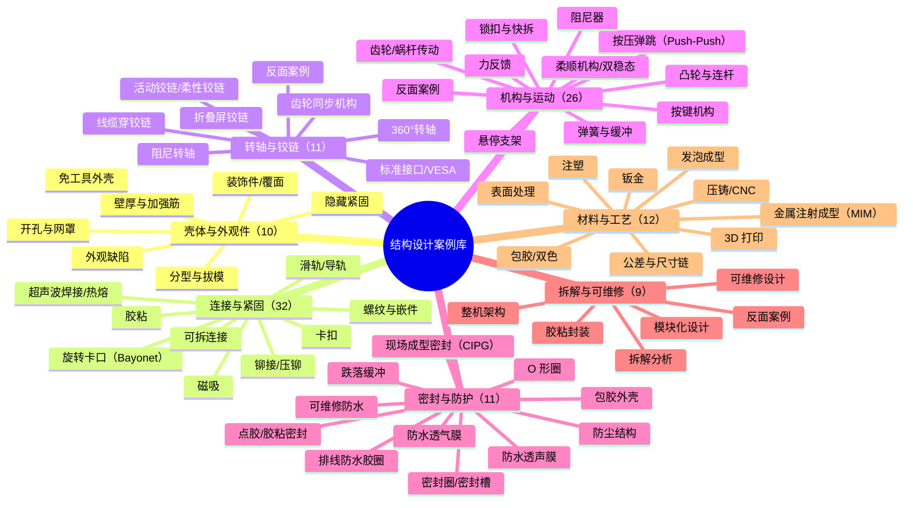

# 结构设计案例库 · 首页

> 产品与机械结构设计案例库：外壳、卡扣、连接件、转轴铰链、锁扣与按压弹跳机构、防水密封、拆解结构……每 2 天更新一次（单日 9:00 左右）。

**快速入口**：[[收集计划]] · [[案例模板]] · [[收集日志]] · [[案例地图.canvas|🗺️ 案例地图]] · [[README]]

## 📊 统计

- 案例总数：**111**　|　平均评分：**4.3 / 5**　|　最近更新：2026-11-21（第 5 次收集，+21）
- 来源平台（按主来源）：iFixit 31、厂商技术文章 56、B站 5、Wikipedia 4、Google Patents 4、其他 11
- 中文来源：主来源为中文的 45 篇；主来源或补充来源含中文的 63 篇（57%）
- 难度分布：入门 34、进阶 68、高级 9
- 每案平均来源数：2.9

| 一级分类 | 案例数 | 占比 |
| --- | --- | --- |
| [[01-壳体与外观件 索引\|01-壳体与外观件]] | 10 | ▇▇▇▇▇▇▇▇▇▇  |
| [[02-连接与紧固 索引\|02-连接与紧固]] | 32 | ▇▇▇▇▇▇▇▇▇▇▇▇▇▇▇▇▇▇▇▇▇▇▇▇▇▇▇▇▇▇▇▇  |
| [[03-转轴与铰链 索引\|03-转轴与铰链]] | 11 | ▇▇▇▇▇▇▇▇▇▇▇  |
| [[04-机构与运动 索引\|04-机构与运动]] | 26 | ▇▇▇▇▇▇▇▇▇▇▇▇▇▇▇▇▇▇▇▇▇▇▇▇▇▇  |
| [[05-密封与防护 索引\|05-密封与防护]] | 11 | ▇▇▇▇▇▇▇▇▇▇▇  |
| [[06-拆解与可维修 索引\|06-拆解与可维修]] | 9 | ▇▇▇▇▇▇▇▇▇  |
| [[07-材料与工艺 索引\|07-材料与工艺]] | 12 | ▇▇▇▇▇▇▇▇▇▇▇▇  |

动态统计（Dataview）：

```dataview
TABLE WITHOUT ID key AS 分类, length(rows) AS 案例数, round(sum(rows.评分)/length(rows),1) AS 平均评分
FROM -"00-说明"
WHERE 一级分类 AND 来源链接
GROUP BY 一级分类
SORT key ASC
```

## 🧭 分类图



## ✨ 最新收录（Dataview）

```dataview
TABLE WITHOUT ID file.link AS 案例, 一级分类 AS 分类, 应用产品, 难度, 评分, 来源平台 AS 平台, 收录日期
FROM -"00-说明"
WHERE 一级分类 AND 来源链接
SORT 收录日期 DESC, 评分 DESC
LIMIT 20
```

## ⭐ 高分案例（评分 ≥ 4，Dataview）

```dataview
LIST 一级分类 + " · " + 评分 + "★"
FROM -"00-说明"
WHERE 评分 >= 4 AND 来源链接
SORT 评分 DESC
```

## 🖼️ 卡片视图（Dataview JS，可选）

```dataviewjs
const pages = dv.pages('-"00-说明"').where(p => p.一级分类 && p.来源链接).sort(p => p.收录日期, 'desc');
for (const p of pages) {
  dv.paragraph(`${p.封面图 ? '![[' + p.封面图 + '|240]]  \n' : ''}**${p.file.link}** · ${p.一级分类} · ${'★'.repeat(p.评分)}`);
}
```

## 📋 全部案例（静态备用表，不依赖插件）

| # | 案例 | 一级分类 | 二级分类 | 应用产品 | 难度 | 评分 | 平台 |
| --- | --- | --- | --- | --- | --- | --- | --- |
| 1 | [[PS5 免工具侧板与 DualSense 隐藏螺丝]] | 01-壳体与外观件 | 免工具外壳、隐藏紧固 | 游戏主机、游戏手柄 | 入门 | ★★★★ | [iFixit](https://www.ifixit.com/Teardown/PlayStation+5+Teardown/138280) |
| 2 | [[咬花（晒纹）与拔模角：每 0.025 mm 纹深加 1°]] | 01-壳体与外观件 | 分型与拔模、装饰件/覆面 | 注塑外观件（小家电面板、对讲机外壳等）、咬花/晒纹侧壁 | 入门 | ★★★★ | [厂商技术文章](https://www.hezidesign.com/gongyi/1228.html) |
| 3 | [[塑料件加强筋设计：厚度、高度与间距比例]] | 01-壳体与外观件 | 壁厚与加强筋 | 注塑外壳、箱体/盒体、螺丝柱 | 入门 | ★★★ | [B站](https://www.bilibili.com/read/cv14903048) |
| 4 | [[塑料外壳止口与扣位：间隙参数与三个翻车案例]] | 01-壳体与外观件 | 分型与拔模、隐藏紧固 | 手持类电子产品外壳、前后壳/面底壳塑料件 | 进阶 | ★★★★ | [厂商技术文章](https://www.hezidesign.com/gongyi/963.html) |
| 5 | [[注塑熔接痕：位置由浇口定、深浅由前锋温差定]] | 01-壳体与外观件 | 外观缺陷 | 带孔/槽的塑料外壳（接口面板、显示仪外壳）、高光免喷涂件、透明灯罩 | 入门 | ★★★★ | [厂商技术文章](https://www.hezidesign.com/gongyi/1278.html) |
| 6 | [[注塑缩痕：厚壁背面凹陷、减胶坑与保压边界]] | 01-壳体与外观件 | 外观缺陷、注塑 | 消费电子外壳、家电面板、带筋和螺丝柱的外观件 | 进阶 | ★★★★ | [厂商技术文章](https://www.hezidesign.com/gongyi/653.html) |
| 7 | [[注塑螺丝柱（Boss 柱）：壁厚比 0.6 分水岭与自攻底孔公式]] | 01-壳体与外观件 | 壁厚与加强筋、隐藏紧固 | 塑料外壳（手持设备、机器人外壳等）、自攻螺丝连接的前后壳 | 入门 | ★★★★ | [厂商技术文章](https://www.hezidesign.com/gongyi/1282.html) |
| 8 | [[3D 打印件热熔铜螺母：孔径与拉拔力实测]] | 02-连接与紧固 | 螺纹与嵌件 | 3D 打印功能件、打印机/治具结构件 | 入门 | ★★★★★ | [厂商技术文章](https://www.cnckitchen.com/blog/are-our-heat-set-insert-datasheets-wrong) |
| 9 | [[任天堂 Switch 2 Joy-Con 2 磁吸连接]] | 02-连接与紧固 | 磁吸、可拆连接 | 游戏机手柄、手柄握把 | 进阶 | ★★★★ | [iFixit](https://www.ifixit.com/Device/Nintendo_Switch_2_Joy-Con_2_Grip) |
| 10 | [[任天堂 Switch Joy-Con 滑轨连接]] | 02-连接与紧固 | 滑轨/导轨、可拆连接 | 游戏机手柄 | 入门 | ★★★★ | [iFixit](https://www.ifixit.com/Teardown/Nintendo+Switch+Teardown/78263) |
| 11 | [[卡扣三种基本形式：悬臂、环形、扭转]] | 02-连接与紧固 | 卡扣 | 电池盖、笔帽、瓶盖、通用塑料件 | 入门 | ★★★ | [Wikipedia](https://en.wikipedia.org/wiki/Snap-fit) |
| 12 | [[塑料件超声波焊接：导熔线、焊筋与溢胶槽]] | 02-连接与紧固 | 超声波焊接/热熔 | 消费电子上下壳、TWS 充电仓、需密封且不拆的塑料组件 | 进阶 | ★★★★★ | [厂商技术文章](https://www.hezidesign.com/gongyi/1043.html) |
| 13 | [[微软 Surface Laptop 超声波点焊与 Alcantara 覆面（反面案例）]] | 02-连接与紧固 | 超声波焊接/热熔、胶粘 | 笔记本电脑 | 进阶 | ★★★ | [iFixit](https://www.ifixit.com/Teardown/Microsoft+Surface+Laptop+Teardown/92915) |
| 14 | [[热铆（热熔柱）：铆柱高度按体积守恒算，蘑菇头直径 2d]] | 02-连接与紧固 | 超声波焊接/热熔、铆接/压铆 | PCB/钣金/薄膜固定到塑料壳、汽车内饰（遮阳板、门板）、光伏接线盒 | 入门 | ★★★★ | [厂商技术文章](https://thermalpress.com/thermal-staking-probe-tip-design-guide/) |
| 15 | [[苹果 AirTag 旋转后盖与内部卡扣]] | 02-连接与紧固 | 旋转卡口(Bayonet)、卡扣 | 防丢器 | 入门 | ★★★ | [iFixit](https://www.ifixit.com/Teardown/Apple+Air+Tag+Teardown/218935) |
| 16 | [[钣金压铆螺母（PEM S/CLS）：孔径、最小板厚、边距与板材硬度上限]] | 02-连接与紧固 | 铆接/压铆、螺纹与嵌件 | 机箱机柜、储能箱体、电子设备钣金支架 | 入门 | ★★★★★ | [厂商技术文章](https://www.pemnet.com/wp-content/uploads/sites/9/2022/06/cldata.pdf) |
| 17 | [[VESA MIS-D 75-100 接口与倾角摩擦关节]] | 03-转轴与铰链 | 阻尼转轴、标准接口 | 电脑显示器与小型电视的支架头部、桌夹/壁挂/横臂类显示器支架 | 入门 | ★★★★ | [厂商技术文章](https://www.ergotron.com/en-us/support/vesa-standard) |
| 18 | [[iMac 27 英寸铰链弹簧塑料帽失效（反面案例）]] | 03-转轴与铰链 | 阻尼转轴、反面案例 | 27 英寸 iMac（2012 起使用该铰链的机型，如 EMC 2639） | 进阶 | ★★★★ | [iFixit](https://www.ifixit.com/Guide/iMac+Intel+27-Inch+EMC+2639+Hinge+spring+caps+Replacement/134707) |
| 19 | [[iPad Magic Keyboard 双铰链悬浮支架与配重]] | 03-转轴与铰链 | 阻尼转轴、弹簧与缓冲 | iPad Pro Magic Keyboard（2020 起，11 英寸与 12 | 进阶 | ★★★★★ | [iFixit](https://www.ifixit.com/News/41291/dang-the-ipad-pro-magic-keyboard-looks-cool-in-x-rays) |
| 20 | [[三星 Galaxy Fold 一代铰链与屏幕支撑结构]] | 03-转轴与铰链 | 折叠屏铰链、齿轮同步机构 | 折叠屏手机 | 高级 | ★★★★★ | [iFixit](https://www.ifixit.com/Teardown/Samsung+Galaxy+Fold+Teardown/122600) |
| 21 | [[三星 Galaxy Z Flip 铰链与尼龙防尘刷]] | 03-转轴与铰链 | 折叠屏铰链、齿轮同步机构 | 折叠屏手机 | 高级 | ★★★★ | [iFixit](https://www.ifixit.com/Teardown/Samsung+Galaxy+Z+Flip+Teardown/131002) |
| 22 | [[微软 Surface Book 动态支点铰链（分段铝铰链）]] | 03-转轴与铰链 | 阻尼转轴、线缆穿铰链 | 二合一笔记本（屏幕可拆） | 进阶 | ★★★★ | [iFixit](https://www.ifixit.com/Teardown/Microsoft+Surface+Book+Teardown/51972) |
| 23 | [[微软 Surface Duo 360° 双铰链]] | 03-转轴与铰链 | 360°转轴、线缆穿铰链 | 双屏手机 | 进阶 | ★★★★ | [iFixit](https://www.ifixit.com/Teardown/Microsoft+Surface+Duo+Teardown/136576) |
| 24 | [[微软 Surface Pro Kickstand 宽角摩擦铰链]] | 03-转轴与铰链 | 阻尼转轴、摩擦铰链 | Surface Pro 二合一平板（Pro 3 起的连续角度撑脚） | 进阶 | ★★★★ | [iFixit](https://www.ifixit.com/Teardown/Microsoft+Surface+Pro+4+Teardown/51568) |
| 25 | [[恒扭力摩擦铰链：卡簧过盈产生扭力与「最低扭力 > 盖板力矩」选型]] | 03-转轴与铰链 | 阻尼转轴 | 笔记本屏幕、显示器支架、设备翻盖与检修门、医疗与车内饰翻板 | 进阶 | ★★★★ | [厂商技术文章](https://reell.com/hubfs/Product-Images/TI-C5M/ti-c5m_application_and_installation_guide_02-28-20_0.pdf) |
| 26 | [[活动铰链（Living Hinge）：一体成型的柔性铰链]] | 03-转轴与铰链 | 活动铰链/柔性铰链 | 瓶盖、Tic Tac 糖盒、药盒、激光切割木盒 | 入门 | ★★★ | [Wikipedia](https://en.wikipedia.org/wiki/Living_hinge) |
| 27 | [[苹果 MacBook Pro 2016 Flexgate（反面案例）：绕板的屏幕排线与 2018 年加长 2 mm]] | 03-转轴与铰链 | 线缆穿铰链、反面案例 | MacBook Pro 13/15 英寸（2016，Touch Bar 世代）、 | 进阶 | ★★★★ | [iFixit](https://www.ifixit.com/News/12903/flexgate) |
| 28 | [[16 英寸 MacBook Pro 剪刀脚键盘：1 mm 键程与交叉支架（对照蝶式）]] | 04-机构与运动 | 按键机构 | 16 英寸 MacBook Pro（2019，A2141）、对照：桌面 Magi | 进阶 | ★★★★★ | [iFixit](https://www.ifixit.com/Teardown/MacBook+Pro+16-Inch+2019+Teardown/128106) |
| 29 | [[DualSense 自适应扳机：电机+蜗杆的力反馈机构]] | 04-机构与运动 | 齿轮/蜗杆传动、力反馈 | 游戏手柄 | 进阶 | ★★★★★ | [iFixit](https://www.ifixit.com/Teardown/PlayStation+5+Teardown/138280) |
| 30 | [[Ergotron CF 恒力螺旋弹簧支架（对比气弹簧）]] | 04-机构与运动 | 弹簧与缓冲、悬停支架 | 桌面显示器支架（爱格升 / Ergotron CF 系列，如 45-241-02 | 进阶 | ★★★★ | [厂商技术文章](https://www.ergotron.com/en-us/company/cf-technology) |
| 31 | [[Mac Pro 2019 旋转把手外壳锁与免工具模块锁]] | 04-机构与运动 | 锁扣与快拆 | 塔式工作站 | 进阶 | ★★★★ | [iFixit](https://www.ifixit.com/Teardown/Mac+Pro+2019+Teardown/128922) |
| 32 | [[微软 Surface Book 形状记忆合金（肌肉线）电控分离锁]] | 04-机构与运动 | 锁扣与快拆、弹簧与缓冲 | 二合一笔记本（屏幕可拆）、可分离式键盘底座 | 高级 | ★★★★★ | [iFixit](https://www.ifixit.com/Teardown/Microsoft+Surface+Book+Teardown/51972) |
| 33 | [[按动圆珠笔：旋转凸轮的按压伸缩机构]] | 04-机构与运动 | 凸轮与连杆、按压弹跳(Push-Push)、弹簧与缓冲 | 按动圆珠笔（Parker Jotter） | 进阶 | ★★★ | [其他](https://penvibe.com/how-pens-work/) |
| 34 | [[旋转阻尼器（缓降盖板）：硅油黏性、水平型与垂直型的扭矩曲线]] | 04-机构与运动 | 弹簧与缓冲、阻尼器 | 马桶盖缓降、垃圾桶盖、钢琴盖、车内杯架与扶手盖、抽油烟机与自动售货机翻板 | 进阶 | ★★★★ | [厂商技术文章](https://rotarydamper-tok-inc.com/wp-content/uploads/2025/07/Catalog_RotaryDampers.pdf) |
| 35 | [[显示器气弹簧支架：张力螺丝与悬停平衡]] | 04-机构与运动 | 弹簧与缓冲、悬停支架 | 桌面显示器支架（乐歌 D7A 等气弹簧臂） | 入门 | ★★★★ | [其他](http://www.jiguo.com/article/article/38193.html) |
| 36 | [[气弹簧内部结构：活塞阻尼孔与氮气预压]] | 04-机构与运动 | 弹簧与缓冲 | 气弹簧/气撑元件（盖板、舱门、座椅等的力源；本篇不写整机支架） | 进阶 | ★★★★★ | [厂商技术文章](https://web.archive.org/web/2024/https://camloc.com/wp-content/uploads/Technical-Guide-Edition-1.2-Gas-Spring-Overview.pdf) |
| 37 | [[苹果蝶式键盘（反面案例）：变薄 40% 的代价与硅胶防尘膜补救]] | 04-机构与运动 | 按键机构、反面案例 | 12 英寸 MacBook（2015）、MacBook Pro 13 英寸 To | 进阶 | ★★★★ | [iFixit](https://www.ifixit.com/Teardown/MacBook+Pro+13-Inch+Touch+Bar+2018+Keyboard+Teardown/111509) |
| 38 | [[防变形静音 Push-Push 按压弹跳锁（ITW 专利 EP1596030）]] | 04-机构与运动 | 按压弹跳(Push-Push)、锁扣与快拆、柔顺机构/双稳态 | 汽车杯托/手套箱/储物盒、电子设备仓门 | 高级 | ★★★★★ | [Google Patents](https://patents.google.com/patent/EP1596030A2/en) |
| 39 | [[GORE 防水透气膜：压力平衡与粘贴式透气阀的安装参数]] | 05-密封与防护 | 防水透气膜、点胶/胶粘密封 | 户外电子设备外壳、灯具/安防摄像头/通信设备、手机喇叭与麦克风孔（同原理） | 入门 | ★★★★★ | [厂商技术文章](https://kr.gore.com/sites/default/files/2017-08/GORE_PTV_AdhesiveVents_EN_WEB.pdf) |
| 40 | [[Garmin fēnix 7X 可复用橡胶密封圈]] | 05-密封与防护 | 密封圈/密封槽、可维修防水 | 运动手表 | 入门 | ★★★★ | [iFixit](https://www.ifixit.com/Teardown/Garmin+f%C4%93nix+7X+Teardown/156672) |
| 41 | [[GoPro Hero4 Session 免外壳防水机身]] | 05-密封与防护 | O 形圈、包胶外壳、点胶/胶粘密封 | 运动相机 | 进阶 | ★★★★ | [iFixit](https://www.ifixit.com/Teardown/GoPro+Hero4+Session+Teardown/44307) |
| 42 | [[O 形圈密封槽设计：填充率、压缩率与挤出间隙的五个数]] | 05-密封与防护 | O 形圈、密封圈/密封槽 | 电子产品防水外壳、液压/气动元件、法兰端盖、活塞与活塞杆 | 进阶 | ★★★★★ | [B站](https://www.bilibili.com/read/cv53610609) |
| 43 | [[TPU 包胶气囊角：拐角外凸空腔缓冲跌落冲击]] | 05-密封与防护 | 跌落缓冲、包胶外壳 | 手机/平板保护壳、电子产品包胶边框 | 进阶 | ★★★ | [Google Patents](https://patents.google.com/patent/CN204707366U/zh) |
| 44 | [[三星 Galaxy Z Fold3 折叠屏防水结构]] | 05-密封与防护 | 现场成型密封(CIPG)、排线防水胶圈 | 折叠屏手机 | 高级 | ★★★★★ | [iFixit](https://www.ifixit.com/News/52399/galaxy-z-flip-fold-3-small-changes-make-a-big-difference) |
| 45 | [[三防手机整机防水结构：上下壳胶圈、电池盖、按键与开孔的参数清单]] | 05-密封与防护 | 密封圈/密封槽、O 形圈、防水透气膜、点胶/胶粘密封、包胶外壳 | 三防手机、户外手持终端、对讲机/手持仪表 | 进阶 | ★★★★★ | [B站](https://www.bilibili.com/read/cv14365267) |
| 46 | [[喇叭防尘网与防水透声膜叠层：声学孔与结构孔不要混用]] | 05-密封与防护 | 防尘结构、防水透声膜 | 麦克风/扬声器开孔、对讲机与安防摄像头、智能头盔通话孔 | 进阶 | ★★★★★ | [厂商技术文章](https://www.shenzhensandeli.com/news/a-mvxki81rxuh.html) |
| 47 | [[安全帽 EPS 与 EPP 缓冲内衬：珠粒模压与硬壳堆叠]] | 05-密封与防护 | 跌落缓冲 | 自行车/电动车头盔、儿童头盔内衬、需反复冲击或一次性吸能的头戴防护 | 进阶 | ★★★★ | [厂商技术文章](https://www.hezidesign.com/gongyi/833.html) |
| 48 | [[苹果 iPhone 7 首代 IP67：逐个开口封堵与气压平衡阀]] | 05-密封与防护 | 点胶/胶粘密封、密封圈/密封槽、防水透气膜、防尘结构 | 智能手机 | 进阶 | ★★★★ | [iFixit](https://www.ifixit.com/Teardown/iPhone+7+Teardown/67382) |
| 49 | [[跌落测试结构加固：六面四角、外圆角与局部 TPU 缓冲]] | 05-密封与防护 | 跌落缓冲、外壳加固 | 消费电子整机、运动相机、小家电外壳 | 进阶 | ★★★★ | [厂商技术文章](https://www.hezidesign.com/jingyan/1050.html) |
| 50 | [[Fairphone 5 卡扣后盖与免胶可换电池]] | 06-拆解与可维修 | 可维修设计、模块化设计 | 智能手机 | 入门 | ★★★★ | [iFixit](https://www.ifixit.com/Guide/Fairphone+5+Battery+Replacement/168819) |
| 51 | [[Fairphone 6 螺丝模块化（屏、电池、摄像头、USB-C）]] | 06-拆解与可维修 | 可维修设计、模块化设计 | Fairphone 6 / The Fairphone (Gen. 6) | 入门 | ★★★★★ | [iFixit](https://www.ifixit.com/News/111613/fairphone-6-teardown-proof-phones-dont-have-to-be-disposable) |
| 52 | [[Framework Desktop 免工具面板与标准件模块化]] | 06-拆解与可维修 | 模块化设计、整机架构 | Framework Desktop（AMD Ryzen AI Max / Str | 入门 | ★★★★ | [iFixit](https://www.ifixit.com/News/108396/framework-let-us-in-for-an-early-teardown-of-the-refreshingly-open-framework-desktop) |
| 53 | [[Framework Laptop 16 Expansion Bay 滑出式显卡模块]] | 06-拆解与可维修 | 模块化设计、可维修设计 | Framework Laptop 16（含 AMD Ryzen AI 300 系 | 入门 | ★★★★ | [iFixit](https://www.ifixit.com/Guide/How+to+Replace+an+Expansion+Bay+Module+in+your+Framework+Laptop+16/195629) |
| 54 | [[Framework 笔记本模块化扩展卡与磁吸边框]] | 06-拆解与可维修 | 模块化设计、可维修设计 | 笔记本电脑 | 入门 | ★★★★★ | [iFixit](https://www.ifixit.com/News/51614/framework-laptop-teardown-10-10-but-is-it-perfect) |
| 55 | [[Valve Steam Deck OLED 可维修改版：金属螺纹柱、T6 Torx 与电池撬卡槽]] | 06-拆解与可维修 | 可维修设计、胶粘封装 | Valve Steam Deck OLED（型号 1030，2023-11）、对 | 进阶 | ★★★★★ | [iFixit](https://www.ifixit.com/News/86954/handheld-head-to-head-steam-deck-oled-v-legion-go) |
| 56 | [[苹果 AirPods Pro 全胶粘封装（反面案例）]] | 06-拆解与可维修 | 反面案例、胶粘封装 | 真无线耳机 | 进阶 | ★★★★ | [iFixit](https://www.ifixit.com/Teardown/AirPods+Pro+Teardown/127551) |
| 57 | [[苹果 iPhone 14 双面可开：中框承力与前后两道密封]] | 06-拆解与可维修 | 可维修设计、整机架构 | 苹果 iPhone 14（A2882） | 进阶 | ★★★★★ | [iFixit](https://www.ifixit.com/News/64865/iphone-14-teardown) |
| 58 | [[苹果 iPhone 16 电解脱粘电池胶]] | 06-拆解与可维修 | 可维修设计、胶粘封装 | 智能手机（iPhone 16 / 16 Plus） | 进阶 | ★★★★★ | [iFixit](https://www.ifixit.com/News/100352/we-hot-wired-the-iphone-16) |
| 59 | [[FDM 一体打印活动件（Print-in-Place）：XY 每边 0.3 mm、Z 两整层的间隙规则]] | 07-材料与工艺 | 3D 打印 | 一体打印铰链、可动关节玩具（关节龙、剪刀）、打印轴承与链条 | 入门 | ★★★★ | [厂商技术文章](https://qidi3d.com/blogs/news/how-to-3d-print-interlocking-parts-and-assemblies) |
| 60 | [[免喷涂材料 vs 喷涂：成本、良率与三条硬边界]] | 07-材料与工艺 | 表面处理、注塑 | 家电外壳（空调面板、吸尘器壳）、卫浴配件、小家电与办公产品外壳 | 进阶 | ★★★★ | [厂商技术文章](https://www.hezidesign.com/gongyi/1268.html) |
| 61 | [[双色注塑：硬胶先射、软胶后射的结构拆件规则]] | 07-材料与工艺 | 包胶/双色、注塑 | 牙刷、杯子、软硬胶结合外壳 | 进阶 | ★★★ | [B站](https://www.bilibili.com/read/cv12125226) |
| 62 | [[发泡件缩水：模温、排气与保压和实心件相反]] | 07-材料与工艺 | 注塑、发泡成型 | 微发泡壳体、电池包下壳、厚壁发泡结构件 | 进阶 | ★★★★ | [厂商技术文章](https://www.hezidesign.com/gongyi/1221.html) |
| 63 | [[换料收缩率：同一张图换料就裂，图纸必须按新缩水放缩]] | 07-材料与工艺 | 公差与尺寸链、注塑 | 注塑外壳与中框、有止口、卡扣、柱距配合的结构件 | 进阶 | ★★★★★ | [厂商技术文章](https://www.hezidesign.com/gongyi/1260.html) |
| 64 | [[气体辅助注塑（GAIM）：用气道掏空厚筋消缩痕]] | 07-材料与工艺 | 注塑 | 把手类厚壁件、平板/面板/电器外壳、带粗加强筋的外观件 | 高级 | ★★★★★ | [其他](https://www.injectionmoldingdivision.org/2021/06/29/ten-part-design-rules-for-gas-assisted-injection-molding-process/) |
| 65 | [[注塑倒扣脱模：强脱、斜顶还是滑块]] | 07-材料与工艺 | 注塑 | 带卡扣/倒扣的注塑件、瓶盖、塑料外壳 | 进阶 | ★★★★ | [厂商技术文章](https://weiyadakeji.com/xwdt/changjianwenti/1414.html) |
| 66 | [[特斯拉 Giga Press 一体化压铸车身件]] | 07-材料与工艺 | 压铸/CNC | 电动车车身（Model Y 后/前车身、Cybertruck）、5G 基站屏蔽罩 | 高级 | ★★★ | [Wikipedia](https://en.wikipedia.org/wiki/Giga_Press) |
| 67 | [[荣耀金属 3D 打印免组装转轴专利：连接余料与垂直打印方向的切割面]] | 07-材料与工艺 | 3D 打印 | 折叠屏手机转轴（荣耀专利 CN121952969A） | 高级 | ★★★★ | [Google Patents](https://patents.google.com/patent/CN121952969A/zh) |
| 68 | [[金属注射成型（MIM）：均匀壁厚、烧结支撑面与 5000 件成本拐点]] | 07-材料与工艺 | 金属注射成型（MIM） | 五金小件（单重几克到几十克）、长条形支架件、转轴零件（折叠屏铰链常用 MIM，见 | 进阶 | ★★★★ | [厂商技术文章](https://www.hezidesign.com/gongyi/1253.html) |
| 69 | [[钣金折弯件设计规则：最小弯曲半径与预留切口]] | 07-材料与工艺 | 钣金 | 钣金机箱/侧板、空调室外机侧板、支架 | 入门 | ★★★ | [B站](https://www.bilibili.com/read/cv10590863) |
| 70 | [[铝件阳极氧化的尺寸链：膜厚一半向外、遮蔽螺纹与挂点]] | 07-材料与工艺 | 表面处理、公差与尺寸链 | CNC 铝合金结构件、轴承座/摇臂类精密件、带导电接地面的铝外壳 | 进阶 | ★★★★★ | [厂商技术文章](https://www.zdpmt.com/zh/resources/anodizing-dimension-control-before-after-finishing/) |
| 71 | [[EMI 蜂窝波导通风板：孔径、深度与截止频率]] | 01-壳体与外观件 | 开孔与网罩 | 需要 EMC 的电子设备机箱通风口、屏蔽室 / 消声室 / 军用电子设备通风（来源列举的应用） | 高级 | ★★★★★ | [厂商技术文章](https://jhcss.com.au/static/uploads/files/parker-chomerics-vent-application-and-design-guide-tb-1200-en-wfiqyffmxqrc.pdf) |
| 72 | [[外壳散热通风口与防雨百叶：开孔率、进出风与滴水路径]] | 01-壳体与外观件 | 开孔与网罩 | 工控铝壳与户外机柜、充电桩、通信与电源外壳、带防雨百叶或疏水槽的产品外壳 | 进阶 | ★★★★ | [厂商技术文章](https://www.yonggubox.com/cn/new/new-97-605.html) |
| 73 | [[注塑喇叭网罩：开孔率、孔径孔距与脱模]] | 01-壳体与外观件 | 开孔与网罩 | 智能音箱与消费电子喇叭网、笔记本与家电出音孔网罩、车用扬声器罩（注塑工艺对照） | 进阶 | ★★★★ | [厂商技术文章](https://solidvents.com/guides/speaker-grille-design) |
| 74 | [[Arca-Swiss 38 mm 燕尾快装板：事实标准与跨品牌混用风险]] | 02-连接与紧固 | 锁扣与快拆、可拆连接 | 相机快装板与云台夹钳、大画幅导轨与球台快装 | 进阶 | ★★★★★ | [其他](https://www.optaxis.app/marketing/articles/arca-dovetail-app-zh.html) |
| 75 | [[Pogo Pin 弹簧顶针：针头、弹簧与针管的工作行程和弹力]] | 02-连接与紧固 | 可拆连接 | 穿戴与消费电子充电触点、板对板弹性互连、工业充电底座与磁吸对接 | 进阶 | ★★★★★ | [厂商技术文章](https://smeconn.com/tw/pogo-pin-specifications/) |
| 76 | [[Sony E 卡口：三爪、18 mm 法兰距与锁销磨损]] | 02-连接与紧固 | 旋转卡口(Bayonet)、可拆连接 | 无反可换镜头相机（Sony E / FE）、可换镜头与转接环 | 进阶 | ★★★★ | [Wikipedia](https://en.wikipedia.org/wiki/Bayonet_mount) |
| 77 | [[Southco、DZUS 四分之一转快锁：90° 凸轮与按总材料厚度选钉长]] | 02-连接与紧固 | 可拆连接 | 需频繁打开的面板、舱盖、赛车与航空检修口盖 | 进阶 | ★★★★★ | [厂商技术文章](https://media.southco.com/media/static/documents/brochures/201808-BR-Quick-Access-Fasteners_EN.pdf) |
| 78 | [[电缆防水格兰头：PG 螺纹、夹紧爪与密封圈]] | 02-连接与紧固 | 可拆连接 | 电气柜与仪器外壳电缆入口、户外箱体、工控与照明设备进线 | 入门 | ★★★★★ | [厂商技术文章](https://www.elit.ee/docs/legrand/ex218001_316.pdf) |
| 79 | [[Blum TIP-ON 按压弹开抽屉：柜体轨弹簧单元与抽屉锁止模块]] | 04-机构与运动 | 按压弹跳(Push-Push)、锁扣与快拆 | 无拉手抽屉 / TANDEMBOX 金属抽屉、无拉手柜门与上翻门（同系列，结构另论） | 进阶 | ★★★★★ | [厂商技术文章](https://www.demos24plus.com/content/wysiwyg/cz/Dokumenty/Katalogy/Katalogy_dodavatelu_CS/Blum/BLUM_navod_Tandembox_Tip_On.pdf) |
| 80 | [[Cherry MX 机械键盘轴：轴心、螺旋弹簧与金交叉触点]] | 04-机构与运动 | 按键机构 | 机械键盘（独立轴体） | 进阶 | ★★★★★ | [厂商技术文章](https://www.cherry.de/en-us/product/mx2a-red) |
| 81 | [[FIDLOCK V-BUCKLE：磁吸引导到位后再由机械扣锁死]] | 04-机构与运动 | 锁扣与快拆、磁吸 | 婴儿背带、背包、鞋履、织带系统上的磁吸机械扣 | 进阶 | ★★★★ | [厂商技术文章](https://www.fidlock.com/components/en/v-buckle) |
| 82 | [[GoPro 快拆卡扣与指旋螺母：两爪弹性卡入和螺钉夹紧是两套锁]] | 04-机构与运动 | 锁扣与快拆 | GoPro 及兼容运动相机的快拆安装系统 | 入门 | ★★★★ | [其他](https://actioncameras.tech/gopro-thumb-screw/) |
| 83 | [[Nifco 经典心形槽 Push-Push：U 形销与片簧（对照 ITW 防变形版）]] | 04-机构与运动 | 按压弹跳(Push-Push)、锁扣与快拆、柔顺机构/双稳态 | 柜门/舱门按压弹跳锁、汽车杯托与储物盒（同类机构） | 进阶 | ★★★★ | [Google Patents](https://patentimages.storage.googleapis.com/pdfs/US4660871.pdf) |
| 84 | [[SD 与 microSD 推推式卡座：心形槽滑块与卡片当撞销]] | 04-机构与运动 | 按压弹跳(Push-Push) | microSD / SD 卡座、microSD + SIM 二合一连接器 | 进阶 | ★★★★★ | [厂商技术文章](https://www.moarconn.cn/blog/b7647) |
| 85 | [[侧向释放插扣（ITW SR 1）：双弹性卡臂、母座侧窗与中间翼]] | 04-机构与运动 | 锁扣与快拆 | 背包、织带、服装与装备上的侧释插扣 | 入门 | ★★★★ | [厂商技术文章](https://global.itwnexus.com/content/sr-1) |
| 86 | [[电动工具电池包：滑轨插入与按压锁舌（得伟拆解）]] | 04-机构与运动 | 锁扣与快拆 | 手持电动工具可换电池包（得伟 20V 平台拆解例） | 进阶 | ★★★★ | [其他](https://www.chongdiantou.com/archives/372241.html) |
| 87 | [[硅胶导电按键：斜壁荷重、碳粒与排气槽]] | 04-机构与运动 | 按键机构 | 遥控器与计算器、工业仪器按键、可配锅仔片的超薄/穿戴按键 | 入门 | ★★★★★ | [厂商技术文章](https://cn.fromrubber.com/oid1753628/pages.htm) |
| 88 | [[薄膜开关叠层：面板、间隔层、电路层与开窗排气]] | 04-机构与运动 | 按键机构 | 仪器与工业控制面板、医疗与家电人机界面、可加金属弹片的触感薄膜开关 | 进阶 | ★★★★ | [厂商技术文章](https://szjasper.com/products/membrane-switches/tactile-membrane-switches.html) |
| 89 | [[金属锅仔片阵列：直径、力值、行程与寿命互换]] | 04-机构与运动 | 按键机构、柔顺机构/双稳态 | 消费电子按键与遥控器、薄膜开关 / 仪器面板、医疗与工业控制 | 进阶 | ★★★★★ | [厂商技术文章](https://www.hannovermesse.de/apollo/hannover_messe_2022/obs/Binary/A1170559/Snaptron-Design-Guide_v2.0.pdf) |
| 90 | [[鼠标微动开关（Omron D2FC）：杠杆、簧片翻转与触点]] | 04-机构与运动 | 按键机构 | 鼠标、轨迹球等需清脆点击的轻载按键 | 进阶 | ★★★★★ | [厂商技术文章](https://mm.digikey.com/Volume0/opasdata/d220001/medias/docus/5389/D2FC_Datasheet_EN.pdf) |

| 91 | [[EJOT Delta PT 塑料用三角齿自攻螺丝：底孔 0.8·d1、20° 牙侧角与应力释放沉孔]] | 02-连接与紧固 | 螺纹与嵌件 | 热塑性塑料壳体、汽车塑料组件、薄壁扁平结构件 | 进阶 | ★★★★★ | [厂商技术文章](https://assets.eu.ctfassets.net/0vp0u5uh75zd/3DLqM7Z9oEMiNjXOeKeL6V/cc666bc273211e5c3e0d6ddfc95f8ff6/F071_F085_Fastening_CN_12_2024.pdf) |
| 92 | [[预涂微胶囊螺纹胶与现场涂厌氧锁固剂（precote 与 Loctite 243）]] | 02-连接与紧固 | 螺纹与嵌件 | 汽车与电器螺纹紧固件、电机、变速箱、泵类螺栓、需要产线预涂的标准件 | 进阶 | ★★★★★ | [厂商技术文章](https://www.precote.com/cn/products/locking/precote-30/) |
| 93 | [[尼龙嵌件锁紧螺母（DIN 985 Nyloc）：预紧力矩、120°C 上限与安装方向]] | 02-连接与紧固 | 螺纹与嵌件 | 汽车与通用机械抗振连接、电器与设备外壳、低于 120°C 的振动工况 | 入门 | ★★★★★ | [厂商技术文章](https://www.aozhanfasteners.com/zh/news/a2-70-stainless-steel-nylock-nuts-how-they-work-din-985-limits-and-how-to-choose/) |
| 94 | [[全金属锁紧螺母（DIN 980）：三点变形与金属嵌片的预紧力矩防松]] | 02-连接与紧固 | 螺纹与嵌件 | 高温或频繁拆装的抗振连接、汽车、机械与能源设备、不宜使用尼龙嵌件的接头 | 进阶 | ★★★★ | [厂商技术文章](https://www.finesz.com/DIN980M.php) |
| 95 | [[钣金压铆螺钉（PEM FH 平头螺柱）：孔径、最小板厚、边距与板材硬度上限]] | 02-连接与紧固 | 铆接/压铆、螺纹与嵌件 | 机箱机柜、电子设备钣金支架、需要板上留下外螺纹杆的薄板装配 | 入门 | ★★★★★ | [厂商技术文章](https://www.pemnet.com/wp-content/uploads/sites/2/2022/06/fhdata.pdf) |
| 96 | [[拉铆螺母（铆螺母）：单面镦头、铆接范围与圆孔滚花及六角防转]] | 02-连接与紧固 | 铆接/压铆、螺纹与嵌件 | 钣金机柜与机箱、封闭型材与管料、只能单面操作的薄板螺纹连接 | 入门 | ★★★★★ | [厂商技术文章](https://www.myquicksample.cn/tech-article/tech-7.html) |
| 97 | [[钣金 U 型夹板螺母与卡式笼式螺母：板边夹持与方孔浮动螺纹]] | 02-连接与紧固 | 螺纹与嵌件、可拆连接 | 薄板边缘连接、19 英寸机柜与电器柜立柱、不希望永久破坏板孔的可拆螺纹 | 入门 | ★★★★ | [厂商技术文章](https://shzyhz.com/jczs/486.html) |
| 98 | [[钢丝螺套（Helicoil 与 STI 底孔）：菱形钢丝嵌件与专用底孔攻丝]] | 02-连接与紧固 | 螺纹与嵌件 | 铝合金、镁合金等软基体螺纹加强、滑牙螺纹孔修复、需要高耐久内螺纹的箱体与支架 | 进阶 | ★★★★★ | [厂商技术文章](https://www.boellhoff.com/cn-zh/产品/装配技术/helicoil螺纹嵌件安装/) |
| 99 | [[注塑模内预埋铜螺母：模具定位、溢胶风险与直纹及斜花滚花]] | 02-连接与紧固 | 螺纹与嵌件 | 注塑壳体与结构件、需要高拉拔力的塑料螺纹连接、不适合事后热熔的批量件 | 进阶 | ★★★★ | [厂商技术文章](https://www.evan.cn/news/detail/139) |
| 100 | [[抽芯铆钉（盲铆钉）：钉套、钉芯与断颈槽，开口型与封闭型]] | 02-连接与紧固 | 铆接/压铆 | 只能单面操作的薄板连接、机箱、灯具与户外壳体、振动或防水要求不同的钣金叠层 | 入门 | ★★★★★ | [厂商技术文章](https://www.rivet-china.com/cn/know/) |
| 101 | [[钣金压铆隔离柱（PEM SO）：孔径、最小板厚、柱长与板材硬度上限]] | 02-连接与紧固 | 铆接/压铆、螺纹与嵌件 | 电子设备钣金支架、机箱机柜、PCB 叠板固定 | 入门 | ★★★★★ | [厂商技术文章](https://www.pemnet.com/wp-content/uploads/sites/9/2023/10/sodata.pdf) |
| 102 | [[TAPTITE II 金属三角挤牙自攻螺丝：按啮合率选底孔]] | 02-连接与紧固 | 螺纹与嵌件 | 钢板连接、压铸铝/锌零件、钣金与结构件装配 | 进阶 | ★★★★★ | [厂商技术文章](https://taptite.com/assets/files/taptite-ii-compressed.pdf) |
| 103 | [[Nord-Lock 楔形防松垫圈：楔角大于螺纹升角的成对拉伸锁紧]] | 02-连接与紧固 | 螺纹与嵌件 | 振动环境螺栓连接、轨道与车辆、一般钢结构与不锈钢结构 | 进阶 | ★★★★★ | [厂商技术文章](https://www.nord-lock.com/nord-lock/original-wedge-locking-washers-product-information/) |
| 104 | [[储能焊螺柱（GB/T 902.3 PT/IT）：电容放电把焊接端熔到板面]] | 02-连接与紧固 | 螺纹与嵌件 | 薄板构件、钣金支架、汽车与电气壳体上的植焊螺钉 | 进阶 | ★★★★ | [其他](https://www.mechtool.cn/stdboltsandnuts/stdboltsandnuts_weldstudsforcapacitordischargewelding.html) |
| 105 | [[橡胶膨胀螺母（Well nut）：橡胶套筒胀紧孔壁兼隔振]] | 02-连接与紧固 | 螺纹与嵌件、可拆连接 | 薄板或封闭型材的盲孔连接、需隔振、降噪或隔离电化学腐蚀的面板、船舶与户外件 | 入门 | ★★★★ | [厂商技术文章](https://www.hansonrivet.com/threaded-inserts-2/rubber-nut-threaded-inserts/) |
| 106 | [[开口弹簧垫圈防松失效（反面案例）：压平后在横向振动中几乎无效]] | 02-连接与紧固 | 螺纹与嵌件 | 振动环境的螺栓连接（反面教材）、维修与既有图纸中仍常见的 GB/T 93 垫圈 | 进阶 | ★★★★★ | [其他](https://whole-spec.com/zh/design-tips/bolt-anti-loosening) |
| 107 | [[Spiralock 楔形底 30° 防松内螺纹：牙顶楔入斜面消除径向间隙]] | 02-连接与紧固 | 螺纹与嵌件 | 振动与冲击环境下的螺母或内螺纹孔、航空与汽车紧固、希望少加锁紧垫圈的接头 | 进阶 | ★★★★★ | [其他](https://www.tuolitai.cn/news/company-news/2786) |
| 108 | [[台阶螺丝（ISO 7379 塞打螺丝）：光杆定位、螺纹只锁紧]] | 02-连接与紧固 | 螺纹与嵌件 | 杠杆与连杆枢轴、模具剥料板导向（stripper bolt）、需要精密转动或滑动的支架 | 进阶 | ★★★★ | [其他](https://aimsindustrial.com.au/blogs/product-guides/shoulder-bolt-guide) |
| 109 | [[ALPS EC11 旋转编码器：11 mm 金属轴增量脉冲与可选按压开关]] | 04-机构与运动 | 按键机构 | 工业设备与转换器、白色家电、音响与车载导航 / HVAC 旋钮 | 进阶 | ★★★★ | [厂商技术文章](https://tech.alpsalpine.com/assets/catalog/product-catalog-ec-01.zh-hans.pdf) |
| 110 | [[Nano-SIM 针顶出托盘（Pin-eject）：外部顶针把客户自制托盘顶出]] | 04-机构与运动 | 锁扣与快拆 | 智能手机、平板电脑等便携通信设备 | 进阶 | ★★★★★ | [厂商技术文章](https://www.jae.com/zh_cn/releases/detail/id=1689) |
| 111 | [[手机侧键传力结构：键帽、软胶导电基与壳体间隙链]] | 04-机构与运动 | 按键机构 | 智能手机侧音量键 / 电源键 / 拍摄键 | 进阶 | ★★★★★ | [其他](https://www.abnotebook.com/a/14931) |

## 🔍 常用筛选示例（Dataview）

```dataview
TABLE 一级分类, 二级分类
FROM -"00-说明"
WHERE contains(标签, "防水")
```

把 `"防水"` 换成任何关键词（铰链、卡扣、反面案例…）即可。

