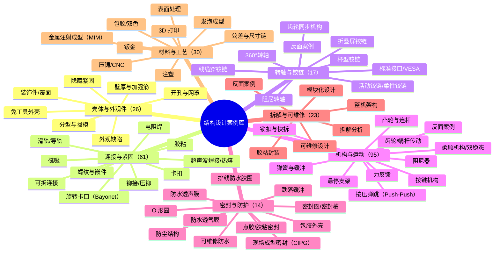

# 结构设计案例库 · 首页

> 产品与机械结构设计案例库：外壳、卡扣、连接件、转轴铰链、锁扣与按压弹跳机构、防水密封、拆解结构……每 2 天更新一次（单日 9:00 左右）。

**快速入口**：[[收集计划]] · [[案例模板]] · [[收集日志]] · [[案例地图.canvas|🗺️ 案例地图]] · [[README]]

## 📊 统计

- 案例总数：**266**　|　平均评分：**4.4 / 5**　|　最近更新：2026-11-27（第 12 次收集 · 主题 12 钣金与压铸，+20）
- 来源平台（按主来源）：厂商技术文章 156、iFixit 33、B站 5、其他 51、Wikipedia 4、Google Patents 17
- 中文来源：主来源中文 149/266（56%）；本轮主来源中文 16/20（80%）。累计按上一轮首页口径 133/246 加上本轮 16 篇中文主来源，未对历史 246 篇重新逐条改判。
- 难度分布：高级 16、入门 75、进阶 175
- 每案平均来源数：3.2（按 YAML 来源链接+补充来源，不等同独立机构数）

| 一级分类 | 案例数 | 占比 |
| --- | --- | --- |
| [[01-壳体与外观件 索引|01-壳体与外观件]] | 26 | ▇▇▇▇▇▇▇▇▇▇▇▇▇▇▇▇▇▇▇▇▇▇▇▇▇▇ |
| [[02-连接与紧固 索引|02-连接与紧固]] | 61 | ▇▇▇▇▇▇▇▇▇▇▇▇▇▇▇▇▇▇▇▇▇▇▇▇▇▇▇▇▇▇▇▇▇▇▇▇▇▇▇▇▇▇▇▇▇▇▇▇▇▇▇▇▇▇▇▇▇▇▇▇▇ |
| [[03-转轴与铰链 索引|03-转轴与铰链]] | 17 | ▇▇▇▇▇▇▇▇▇▇▇▇▇▇▇▇▇ |
| [[04-机构与运动 索引|04-机构与运动]] | 95 | ▇▇▇▇▇▇▇▇▇▇▇▇▇▇▇▇▇▇▇▇▇▇▇▇▇▇▇▇▇▇▇▇▇▇▇▇▇▇▇▇▇▇▇▇▇▇▇▇▇▇▇▇▇▇▇▇▇▇▇▇▇▇▇▇▇▇▇▇▇▇▇▇▇▇▇▇▇▇▇▇▇▇▇▇▇▇▇▇▇▇▇▇▇▇▇ |
| [[05-密封与防护 索引|05-密封与防护]] | 14 | ▇▇▇▇▇▇▇▇▇▇▇▇▇▇ |
| [[06-拆解与可维修 索引|06-拆解与可维修]] | 23 | ▇▇▇▇▇▇▇▇▇▇▇▇▇▇▇▇▇▇▇▇▇▇▇ |
| [[07-材料与工艺 索引|07-材料与工艺]] | 30 | ▇▇▇▇▇▇▇▇▇▇▇▇▇▇▇▇▇▇▇▇▇▇▇▇▇▇▇▇▇▇ |


动态统计（Dataview）：

```dataview
TABLE WITHOUT ID key AS 分类, length(rows) AS 案例数, round(sum(rows.评分)/length(rows),1) AS 平均评分
FROM -"00-说明"
WHERE 一级分类 AND 来源链接
GROUP BY 一级分类
SORT key ASC
```

## 🧭 分类图



## ✨ 最新收录（Dataview）

```dataview
TABLE WITHOUT ID file.link AS 案例, 一级分类 AS 分类, 应用产品, 难度, 评分, 来源平台 AS 平台, 收录日期
FROM -"00-说明"
WHERE 一级分类 AND 来源链接
SORT 收录日期 DESC, 评分 DESC
LIMIT 20
```

## ⭐ 高分案例（评分 ≥ 4，Dataview）

```dataview
LIST 一级分类 + " · " + 评分 + "★"
FROM -"00-说明"
WHERE 评分 >= 4 AND 来源链接
SORT 评分 DESC
```

## 🖼️ 卡片视图（Dataview JS，可选）

```dataviewjs
const pages = dv.pages('-"00-说明"').where(p => p.一级分类 && p.来源链接).sort(p => p.收录日期, 'desc');
for (const p of pages) {
  dv.paragraph(`${p.封面图 ? '![[' + p.封面图 + '|240]]  \n' : ''}**${p.file.link}** · ${p.一级分类} · ${'★'.repeat(p.评分)}`);
}
```

## 📋 全部案例（静态备用表，不依赖插件）

| # | 案例 | 一级分类 | 二级分类 | 应用产品 | 难度 | 评分 | 平台 |
| --- | --- | --- | --- | --- | --- | --- | --- |
| 1 | [[PS5 免工具侧板与 DualSense 隐藏螺丝]] | 01-壳体与外观件 | 免工具外壳、隐藏紧固 | 游戏主机、游戏手柄 | 入门 | ★★★★ | [iFixit](https://www.ifixit.com/Teardown/PlayStation+5+Teardown/138280) |
| 2 | [[咬花（晒纹）与拔模角：每 0.025 mm 纹深加 1°]] | 01-壳体与外观件 | 分型与拔模、装饰件/覆面 | 注塑外观件（小家电面板、对讲机外壳等）、咬花/晒纹侧壁 | 入门 | ★★★★ | [厂商技术文章](https://www.hezidesign.com/gongyi/1228.html) |
| 3 | [[塑料件加强筋设计：厚度、高度与间距比例]] | 01-壳体与外观件 | 壁厚与加强筋 | 注塑外壳、箱体/盒体、螺丝柱 | 入门 | ★★★ | [B站](https://www.bilibili.com/read/cv14903048) |
| 4 | [[塑料外壳止口与扣位：间隙参数与三个翻车案例]] | 01-壳体与外观件 | 分型与拔模、隐藏紧固 | 手持类电子产品外壳、前后壳/面底壳塑料件 | 进阶 | ★★★★ | [厂商技术文章](https://www.hezidesign.com/gongyi/963.html) |
| 5 | [[注塑熔接痕：位置由浇口定、深浅由前锋温差定]] | 01-壳体与外观件 | 外观缺陷 | 带孔/槽的塑料外壳（接口面板、显示仪外壳）、高光免喷涂件、透明灯罩 | 入门 | ★★★★ | [厂商技术文章](https://www.hezidesign.com/gongyi/1278.html) |
| 6 | [[注塑缩痕：厚壁背面凹陷、减胶坑与保压边界]] | 01-壳体与外观件 | 外观缺陷、注塑 | 消费电子外壳、家电面板、带筋和螺丝柱的外观件 | 进阶 | ★★★★ | [厂商技术文章](https://www.hezidesign.com/gongyi/653.html) |
| 7 | [[注塑螺丝柱（Boss 柱）：壁厚比 0.6 分水岭与自攻底孔公式]] | 01-壳体与外观件 | 壁厚与加强筋、隐藏紧固 | 塑料外壳（手持设备、机器人外壳等）、自攻螺丝连接的前后壳 | 入门 | ★★★★ | [厂商技术文章](https://www.hezidesign.com/gongyi/1282.html) |
| 8 | [[3D 打印件热熔铜螺母：孔径与拉拔力实测]] | 02-连接与紧固 | 螺纹与嵌件 | 3D 打印功能件、打印机/治具结构件 | 入门 | ★★★★★ | [厂商技术文章](https://www.cnckitchen.com/blog/are-our-heat-set-insert-datasheets-wrong) |
| 9 | [[任天堂 Switch 2 Joy-Con 2 磁吸连接]] | 02-连接与紧固 | 磁吸、可拆连接 | 游戏机手柄、手柄握把 | 进阶 | ★★★★ | [iFixit](https://www.ifixit.com/Device/Nintendo_Switch_2_Joy-Con_2_Grip) |
| 10 | [[任天堂 Switch Joy-Con 滑轨连接]] | 02-连接与紧固 | 滑轨/导轨、可拆连接 | 游戏机手柄 | 入门 | ★★★★ | [iFixit](https://www.ifixit.com/Teardown/Nintendo+Switch+Teardown/78263) |
| 11 | [[卡扣三种基本形式：悬臂、环形、扭转]] | 02-连接与紧固 | 卡扣 | 电池盖、笔帽、瓶盖、通用塑料件 | 入门 | ★★★ | [Wikipedia](https://en.wikipedia.org/wiki/Snap-fit) |
| 12 | [[塑料件超声波焊接：导熔线、焊筋与溢胶槽]] | 02-连接与紧固 | 超声波焊接/热熔 | 消费电子上下壳、TWS 充电仓、需密封且不拆的塑料组件 | 进阶 | ★★★★★ | [厂商技术文章](https://www.hezidesign.com/gongyi/1043.html) |
| 13 | [[微软 Surface Laptop 超声波点焊与 Alcantara 覆面（反面案例）]] | 02-连接与紧固 | 超声波焊接/热熔、胶粘 | 笔记本电脑 | 进阶 | ★★★ | [iFixit](https://www.ifixit.com/Teardown/Microsoft+Surface+Laptop+Teardown/92915) |
| 14 | [[热铆（热熔柱）：铆柱高度按体积守恒算，蘑菇头直径 2d]] | 02-连接与紧固 | 超声波焊接/热熔、铆接/压铆 | PCB/钣金/薄膜固定到塑料壳、汽车内饰（遮阳板、门板）、光伏接线盒 | 入门 | ★★★★ | [厂商技术文章](https://thermalpress.com/thermal-staking-probe-tip-design-guide/) |
| 15 | [[苹果 AirTag 旋转后盖与内部卡扣]] | 02-连接与紧固 | 旋转卡口(Bayonet)、卡扣 | 防丢器 | 入门 | ★★★ | [iFixit](https://www.ifixit.com/Teardown/Apple+Air+Tag+Teardown/218935) |
| 16 | [[钣金压铆螺母（PEM S/CLS）：孔径、最小板厚、边距与板材硬度上限]] | 02-连接与紧固 | 铆接/压铆、螺纹与嵌件 | 机箱机柜、储能箱体、电子设备钣金支架 | 入门 | ★★★★★ | [厂商技术文章](https://www.pemnet.com/wp-content/uploads/sites/9/2022/06/cldata.pdf) |
| 17 | [[VESA MIS-D 75-100 接口与倾角摩擦关节]] | 03-转轴与铰链 | 阻尼转轴、标准接口 | 电脑显示器与小型电视的支架头部、桌夹/壁挂/横臂类显示器支架 | 入门 | ★★★★ | [厂商技术文章](https://www.ergotron.com/en-us/support/vesa-standard) |
| 18 | [[iMac 27 英寸铰链弹簧塑料帽失效（反面案例）]] | 03-转轴与铰链 | 阻尼转轴、反面案例 | 27 英寸 iMac（2012 起使用该铰链的机型，如 EMC 2639） | 进阶 | ★★★★ | [iFixit](https://www.ifixit.com/Guide/iMac+Intel+27-Inch+EMC+2639+Hinge+spring+caps+Replacement/134707) |
| 19 | [[iPad Magic Keyboard 双铰链悬浮支架与配重]] | 03-转轴与铰链 | 阻尼转轴、弹簧与缓冲 | iPad Pro Magic Keyboard（2020 起，11 英寸与 12 | 进阶 | ★★★★★ | [iFixit](https://www.ifixit.com/News/41291/dang-the-ipad-pro-magic-keyboard-looks-cool-in-x-rays) |
| 20 | [[三星 Galaxy Fold 一代铰链与屏幕支撑结构]] | 03-转轴与铰链 | 折叠屏铰链、齿轮同步机构 | 折叠屏手机 | 高级 | ★★★★★ | [iFixit](https://www.ifixit.com/Teardown/Samsung+Galaxy+Fold+Teardown/122600) |
| 21 | [[三星 Galaxy Z Flip 铰链与尼龙防尘刷]] | 03-转轴与铰链 | 折叠屏铰链、齿轮同步机构 | 折叠屏手机 | 高级 | ★★★★ | [iFixit](https://www.ifixit.com/Teardown/Samsung+Galaxy+Z+Flip+Teardown/131002) |
| 22 | [[微软 Surface Book 动态支点铰链（分段铝铰链）]] | 03-转轴与铰链 | 阻尼转轴、线缆穿铰链 | 二合一笔记本（屏幕可拆） | 进阶 | ★★★★ | [iFixit](https://www.ifixit.com/Teardown/Microsoft+Surface+Book+Teardown/51972) |
| 23 | [[微软 Surface Duo 360° 双铰链]] | 03-转轴与铰链 | 360°转轴、线缆穿铰链 | 双屏手机 | 进阶 | ★★★★ | [iFixit](https://www.ifixit.com/Teardown/Microsoft+Surface+Duo+Teardown/136576) |
| 24 | [[微软 Surface Pro Kickstand 宽角摩擦铰链]] | 03-转轴与铰链 | 阻尼转轴、摩擦铰链 | Surface Pro 二合一平板（Pro 3 起的连续角度撑脚） | 进阶 | ★★★★ | [iFixit](https://www.ifixit.com/Teardown/Microsoft+Surface+Pro+4+Teardown/51568) |
| 25 | [[恒扭力摩擦铰链：卡簧过盈产生扭力与「最低扭力 > 盖板力矩」选型]] | 03-转轴与铰链 | 阻尼转轴 | 笔记本屏幕、显示器支架、设备翻盖与检修门、医疗与车内饰翻板 | 进阶 | ★★★★ | [厂商技术文章](https://reell.com/hubfs/Product-Images/TI-C5M/ti-c5m_application_and_installation_guide_02-28-20_0.pdf) |
| 26 | [[活动铰链（Living Hinge）：一体成型的柔性铰链]] | 03-转轴与铰链 | 活动铰链/柔性铰链 | 瓶盖、Tic Tac 糖盒、药盒、激光切割木盒 | 入门 | ★★★ | [Wikipedia](https://en.wikipedia.org/wiki/Living_hinge) |
| 27 | [[苹果 MacBook Pro 2016 Flexgate（反面案例）：绕板的屏幕排线与 2018 年加长 2 mm]] | 03-转轴与铰链 | 线缆穿铰链、反面案例 | MacBook Pro 13/15 英寸（2016，Touch Bar 世代）、 | 进阶 | ★★★★ | [iFixit](https://www.ifixit.com/News/12903/flexgate) |
| 28 | [[16 英寸 MacBook Pro 剪刀脚键盘：1 mm 键程与交叉支架（对照蝶式）]] | 04-机构与运动 | 按键机构 | 16 英寸 MacBook Pro（2019，A2141）、对照：桌面 Magi | 进阶 | ★★★★★ | [iFixit](https://www.ifixit.com/Teardown/MacBook+Pro+16-Inch+2019+Teardown/128106) |
| 29 | [[DualSense 自适应扳机：电机+蜗杆的力反馈机构]] | 04-机构与运动 | 齿轮/蜗杆传动、力反馈 | 游戏手柄 | 进阶 | ★★★★★ | [iFixit](https://www.ifixit.com/Teardown/PlayStation+5+Teardown/138280) |
| 30 | [[Ergotron CF 恒力螺旋弹簧支架（对比气弹簧）]] | 04-机构与运动 | 弹簧与缓冲、悬停支架 | 桌面显示器支架（爱格升 / Ergotron CF 系列，如 45-241-02 | 进阶 | ★★★★ | [厂商技术文章](https://www.ergotron.com/en-us/company/cf-technology) |
| 31 | [[Mac Pro 2019 旋转把手外壳锁与免工具模块锁]] | 04-机构与运动 | 锁扣与快拆 | 塔式工作站 | 进阶 | ★★★★ | [iFixit](https://www.ifixit.com/Teardown/Mac+Pro+2019+Teardown/128922) |
| 32 | [[微软 Surface Book 形状记忆合金（肌肉线）电控分离锁]] | 04-机构与运动 | 锁扣与快拆、弹簧与缓冲 | 二合一笔记本（屏幕可拆）、可分离式键盘底座 | 高级 | ★★★★★ | [iFixit](https://www.ifixit.com/Teardown/Microsoft+Surface+Book+Teardown/51972) |
| 33 | [[按动圆珠笔：旋转凸轮的按压伸缩机构]] | 04-机构与运动 | 凸轮与连杆、按压弹跳(Push-Push)、弹簧与缓冲 | 按动圆珠笔（Parker Jotter） | 进阶 | ★★★ | [其他](https://penvibe.com/how-pens-work/) |
| 34 | [[旋转阻尼器（缓降盖板）：硅油黏性、水平型与垂直型的扭矩曲线]] | 04-机构与运动 | 弹簧与缓冲、阻尼器 | 马桶盖缓降、垃圾桶盖、钢琴盖、车内杯架与扶手盖、抽油烟机与自动售货机翻板 | 进阶 | ★★★★ | [厂商技术文章](https://rotarydamper-tok-inc.com/wp-content/uploads/2025/07/Catalog_RotaryDampers.pdf) |
| 35 | [[显示器气弹簧支架：张力螺丝与悬停平衡]] | 04-机构与运动 | 弹簧与缓冲、悬停支架 | 桌面显示器支架（乐歌 D7A 等气弹簧臂） | 入门 | ★★★★ | [其他](http://www.jiguo.com/article/article/38193.html) |
| 36 | [[气弹簧内部结构：活塞阻尼孔与氮气预压]] | 04-机构与运动 | 弹簧与缓冲 | 气弹簧/气撑元件（盖板、舱门、座椅等的力源；本篇不写整机支架） | 进阶 | ★★★★★ | [厂商技术文章](https://web.archive.org/web/2024/https://camloc.com/wp-content/uploads/Technical-Guide-Edition-1.2-Gas-Spring-Overview.pdf) |
| 37 | [[苹果蝶式键盘（反面案例）：变薄 40% 的代价与硅胶防尘膜补救]] | 04-机构与运动 | 按键机构、反面案例 | 12 英寸 MacBook（2015）、MacBook Pro 13 英寸 To | 进阶 | ★★★★ | [iFixit](https://www.ifixit.com/Teardown/MacBook+Pro+13-Inch+Touch+Bar+2018+Keyboard+Teardown/111509) |
| 38 | [[防变形静音 Push-Push 按压弹跳锁（ITW 专利 EP1596030）]] | 04-机构与运动 | 按压弹跳(Push-Push)、锁扣与快拆、柔顺机构/双稳态 | 汽车杯托/手套箱/储物盒、电子设备仓门 | 高级 | ★★★★★ | [Google Patents](https://patents.google.com/patent/EP1596030A2/en) |
| 39 | [[GORE 防水透气膜：压力平衡与粘贴式透气阀的安装参数]] | 05-密封与防护 | 防水透气膜、点胶/胶粘密封 | 户外电子设备外壳、灯具/安防摄像头/通信设备、手机喇叭与麦克风孔（同原理） | 入门 | ★★★★★ | [厂商技术文章](https://kr.gore.com/sites/default/files/2017-08/GORE_PTV_AdhesiveVents_EN_WEB.pdf) |
| 40 | [[Garmin fēnix 7X 可复用橡胶密封圈]] | 05-密封与防护 | 密封圈/密封槽、可维修防水 | 运动手表 | 入门 | ★★★★ | [iFixit](https://www.ifixit.com/Teardown/Garmin+f%C4%93nix+7X+Teardown/156672) |
| 41 | [[GoPro Hero4 Session 免外壳防水机身]] | 05-密封与防护 | O 形圈、包胶外壳、点胶/胶粘密封 | 运动相机 | 进阶 | ★★★★ | [iFixit](https://www.ifixit.com/Teardown/GoPro+Hero4+Session+Teardown/44307) |
| 42 | [[O 形圈密封槽设计：填充率、压缩率与挤出间隙的五个数]] | 05-密封与防护 | O 形圈、密封圈/密封槽 | 电子产品防水外壳、液压/气动元件、法兰端盖、活塞与活塞杆 | 进阶 | ★★★★★ | [B站](https://www.bilibili.com/read/cv53610609) |
| 43 | [[TPU 包胶气囊角：拐角外凸空腔缓冲跌落冲击]] | 05-密封与防护 | 跌落缓冲、包胶外壳 | 手机/平板保护壳、电子产品包胶边框 | 进阶 | ★★★ | [Google Patents](https://patents.google.com/patent/CN204707366U/zh) |
| 44 | [[三星 Galaxy Z Fold3 折叠屏防水结构]] | 05-密封与防护 | 现场成型密封(CIPG)、排线防水胶圈 | 折叠屏手机 | 高级 | ★★★★★ | [iFixit](https://www.ifixit.com/News/52399/galaxy-z-flip-fold-3-small-changes-make-a-big-difference) |
| 45 | [[三防手机整机防水结构：上下壳胶圈、电池盖、按键与开孔的参数清单]] | 05-密封与防护 | 密封圈/密封槽、O 形圈、防水透气膜、点胶/胶粘密封、包胶外壳 | 三防手机、户外手持终端、对讲机/手持仪表 | 进阶 | ★★★★★ | [B站](https://www.bilibili.com/read/cv14365267) |
| 46 | [[喇叭防尘网与防水透声膜叠层：声学孔与结构孔不要混用]] | 05-密封与防护 | 防尘结构、防水透声膜 | 麦克风/扬声器开孔、对讲机与安防摄像头、智能头盔通话孔 | 进阶 | ★★★★★ | [厂商技术文章](https://www.shenzhensandeli.com/news/a-mvxki81rxuh.html) |
| 47 | [[安全帽 EPS 与 EPP 缓冲内衬：珠粒模压与硬壳堆叠]] | 05-密封与防护 | 跌落缓冲 | 自行车/电动车头盔、儿童头盔内衬、需反复冲击或一次性吸能的头戴防护 | 进阶 | ★★★★ | [厂商技术文章](https://www.hezidesign.com/gongyi/833.html) |
| 48 | [[苹果 iPhone 7 首代 IP67：逐个开口封堵与气压平衡阀]] | 05-密封与防护 | 点胶/胶粘密封、密封圈/密封槽、防水透气膜、防尘结构 | 智能手机 | 进阶 | ★★★★ | [iFixit](https://www.ifixit.com/Teardown/iPhone+7+Teardown/67382) |
| 49 | [[跌落测试结构加固：六面四角、外圆角与局部 TPU 缓冲]] | 05-密封与防护 | 跌落缓冲、外壳加固 | 消费电子整机、运动相机、小家电外壳 | 进阶 | ★★★★ | [厂商技术文章](https://www.hezidesign.com/jingyan/1050.html) |
| 50 | [[Fairphone 5 卡扣后盖与免胶可换电池]] | 06-拆解与可维修 | 可维修设计、模块化设计 | 智能手机 | 入门 | ★★★★ | [iFixit](https://www.ifixit.com/Guide/Fairphone+5+Battery+Replacement/168819) |
| 51 | [[Fairphone 6 螺丝模块化（屏、电池、摄像头、USB-C）]] | 06-拆解与可维修 | 可维修设计、模块化设计 | Fairphone 6 / The Fairphone (Gen. 6) | 入门 | ★★★★★ | [iFixit](https://www.ifixit.com/News/111613/fairphone-6-teardown-proof-phones-dont-have-to-be-disposable) |
| 52 | [[Framework Desktop 免工具面板与标准件模块化]] | 06-拆解与可维修 | 模块化设计、整机架构 | Framework Desktop（AMD Ryzen AI Max / Str | 入门 | ★★★★ | [iFixit](https://www.ifixit.com/News/108396/framework-let-us-in-for-an-early-teardown-of-the-refreshingly-open-framework-desktop) |
| 53 | [[Framework Laptop 16 Expansion Bay 滑出式显卡模块]] | 06-拆解与可维修 | 模块化设计、可维修设计 | Framework Laptop 16（含 AMD Ryzen AI 300 系 | 入门 | ★★★★ | [iFixit](https://www.ifixit.com/Guide/How+to+Replace+an+Expansion+Bay+Module+in+your+Framework+Laptop+16/195629) |
| 54 | [[Framework 笔记本模块化扩展卡与磁吸边框]] | 06-拆解与可维修 | 模块化设计、可维修设计 | 笔记本电脑 | 入门 | ★★★★★ | [iFixit](https://www.ifixit.com/News/51614/framework-laptop-teardown-10-10-but-is-it-perfect) |
| 55 | [[Valve Steam Deck OLED 可维修改版：金属螺纹柱、T6 Torx 与电池撬卡槽]] | 06-拆解与可维修 | 可维修设计、胶粘封装 | Valve Steam Deck OLED（型号 1030，2023-11）、对 | 进阶 | ★★★★★ | [iFixit](https://www.ifixit.com/News/86954/handheld-head-to-head-steam-deck-oled-v-legion-go) |
| 56 | [[苹果 AirPods Pro 全胶粘封装（反面案例）]] | 06-拆解与可维修 | 反面案例、胶粘封装 | 真无线耳机 | 进阶 | ★★★★ | [iFixit](https://www.ifixit.com/Teardown/AirPods+Pro+Teardown/127551) |
| 57 | [[苹果 iPhone 14 双面可开：中框承力与前后两道密封]] | 06-拆解与可维修 | 可维修设计、整机架构 | 苹果 iPhone 14（A2882） | 进阶 | ★★★★★ | [iFixit](https://www.ifixit.com/News/64865/iphone-14-teardown) |
| 58 | [[苹果 iPhone 16 电解脱粘电池胶]] | 06-拆解与可维修 | 可维修设计、胶粘封装 | 智能手机（iPhone 16 / 16 Plus） | 进阶 | ★★★★★ | [iFixit](https://www.ifixit.com/News/100352/we-hot-wired-the-iphone-16) |
| 59 | [[FDM 一体打印活动件（Print-in-Place）：XY 每边 0.3 mm、Z 两整层的间隙规则]] | 07-材料与工艺 | 3D 打印 | 一体打印铰链、可动关节玩具（关节龙、剪刀）、打印轴承与链条 | 入门 | ★★★★ | [厂商技术文章](https://qidi3d.com/blogs/news/how-to-3d-print-interlocking-parts-and-assemblies) |
| 60 | [[免喷涂材料 vs 喷涂：成本、良率与三条硬边界]] | 07-材料与工艺 | 表面处理、注塑 | 家电外壳（空调面板、吸尘器壳）、卫浴配件、小家电与办公产品外壳 | 进阶 | ★★★★ | [厂商技术文章](https://www.hezidesign.com/gongyi/1268.html) |
| 61 | [[双色注塑：硬胶先射、软胶后射的结构拆件规则]] | 07-材料与工艺 | 包胶/双色、注塑 | 牙刷、杯子、软硬胶结合外壳 | 进阶 | ★★★ | [B站](https://www.bilibili.com/read/cv12125226) |
| 62 | [[发泡件缩水：模温、排气与保压和实心件相反]] | 07-材料与工艺 | 注塑、发泡成型 | 微发泡壳体、电池包下壳、厚壁发泡结构件 | 进阶 | ★★★★ | [厂商技术文章](https://www.hezidesign.com/gongyi/1221.html) |
| 63 | [[换料收缩率：同一张图换料就裂，图纸必须按新缩水放缩]] | 07-材料与工艺 | 公差与尺寸链、注塑 | 注塑外壳与中框、有止口、卡扣、柱距配合的结构件 | 进阶 | ★★★★★ | [厂商技术文章](https://www.hezidesign.com/gongyi/1260.html) |
| 64 | [[气体辅助注塑（GAIM）：用气道掏空厚筋消缩痕]] | 07-材料与工艺 | 注塑 | 把手类厚壁件、平板/面板/电器外壳、带粗加强筋的外观件 | 高级 | ★★★★★ | [其他](https://www.injectionmoldingdivision.org/2021/06/29/ten-part-design-rules-for-gas-assisted-injection-molding-process/) |
| 65 | [[注塑倒扣脱模：强脱、斜顶还是滑块]] | 07-材料与工艺 | 注塑 | 带卡扣/倒扣的注塑件、瓶盖、塑料外壳 | 进阶 | ★★★★ | [厂商技术文章](https://weiyadakeji.com/xwdt/changjianwenti/1414.html) |
| 66 | [[特斯拉 Giga Press 一体化压铸车身件]] | 07-材料与工艺 | 压铸/CNC | 电动车车身（Model Y 后/前车身、Cybertruck）、5G 基站屏蔽罩 | 高级 | ★★★ | [Wikipedia](https://en.wikipedia.org/wiki/Giga_Press) |
| 67 | [[荣耀金属 3D 打印免组装转轴专利：连接余料与垂直打印方向的切割面]] | 07-材料与工艺 | 3D 打印 | 折叠屏手机转轴（荣耀专利 CN121952969A） | 高级 | ★★★★ | [Google Patents](https://patents.google.com/patent/CN121952969A/zh) |
| 68 | [[金属注射成型（MIM）：均匀壁厚、烧结支撑面与 5000 件成本拐点]] | 07-材料与工艺 | 金属注射成型（MIM） | 五金小件（单重几克到几十克）、长条形支架件、转轴零件（折叠屏铰链常用 MIM，见 | 进阶 | ★★★★ | [厂商技术文章](https://www.hezidesign.com/gongyi/1253.html) |
| 69 | [[钣金折弯件设计规则：最小弯曲半径与预留切口]] | 07-材料与工艺 | 钣金 | 钣金机箱/侧板、空调室外机侧板、支架 | 入门 | ★★★ | [B站](https://www.bilibili.com/read/cv10590863) |
| 70 | [[铝件阳极氧化的尺寸链：膜厚一半向外、遮蔽螺纹与挂点]] | 07-材料与工艺 | 表面处理、公差与尺寸链 | CNC 铝合金结构件、轴承座/摇臂类精密件、带导电接地面的铝外壳 | 进阶 | ★★★★★ | [厂商技术文章](https://www.zdpmt.com/zh/resources/anodizing-dimension-control-before-after-finishing/) |
| 71 | [[EMI 蜂窝波导通风板：孔径、深度与截止频率]] | 01-壳体与外观件 | 开孔与网罩 | 需要 EMC 的电子设备机箱通风口、屏蔽室 / 消声室 / 军用电子设备通风（来源列举的应用） | 高级 | ★★★★★ | [厂商技术文章](https://jhcss.com.au/static/uploads/files/parker-chomerics-vent-application-and-design-guide-tb-1200-en-wfiqyffmxqrc.pdf) |
| 72 | [[外壳散热通风口与防雨百叶：开孔率、进出风与滴水路径]] | 01-壳体与外观件 | 开孔与网罩 | 工控铝壳与户外机柜、充电桩、通信与电源外壳、带防雨百叶或疏水槽的产品外壳 | 进阶 | ★★★★ | [厂商技术文章](https://www.yonggubox.com/cn/new/new-97-605.html) |
| 73 | [[注塑喇叭网罩：开孔率、孔径孔距与脱模]] | 01-壳体与外观件 | 开孔与网罩 | 智能音箱与消费电子喇叭网、笔记本与家电出音孔网罩、车用扬声器罩（注塑工艺对照） | 进阶 | ★★★★ | [厂商技术文章](https://solidvents.com/guides/speaker-grille-design) |
| 74 | [[Arca-Swiss 38 mm 燕尾快装板：事实标准与跨品牌混用风险]] | 02-连接与紧固 | 锁扣与快拆、可拆连接 | 相机快装板与云台夹钳、大画幅导轨与球台快装 | 进阶 | ★★★★★ | [其他](https://www.optaxis.app/marketing/articles/arca-dovetail-app-zh.html) |
| 75 | [[Pogo Pin 弹簧顶针：针头、弹簧与针管的工作行程和弹力]] | 02-连接与紧固 | 可拆连接 | 穿戴与消费电子充电触点、板对板弹性互连、工业充电底座与磁吸对接 | 进阶 | ★★★★★ | [厂商技术文章](https://smeconn.com/tw/pogo-pin-specifications/) |
| 76 | [[Sony E 卡口：三爪、18 mm 法兰距与锁销磨损]] | 02-连接与紧固 | 旋转卡口(Bayonet)、可拆连接 | 无反可换镜头相机（Sony E / FE）、可换镜头与转接环 | 进阶 | ★★★★ | [Wikipedia](https://en.wikipedia.org/wiki/Bayonet_mount) |
| 77 | [[Southco、DZUS 四分之一转快锁：90° 凸轮与按总材料厚度选钉长]] | 02-连接与紧固 | 可拆连接 | 需频繁打开的面板、舱盖、赛车与航空检修口盖 | 进阶 | ★★★★★ | [厂商技术文章](https://media.southco.com/media/static/documents/brochures/201808-BR-Quick-Access-Fasteners_EN.pdf) |
| 78 | [[电缆防水格兰头：PG 螺纹、夹紧爪与密封圈]] | 02-连接与紧固 | 可拆连接 | 电气柜与仪器外壳电缆入口、户外箱体、工控与照明设备进线 | 入门 | ★★★★★ | [厂商技术文章](https://www.elit.ee/docs/legrand/ex218001_316.pdf) |
| 79 | [[Blum TIP-ON 按压弹开抽屉：柜体轨弹簧单元与抽屉锁止模块]] | 04-机构与运动 | 按压弹跳(Push-Push)、锁扣与快拆 | 无拉手抽屉 / TANDEMBOX 金属抽屉、无拉手柜门与上翻门（同系列，结构另论） | 进阶 | ★★★★★ | [厂商技术文章](https://www.demos24plus.com/content/wysiwyg/cz/Dokumenty/Katalogy/Katalogy_dodavatelu_CS/Blum/BLUM_navod_Tandembox_Tip_On.pdf) |
| 80 | [[Cherry MX 机械键盘轴：轴心、螺旋弹簧与金交叉触点]] | 04-机构与运动 | 按键机构 | 机械键盘（独立轴体） | 进阶 | ★★★★★ | [厂商技术文章](https://www.cherry.de/en-us/product/mx2a-red) |
| 81 | [[FIDLOCK V-BUCKLE：磁吸引导到位后再由机械扣锁死]] | 04-机构与运动 | 锁扣与快拆、磁吸 | 婴儿背带、背包、鞋履、织带系统上的磁吸机械扣 | 进阶 | ★★★★ | [厂商技术文章](https://www.fidlock.com/components/en/v-buckle) |
| 82 | [[GoPro 快拆卡扣与指旋螺母：两爪弹性卡入和螺钉夹紧是两套锁]] | 04-机构与运动 | 锁扣与快拆 | GoPro 及兼容运动相机的快拆安装系统 | 入门 | ★★★★ | [其他](https://actioncameras.tech/gopro-thumb-screw/) |
| 83 | [[Nifco 经典心形槽 Push-Push：U 形销与片簧（对照 ITW 防变形版）]] | 04-机构与运动 | 按压弹跳(Push-Push)、锁扣与快拆、柔顺机构/双稳态 | 柜门/舱门按压弹跳锁、汽车杯托与储物盒（同类机构） | 进阶 | ★★★★ | [Google Patents](https://patentimages.storage.googleapis.com/pdfs/US4660871.pdf) |
| 84 | [[SD 与 microSD 推推式卡座：心形槽滑块与卡片当撞销]] | 04-机构与运动 | 按压弹跳(Push-Push) | microSD / SD 卡座、microSD + SIM 二合一连接器 | 进阶 | ★★★★★ | [厂商技术文章](https://www.moarconn.cn/blog/b7647) |
| 85 | [[侧向释放插扣（ITW SR 1）：双弹性卡臂、母座侧窗与中间翼]] | 04-机构与运动 | 锁扣与快拆 | 背包、织带、服装与装备上的侧释插扣 | 入门 | ★★★★ | [厂商技术文章](https://global.itwnexus.com/content/sr-1) |
| 86 | [[电动工具电池包：滑轨插入与按压锁舌（得伟拆解）]] | 04-机构与运动 | 锁扣与快拆 | 手持电动工具可换电池包（得伟 20V 平台拆解例） | 进阶 | ★★★★ | [其他](https://www.chongdiantou.com/archives/372241.html) |
| 87 | [[硅胶导电按键：斜壁荷重、碳粒与排气槽]] | 04-机构与运动 | 按键机构 | 遥控器与计算器、工业仪器按键、可配锅仔片的超薄/穿戴按键 | 入门 | ★★★★★ | [厂商技术文章](https://cn.fromrubber.com/oid1753628/pages.htm) |
| 88 | [[薄膜开关叠层：面板、间隔层、电路层与开窗排气]] | 04-机构与运动 | 按键机构 | 仪器与工业控制面板、医疗与家电人机界面、可加金属弹片的触感薄膜开关 | 进阶 | ★★★★ | [厂商技术文章](https://szjasper.com/products/membrane-switches/tactile-membrane-switches.html) |
| 89 | [[金属锅仔片阵列：直径、力值、行程与寿命互换]] | 04-机构与运动 | 按键机构、柔顺机构/双稳态 | 消费电子按键与遥控器、薄膜开关 / 仪器面板、医疗与工业控制 | 进阶 | ★★★★★ | [厂商技术文章](https://www.hannovermesse.de/apollo/hannover_messe_2022/obs/Binary/A1170559/Snaptron-Design-Guide_v2.0.pdf) |
| 90 | [[鼠标微动开关（Omron D2FC）：杠杆、簧片翻转与触点]] | 04-机构与运动 | 按键机构 | 鼠标、轨迹球等需清脆点击的轻载按键 | 进阶 | ★★★★★ | [厂商技术文章](https://mm.digikey.com/Volume0/opasdata/d220001/medias/docus/5389/D2FC_Datasheet_EN.pdf) |

| 91 | [[EJOT Delta PT 塑料用三角齿自攻螺丝：底孔 0.8·d1、20° 牙侧角与应力释放沉孔]] | 02-连接与紧固 | 螺纹与嵌件 | 热塑性塑料壳体、汽车塑料组件、薄壁扁平结构件 | 进阶 | ★★★★★ | [厂商技术文章](https://assets.eu.ctfassets.net/0vp0u5uh75zd/3DLqM7Z9oEMiNjXOeKeL6V/cc666bc273211e5c3e0d6ddfc95f8ff6/F071_F085_Fastening_CN_12_2024.pdf) |
| 92 | [[预涂微胶囊螺纹胶与现场涂厌氧锁固剂（precote 与 Loctite 243）]] | 02-连接与紧固 | 螺纹与嵌件 | 汽车与电器螺纹紧固件、电机、变速箱、泵类螺栓、需要产线预涂的标准件 | 进阶 | ★★★★★ | [厂商技术文章](https://www.precote.com/cn/products/locking/precote-30/) |
| 93 | [[尼龙嵌件锁紧螺母（DIN 985 Nyloc）：预紧力矩、120°C 上限与安装方向]] | 02-连接与紧固 | 螺纹与嵌件 | 汽车与通用机械抗振连接、电器与设备外壳、低于 120°C 的振动工况 | 入门 | ★★★★★ | [厂商技术文章](https://www.aozhanfasteners.com/zh/news/a2-70-stainless-steel-nylock-nuts-how-they-work-din-985-limits-and-how-to-choose/) |
| 94 | [[全金属锁紧螺母（DIN 980）：三点变形与金属嵌片的预紧力矩防松]] | 02-连接与紧固 | 螺纹与嵌件 | 高温或频繁拆装的抗振连接、汽车、机械与能源设备、不宜使用尼龙嵌件的接头 | 进阶 | ★★★★ | [厂商技术文章](https://www.finesz.com/DIN980M.php) |
| 95 | [[钣金压铆螺钉（PEM FH 平头螺柱）：孔径、最小板厚、边距与板材硬度上限]] | 02-连接与紧固 | 铆接/压铆、螺纹与嵌件 | 机箱机柜、电子设备钣金支架、需要板上留下外螺纹杆的薄板装配 | 入门 | ★★★★★ | [厂商技术文章](https://www.pemnet.com/wp-content/uploads/sites/2/2022/06/fhdata.pdf) |
| 96 | [[拉铆螺母（铆螺母）：单面镦头、铆接范围与圆孔滚花及六角防转]] | 02-连接与紧固 | 铆接/压铆、螺纹与嵌件 | 钣金机柜与机箱、封闭型材与管料、只能单面操作的薄板螺纹连接 | 入门 | ★★★★★ | [厂商技术文章](https://www.myquicksample.cn/tech-article/tech-7.html) |
| 97 | [[钣金 U 型夹板螺母与卡式笼式螺母：板边夹持与方孔浮动螺纹]] | 02-连接与紧固 | 螺纹与嵌件、可拆连接 | 薄板边缘连接、19 英寸机柜与电器柜立柱、不希望永久破坏板孔的可拆螺纹 | 入门 | ★★★★ | [厂商技术文章](https://shzyhz.com/jczs/486.html) |
| 98 | [[钢丝螺套（Helicoil 与 STI 底孔）：菱形钢丝嵌件与专用底孔攻丝]] | 02-连接与紧固 | 螺纹与嵌件 | 铝合金、镁合金等软基体螺纹加强、滑牙螺纹孔修复、需要高耐久内螺纹的箱体与支架 | 进阶 | ★★★★★ | [厂商技术文章](https://www.boellhoff.com/cn-zh/产品/装配技术/helicoil螺纹嵌件安装/) |
| 99 | [[注塑模内预埋铜螺母：模具定位、溢胶风险与直纹及斜花滚花]] | 02-连接与紧固 | 螺纹与嵌件 | 注塑壳体与结构件、需要高拉拔力的塑料螺纹连接、不适合事后热熔的批量件 | 进阶 | ★★★★ | [厂商技术文章](https://www.evan.cn/news/detail/139) |
| 100 | [[抽芯铆钉（盲铆钉）：钉套、钉芯与断颈槽，开口型与封闭型]] | 02-连接与紧固 | 铆接/压铆 | 只能单面操作的薄板连接、机箱、灯具与户外壳体、振动或防水要求不同的钣金叠层 | 入门 | ★★★★★ | [厂商技术文章](https://www.rivet-china.com/cn/know/) |
| 101 | [[钣金压铆隔离柱（PEM SO）：孔径、最小板厚、柱长与板材硬度上限]] | 02-连接与紧固 | 铆接/压铆、螺纹与嵌件 | 电子设备钣金支架、机箱机柜、PCB 叠板固定 | 入门 | ★★★★★ | [厂商技术文章](https://www.pemnet.com/wp-content/uploads/sites/9/2023/10/sodata.pdf) |
| 102 | [[TAPTITE II 金属三角挤牙自攻螺丝：按啮合率选底孔]] | 02-连接与紧固 | 螺纹与嵌件 | 钢板连接、压铸铝/锌零件、钣金与结构件装配 | 进阶 | ★★★★★ | [厂商技术文章](https://taptite.com/assets/files/taptite-ii-compressed.pdf) |
| 103 | [[Nord-Lock 楔形防松垫圈：楔角大于螺纹升角的成对拉伸锁紧]] | 02-连接与紧固 | 螺纹与嵌件 | 振动环境螺栓连接、轨道与车辆、一般钢结构与不锈钢结构 | 进阶 | ★★★★★ | [厂商技术文章](https://www.nord-lock.com/nord-lock/original-wedge-locking-washers-product-information/) |
| 104 | [[储能焊螺柱（GB/T 902.3 PT/IT）：电容放电把焊接端熔到板面]] | 02-连接与紧固 | 螺纹与嵌件 | 薄板构件、钣金支架、汽车与电气壳体上的植焊螺钉 | 进阶 | ★★★★ | [其他](https://www.mechtool.cn/stdboltsandnuts/stdboltsandnuts_weldstudsforcapacitordischargewelding.html) |
| 105 | [[橡胶膨胀螺母（Well nut）：橡胶套筒胀紧孔壁兼隔振]] | 02-连接与紧固 | 螺纹与嵌件、可拆连接 | 薄板或封闭型材的盲孔连接、需隔振、降噪或隔离电化学腐蚀的面板、船舶与户外件 | 入门 | ★★★★ | [厂商技术文章](https://www.hansonrivet.com/threaded-inserts-2/rubber-nut-threaded-inserts/) |
| 106 | [[开口弹簧垫圈防松失效（反面案例）：压平后在横向振动中几乎无效]] | 02-连接与紧固 | 螺纹与嵌件 | 振动环境的螺栓连接（反面教材）、维修与既有图纸中仍常见的 GB/T 93 垫圈 | 进阶 | ★★★★★ | [其他](https://whole-spec.com/zh/design-tips/bolt-anti-loosening) |
| 107 | [[Spiralock 楔形底 30° 防松内螺纹：牙顶楔入斜面消除径向间隙]] | 02-连接与紧固 | 螺纹与嵌件 | 振动与冲击环境下的螺母或内螺纹孔、航空与汽车紧固、希望少加锁紧垫圈的接头 | 进阶 | ★★★★★ | [其他](https://www.tuolitai.cn/news/company-news/2786) |
| 108 | [[台阶螺丝（ISO 7379 塞打螺丝）：光杆定位、螺纹只锁紧]] | 02-连接与紧固 | 螺纹与嵌件 | 杠杆与连杆枢轴、模具剥料板导向（stripper bolt）、需要精密转动或滑动的支架 | 进阶 | ★★★★ | [其他](https://aimsindustrial.com.au/blogs/product-guides/shoulder-bolt-guide) |
| 109 | [[ALPS EC11 旋转编码器：11 mm 金属轴增量脉冲与可选按压开关]] | 04-机构与运动 | 按键机构 | 工业设备与转换器、白色家电、音响与车载导航 / HVAC 旋钮 | 进阶 | ★★★★ | [厂商技术文章](https://tech.alpsalpine.com/assets/catalog/product-catalog-ec-01.zh-hans.pdf) |
| 110 | [[Nano-SIM 针顶出托盘（Pin-eject）：外部顶针把客户自制托盘顶出]] | 04-机构与运动 | 锁扣与快拆 | 智能手机、平板电脑等便携通信设备 | 进阶 | ★★★★★ | [厂商技术文章](https://www.jae.com/zh_cn/releases/detail/id=1689) |
| 111 | [[手机侧键传力结构：键帽、软胶导电基与壳体间隙链]] | 04-机构与运动 | 按键机构 | 智能手机侧音量键 / 电源键 / 拍摄键 | 进阶 | ★★★★★ | [其他](https://www.abnotebook.com/a/14931) |

| 112 | [[长键卫星轴：双滑块与弯钢丝同步，偏心按压不再单端下沉]] | 04-机构与运动 | 按键机构 | 机械键盘空格、Shift、Enter | 进阶 | ★★★★ | [其他](https://www.zfrontier.com/app/flow/eVz5jvVvmBZR) |
| 113 | [[手柄十字键：中央半球支点与四向弹性触点的倾转选择]] | 04-机构与运动 | 按键机构 | Nintendo 四向十字键／NES维修对照 | 进阶 | ★★★★★ | [Google Patents](https://patents.google.com/patent/US4687200A/en) |
| 114 | [[拇指摇杆万向导向：正交转动框与中央弹簧回中]] | 04-机构与运动 | 按键机构 | Alps RKJXV／DualSense摇杆 | 进阶 | ★★★★★ | [厂商技术文章](https://tech.alpsalpine.com/c/products/faq/muiti-control-device/thumbpointer/) |
| 115 | [[鼠标分体主键预压：独立键板、金属枢轴与弹簧张紧]] | 04-机构与运动 | 按键机构 | Logitech G900金属枢轴；G305弹簧张紧对照 | 进阶 | ★★★★ | [其他](https://gamersnexus.net/news-pc/2365-logitech-g900-chaos-spectrum-engineering-interview) |
| 116 | [[手表防水推杆：套管导向、轴向回位与径向滑动密封]] | 05-密封与防护 | O 形圈、可维修防水 | 电子手表按钮；Feurer和Seiko专利对照 | 进阶 | ★★★★ | [Google Patents](https://patents.google.com/patent/US3783607A/en) |
| 117 | [[相机两段按键：上下金属动触点与分级力行程，不把两路电信号当两级手感]] | 04-机构与运动 | 按键机构 | 数码相机快门用双动作TACT开关 | 进阶 | ★★★★★ | [厂商技术文章](https://tech.alpsalpine.com/c/products/faq/tact-switch/multi-control/) |
| 118 | [[急停蘑菇头：机械保持、刻意复位与触点脱落向安全侧断开]] | 04-机构与运动 | 按键机构、锁扣与快拆 | Schmersal EDRR与IDEC X系列急停 | 进阶 | ★★★★★ | [厂商技术文章](https://products.schmersal.com/media/documents/DOC_MAN_MEC_mrl-edrr_SEN_AIN_V3.pdf) |
| 119 | [[联排按钮共享闩条：按新键释放旧键，互锁不自动等于禁止双按]] | 04-机构与运动 | 按键机构、锁扣与快拆 | Drayton控制按钮组；C&K F系列联排开关 | 进阶 | ★★★★★ | [Google Patents](https://patents.google.com/patent/US3739110A/en) |
| 120 | [[翻盖式按键防误触：铰链、自动回盖弹簧与独立按钮]] | 04-机构与运动 | 按键机构、锁扣与快拆 | NKK AT4142／EAO 31-925保护盖 | 进阶 | ★★★★ | [厂商技术文章](https://www.nkkswitches.com/pdf/UB2Series_ProductSheet_.pdf) |
| 121 | [[跷板开关的弹簧柱塞：滑动压点、摇动触桥与中位自定心]] | 04-机构与运动 | 按键机构、柔顺机构/双稳态 | Reliance Controls跷板专利，Cutler-Hammer越中机构对照 | 进阶 | ★★★★ | [Google Patents](https://patents.google.com/patent/US6600122B1/en) |
| 122 | [[气动远置按钮：压缩气腔、软管与隔离的电气开关]] | 04-机构与运动 | 按键机构 | Tecmark MPT、Herga 6442浴缸／水疗气动按钮 | 进阶 | ★★★★ | [厂商技术文章](https://www.tecmarkcorp.com/products/air-transmitters) |
| 123 | [[三位置使能握持键：松手OFF、轻握ON、过握OFF且回程不再导通]] | 04-机构与运动 | 按键机构 | IDEC三位置使能开关／Omron A4EG示教握柄 | 进阶 | ★★★★★ | [厂商技术文章](https://www.idec.com/en-us/solutions/safety/guide/safety05) |
| 124 | [[脚踏开关：后铰轴踏板、独立防护罩与多级操作边界]] | 04-机构与运动 | 按键机构 | Linemaster Hercules／steute GFS系列 | 进阶 | ★★★★ | [厂商技术文章](https://linemaster.com/wp-content/uploads/2025/03/hercules_lit-034_rev_e.pdf) |
| 125 | [[IBM屈曲弹簧键：螺旋簧失稳产生力矩，驱动翻转锤]] | 04-机构与运动 | 按键机构、柔顺机构/双稳态 | IBM Model F专利／Unicomp Model M后继产品 | 进阶 | ★★★★★ | [Google Patents](https://patents.google.com/patent/US4118611A/en) |
| 126 | [[IBM Beam Spring键：片簧越中反转并向上提起飞板]] | 04-机构与运动 | 按键机构、柔顺机构/双稳态 | IBM 3277／Displaywriter历史键盘 | 进阶 | ★★★★ | [Google Patents](https://patents.google.com/patent/GB1363777A/en) |
| 127 | [[金属压电按钮：连续金属面微挠曲，无可见滑动键程的扩展案例]] | 04-机构与运动 | 按键机构 | SCHURTER PSE NO／APEM PBA面板按钮 | 进阶 | ★★★★ | [厂商技术文章](https://media.digikey.com/pdf/Data%20Sheets/Schurter%20PDFs/PSE_NO_Switch.pdf) |
| 128 | [[键盘内胆Gasket悬置：把按键触底载荷从刚性螺柱改经弹性垫传到壳体]] | 04-机构与运动 | 按键机构、弹簧与缓冲 | 初代Keychron Q1内胆悬置 | 进阶 | ★★★★ | [厂商技术文章](https://www.keychron.com/blogs/archived/how-we-create-the-keychron-q1-customizable-mechanical-keyboard) |
| 129 | [[应变式指点杆：十字薄片根部弯曲，将侧向按力变成二维输入]] | 04-机构与运动 | 按键机构 | IBM应变式指点杆专利／Lenovo键盘维修对照 | 进阶 | ★★★★ | [Google Patents](https://patents.google.com/patent/US5867808A/en) |
| 130 | [[灶具旋钮轴向解锁：先推或拉解除转动约束，阀芯压紧与解锁分工]] | 04-机构与运动 | 按键机构、锁扣与快拆 | Electrolux拉转阀专利／Whirlpool按转旋钮专利 | 进阶 | ★★★★ | [Google Patents](https://patents.google.com/patent/US11473779B2/en) |
| 131 | [[机械快门线：柔性芯与固定外套的反力闭环，远置按钮不传手部晃动]] | 04-机构与运动 | 按键机构 | Kaiser 6105及机械相机快门线维修 | 进阶 | ★★★★ | [其他](https://dotinthelandscape.org/projects/cablerelease/) |
| 132 | [[Blum CLIP top BLUMOTION 杯型铰链：35 mm 杯孔、免工具卡底板与杯内集成阻尼]] | 03-转轴与铰链 | 杯型铰链、阻尼铰链 | 无框橱柜门、家具门扇（木门） | 进阶 | ★★★★★ | [厂商技术文章](https://d2.blum.com/services/BEC003/cme198264_ma_dok_bus_$sen-us_$aof_$v1.pdf) |
| 133 | [[Häfele Minifix 15 柜体连接件：半球头对中拉入杯形凹槽（对照 Hettich Rastex）]] | 02-连接与紧固 | 可拆连接、板式家具连接件 | 板式柜体侧板与顶底板、层板的直角连接 | 进阶 | ★★★★★ | [厂商技术文章](https://www.hafele.com.cn/zh/product/haefele-minifix-15-haefele-minifix-15-/P-00861333/) |
| 134 | [[ISO 集装箱角件扭锁：锁头插入椭圆孔后旋转约 90° 卡住]] | 04-机构与运动 | 扭转锁、标准接口 | ISO 系列 1 集装箱的堆叠、吊装与车辆/甲板固定 | 进阶 | ★★★★★ | [厂商技术文章](https://hz-containers.com/zh/%E8%A8%8A%E6%81%AF/%E6%89%AD%E9%94%81%E4%B8%8E%E8%A7%92%E4%BB%B6/) |
| 135 | [[儿童安全瓶盖压旋锁：外盖与内芯齿平时不啮合，按下后啮合再旋转]] | 04-机构与运动 | 锁扣与快拆 | 药品与口服制剂瓶、家用化学品瓶 | 入门 | ★★★★ | [其他](https://www.beide.com/prod_view.aspx?FId=t3%3A140%3A3&Id=317&TypeId=140) |
| 136 | [[单动式球头快卸销：按按钮收钢珠，松手后钢珠弹出锁紧]] | 04-机构与运动 | 快拆销、正锁定位 | 工装夹具与频繁更换的机床零件、航空结构按 NAS / MS 规范的快卸连接 | 进阶 | ★★★★★ | [厂商技术文章](https://www.halder.com/eng/file-download/object_file_ds4212a20_en) |
| 137 | [[带拉环弹簧分度销：弹簧保持插入，拉出后转 90° 停在槽上]] | 04-机构与运动 | 锁扣与快拆、弹簧与缓冲 | 分度盘与旋转工作台定位、滑动平台的插入式定位、需要暂时保持缩回的工装销 | 入门 | ★★★★★ | [厂商技术文章](https://techinfo.misumi.com.cn/exportarticle/article/2664/) |
| 138 | [[弹出式地面插座：按压锁条解锁后面板弹起（对照 TIP-ON 与心形槽）]] | 04-机构与运动 | 锁扣与快拆、弹起机构 | 弹起式地面插座、桌面/地插接线盒 | 进阶 | ★★★★★ | [其他](https://www.xjishu.com/zhuanli/59/202422209392.html) |
| 139 | [[手表折叠扣与蝴蝶扣：双按或掀盖释放，表带折叠后由卡舌锁住]] | 04-机构与运动 | 锁扣与快拆 | 手表金属表链、配折叠扣的皮革或橡胶表带 | 进阶 | ★★★★ | [其他](https://www.fratellowatches.com/watch-buckles-clasps-guide/) |
| 140 | [[柜用凸轮转舌锁：钥匙带动锁舌转过门框挡边（不是板式偏心轮）]] | 04-机构与运动 | 锁扣与快拆 | 电气柜与控制箱小门、文件柜、储物柜与邮箱、设备盖板与工具箱 | 入门 | ★★★★ | [厂商技术文章](https://fornd.com/zh_CN/blog/article/cam-locks-explained-uses-applications-and-how-they-work) |
| 141 | [[橱柜弹簧碰珠（Hager、Brusso）：弹簧把钢珠顶入锁片凹坑]] | 04-机构与运动 | 锁扣与快拆、碰珠 | 橱柜门、轻型木门、木盒盖 | 入门 | ★★★★★ | [厂商技术文章](https://www.hagerco.com/trim-auxiliary/residential/1446) |
| 142 | [[橱柜磁吸门吸：只有磁力保持、没有机械锁死（对照 FIDLOCK）]] | 02-连接与紧固 | 磁吸连接、门吸 | 木柜门、家具翻门（无自闭铰或需额外保持时） | 入门 | ★★★★★ | [厂商技术文章](https://www.hafele.com.cn/zh/product/-4.0-kg-6.0-kg-/P-00871792/) |
| 143 | [[气动快插接头（SMC KQ2 一类）：卡爪咬管、密封圈密封，按解锁套后拔出]] | 04-机构与运动 | 锁扣与快拆 | 气动管路快插连接、一般工业用水管路（须符合厂商限制） | 进阶 | ★★★★★ | [厂商技术文章](https://content2.smcetech.com/pdf/KQ2_3132.pdf) |
| 144 | [[汽车安全带带扣：锁钩卡入锁舌孔，按钮解锁后顶出弹簧弹出锁舌]] | 04-机构与运动 | 锁扣、乘员约束 | 汽车三点式安全带的锁舌与带扣 | 进阶 | ★★★★★ | [Google Patents](https://patents.google.com/patent/CN207136399U/zh) |
| 145 | [[汽车引擎盖双级锁：主锁棘轮棘爪与二次安全钩，必须两次操作才能全开]] | 04-机构与运动 | 双级锁、安全钩 | 前缘开启、会挡住驾驶视线的汽车引擎盖（机盖） | 进阶 | ★★★★★ | [厂商技术文章](https://www.haoguo.tw/zh/blog/hood-latch-hinge-secondary-catch-diagnosis) |
| 146 | [[液压平面阀快速接头（ISO 16028）：双向截止阀与套筒钢球锁，区别于气管快插]] | 04-机构与运动 | 锁扣与快拆 | 工程机械与农机液压快换、液压试验台与注塑机等液路 | 进阶 | ★★★★★ | [厂商技术文章](https://flexq-connectors.com/pdf/FLEXQ-HPF-EN.pdf) |
| 147 | [[电柜三点连杆锁：一点把手驱动上下连杆把柜门多点锁在框上]] | 04-机构与运动 | 锁扣与快拆、凸轮与连杆 | 电气柜与控制柜大门、户外通信与配电柜门、需要均匀压紧密封条的高门板 | 进阶 | ★★★★ | [厂商技术文章](https://www.emka.com/zh/sectors/switch-and-control-cabinets/) |
| 148 | [[电柜压缩式门锁（Southco E3 与 EMKA 1022）：先转舌再轴向压缩密封条]] | 04-机构与运动 | 锁扣与快拆 | 电气柜与控制柜门、需要压紧密封条的机箱面板、户外或防尘防水机柜 | 进阶 | ★★★★★ | [厂商技术文章](https://media.southco.com/media/static/Literature/e3.zh.pdf) |
| 149 | [[自行车花鼓快拆杆：空心轴、调节螺母与偏心凸轮过中心夹紧]] | 04-机构与运动 | 凸轮夹紧、车轮快拆 | 公路与越野自行车的花鼓/前叉与车架轴叉、座管夹等同类凸轮快拆（结构相同但通常不需要两端弹簧） | 进阶 | ★★★★★ | [其他](http://www.biketo.com/knowledge/9739.html) |
| 150 | [[过中心拉伸搭扣（Southco 97）：杠杆过死点自锁，把箱盖拉向箱体]] | 04-机构与运动 | 锁扣与快拆 | 工具箱与仪器箱盖、设备罩壳与检修门、需要压紧密封条的箱体 | 进阶 | ★★★★★ | [厂商技术文章](https://media.southco.com/media/static/Literature/97.zh.pdf) |
| 151 | [[飞行箱嵌入式蝴蝶锁：旋转翼板 180° 钩住保持器（对照直线拉扣）]] | 04-机构与运动 | 锁扣与快拆 | 飞行箱与航空运输箱、乐器与影视器材箱、需齐平堆叠的防护箱 | 进阶 | ★★★★ | [厂商技术文章](https://www.nrhwj.com/m/news/ask/3241.html) |
| 152 | [[鲁尔锁定接头：6% 锥面负责密封，螺纹与锁耳只负责保持]] | 02-连接与紧固 | 可拆连接 | 血管内或皮下医疗连接件、实验室与分析仪器软管转接（仪器用鲁尔，不能直接当作医疗成品） | 进阶 | ★★★★★ | [厂商技术文章](https://www.foreachtek.com/resources/technical-articles/what-is-a-luer-fitting/) |
| 153 | [[SODIMM 双侧释放卡扣：斜插入槽后下压锁止（对照焊接 LPDDR）]] | 02-连接与紧固 | 可拆连接、内存插槽、卡扣 | 使用 SODIMM / CSODIMM 插槽的笔记本电脑与小型主机；对照无插槽、内存焊在主板的 LPDDR 机型 | 入门 | ★★★★ | [厂商技术文章](https://www.klevv.com/HyAdmin/upload/goodFile/KLEVV%20MEMORY%20INSTALLATION%20GUIDE_SC.pdf) |
| 154 | [[服务器免工具机柜滑轨：方孔卡入导轨与解锁拉片后整机抽出]] | 06-拆解与可维修 | 机柜导轨、免工具安装、整机维护 | 方孔或圆孔机柜中的机架式服务器（以联想 ThinkSystem SR630 V4 滑轨套件与戴尔 Sliding Rails 为例） | 进阶 | ★★★★ | [厂商技术文章](https://pubs.lenovo.com/sr630-v4/zh-CN/install_rails_slide) |
| 155 | [[热插拔服务器电源：释放闩锁加手柄抽出、盲插连接器对接]] | 06-拆解与可维修 | 热插拔模块、电源模块、盲插连接器 | 具有冗余热插拔电源槽的机架式服务器（以联想 ThinkSystem SR250 V3 与戴尔 PowerEdge R740xd 为例） | 进阶 | ★★★★ | [厂商技术文章](https://pubs.lenovo.com/sr250-v3/zh-CN/remove_hot_swap_power_supply) |
| 156 | [[热插拔硬盘托架：前手柄锁止、托盘滑入并把接口盲插到背板]] | 06-拆解与可维修 | 热插拔模块、硬盘托架、背板盲插 | NAS 与机架服务器热插拔硬盘位（以群晖 DS925+ 与联想 ThinkSystem SR630 为例） | 进阶 | ★★★★ | [厂商技术文章](https://cndl.synology.cn/download/Document/Hardware/HIG/DiskStation/25-year/DS925+/chs/DS925p_HIG_chs.pdf) |
| 157 | [[热插拔风扇模块：快拆手柄或凸轮把手与运行中更换]] | 06-拆解与可维修 | 热插拔模块、风扇模块、冷却维护 | 机架服务器与存储控制器的热插拔风扇位（以联想 ThinkSystem SR950 与 NetApp FAS8300 / FAS8700 为例） | 进阶 | ★★★★ | [厂商技术文章](https://pubs.lenovo.com/sr950/zh-CN/remove_the_fan) |
| 158 | [[FPC 翻盖锁扣连接器：IRISO 三类锁与 Hirose FH12 前翻盖 ZIF]] | 02-连接与紧固 | 可拆连接 | 笔记本、打印机、相机等用 FPC/FFC 连接主板与显示、硬盘或其他组件（Hirose 所述应用）、维修中可开合的排线接口 | 进阶 | ★★★★★ | [厂商技术文章](https://www.irisoele.com/cn/technology/connectors/feature/fpcffc-types-features/) |
| 159 | [[HMD Skyline 螺杆凸轮顶开后盖与塑料衬膜取电池]] | 06-拆解与可维修 | 可维修设计、拆解分析 | 智能手机（HMD Skyline） | 进阶 | ★★★★★ | [iFixit](https://www.ifixit.com/News/97701/hmd-skyline-a-new-twist-on-repairable-smartphone-design) |
| 160 | [[PEM 与 Southco 防脱落面板螺丝：拧松后留在盖上，HP EliteBook 845 G8 五颗底盖钉]] | 02-连接与紧固 | 可拆连接、螺纹与嵌件 | 维护盖 / 薄板面板、商务笔记本底盖（HP EliteBook 845 G8）、服务器与机柜面板（厂商所述典型应用） | 进阶 | ★★★★★ | [厂商技术文章](https://www.pemnet.com/cn/wp-content/uploads/sites/12/2025/03/15_-PF-1-19-24.pdf) |
| 161 | [[ThinkPad T480 整张键盘作为可选服务 CRU：两颗螺丝滑出后拔排线]] | 06-拆解与可维修 | 模块化设计、可维修设计 | 商务笔记本（ThinkPad T480） | 入门 | ★★★★★ | [厂商技术文章](https://download.lenovo.com/pccbbs/mobiles_pdf/t480_ug_zh-cn.pdf) |
| 162 | [[拉伸释放电池胶：沿长度方向拉出颈缩失粘，避免弯折电芯]] | 06-拆解与可维修 | 可维修设计、胶粘封装 | 智能手机电池固定（以 iPhone 13 拉胶条为例）、平板电脑电池固定（3M 所述典型应用） | 进阶 | ★★★★ | [厂商技术文章](https://www.3m.com.cn/3M/zh_CN/bonding-and-assembly-cn/bonding_news/pressure-sensitive-adhesive/) |
| 163 | [[DIN 导轨卡装模块（IEC 60715 TH35）：卡钩挂住 35 mm 顶帽轨，弹簧卡脚锁紧，拆时拨开卡脚]] | 02-连接与紧固 | 可拆连接、导轨卡装 | 工业导轨电器模块、电子壳体（如菲尼克斯 EH…F）、数据采集/通信模块（如周立功导轨安装说明所示） | 入门 | ★★★★ | [厂商技术文章](https://zlg.cn/data/upload/software/Products/pxb/rail-mounted-pxb.pdf) |
| 164 | [[博世 FlexiClick 机头快换：插入夹持座后转动锁环至咔哒，轴向拉出约 5 mm 转到 16 个位置]] | 04-机构与运动 | 模块化快换、旋转锁环 | 博世专业 FlexiClick 充电式电钻/起子机（如 GSR 18V-60 FC）及其 GFA 系列机头适配器 | 进阶 | ★★★★ | [厂商技术文章](https://www.bosch-pt.com.cn/cn/zh/products/gfa-18-m-1600A013P6) |
| 165 | [[博世 PowerTube 可抽电池：钥匙锁与安全托两级保持，轴向型沿导轨插入并由安全钩钩住]] | 06-拆解与可维修 | 可更换能源模块、车架导轨 | 博世 eBike PowerTube 500/625/750 及其车架安装接口（Pivot 摆入型与 Axial 轴向型） | 进阶 | ★★★★★ | [厂商技术文章](https://cdn.css-help-center.prod.connected-biking.cloud/fileadmin/EBC/Service/Downloads/Bedienungsanleitungen/MY2023/Batteries/Bosch-eBike-Manual-Batteries-MY23-WEU-oReg.pdf?_=1708417637) |
| 166 | [[戴森 V11 集尘筒红色释放钮与可拆滤网：按下后尘筒沿滑轨下滑并打开底座，滤网逆时针旋出]] | 06-拆解与可维修 | 用户可拆维护模块、尘筒与滤芯 | 戴森 V11 无绳手持吸尘器（SV14，如 V11 Fluffy / Absolute） | 入门 | ★★★★ | [厂商技术文章](https://support.dyson.cn/support/sv14/dyson-v11-fluffy/maintaining-your-dyson/cleaning-the-bin-and-cyclone) |
| 167 | [[琢美 Dremel 4000 碳刷窗：两侧旋下刷盖，弹簧把碳刷压向换向器，不必拆电机]] | 06-拆解与可维修 | 用户可更换易损件、电刷窗 | 琢美 / Dremel 4000 电磨机（有刷电机） | 入门 | ★★★★ | [厂商技术文章](https://ptoeuxdevfilestore.blob.core.windows.net/dremel/2025%E7%90%A2%E7%BE%8E%E7%9B%AE%E5%BD%950121.pdf) |
| 168 | [[3D 打印磁吸弹簧钢构建板：热床磁吸固定，取下弯曲脱件（对照橱柜磁吸门吸）]] | 06-拆解与可维修 | 磁吸定位、用户可更换构建面 | FDM 3D 打印机热床上的可拆弹簧钢打印板 | 入门 | ★★★★★ | [厂商技术文章](https://wiki.bambulab.com/zh/filament-acc/acc/plates) |
| 169 | [[喷墨用户可更换维护箱：抽换定位、端子禁触与盖板锁紧]] | 06-拆解与可维修 | 用户可更换耗材、维护箱 | 佳能 G3020 系列喷墨打印机的保养墨盒 MC-G02；爱普生 L436X 系列维护箱 T04D1 | 入门 | ★★★★★ | [厂商技术文章](https://ij.manual.canon/ij/webmanual/Manual/All/G3020%20series/SC/UG/ug-235.html) |
| 170 | [[德龙全自动咖啡机可拆冲煮器：侧门抽出、彩色释放钮与 PUSH 锁紧]] | 06-拆解与可维修 | 用户可拆模块、冲煮器 | 德龙全自动意式咖啡机（手册机型 ECAM22.110；iFixit 润滑指南针对 Magnifica 同类可抽出冲煮器） | 入门 | ★★★★★ | [厂商技术文章](https://dls.delonghigroup.com/files/docs/5/A1-57132C7759.pdf) |
| 171 | [[机械键盘热插拔轴座：PCB 插座夹住轴针脚，换轴不必焊接（对照 Cherry MX 轴内部）]] | 02-连接与紧固 | 板载插座、热插拔连接器 | 机械键盘 PCB（MX 针脚间距的轴体） | 入门 | ★★★★★ | [厂商技术文章](https://gateron.com/u_file/2311/22/file/GATERONUpgradeHot-swapPCB20Socket-KS-2P02B01-01-a.pdf) |
| 172 | [[鼓粉分离：感光鼓与碳粉仓分件更换（对照传统鼓粉一体）]] | 06-拆解与可维修 | 用户可更换耗材、鼓粉分离 | 激光打印机 / 一体机（兄弟按需供粉机型、佳能 imageCLASS LBP913 / MF913 等） | 入门 | ★★★★★ | [厂商技术文章](https://www.brother.cn/printer/prt/hl-b2000d) |
| 173 | [[RCC 远程柔顺手腕：把柔顺中心配置到装配孔口附近实现倒角自动对中]] | 04-机构与运动 | 柔顺机构、装配手腕 | 机器人或自动装配机的轴孔装配（销、轴承、轴与孔等 peg-in-hole） | 进阶 | ★★★★★ | [厂商技术文章](https://ati.novanta.com/wp-content/uploads/sites/2/2025/05/9610-15-1000.pdf) |
| 174 | [[十字交叉簧片枢轴（Cross-spring pivot）：交叉位置对寄生位移的影响与 C-Flex I-10 实例]] | 03-转轴与铰链 | 活动铰链/柔性铰链、交叉簧片轴承 | 精密有限转角轴承、光学扫描反射镜、仪表转轴、振动料斗等（C-Flex 产品页列举） | 进阶 | ★★★★★ | [厂商技术文章](https://c-flex.com/wp-content/uploads/2025/02/I-10-SERIES-Specification-Sheet.pdf) |
| 175 | [[卡特轮柔性铰链（Cartwheel flexure）：中心交叉梁转动副，对照切口短铰与十字簧片]] | 03-转轴与铰链 | 活动铰链/柔性铰链、精密柔性铰链 | 大转角柔性轴承、精密转台/关节、机器人手指柔顺枢轴等 | 高级 | ★★★★★ | [其他](https://ris.utwente.nl/ws/files/175963914/1_s2.0_S0141635919308104_main.pdf) |
| 176 | [[压电驱动桥式柔性铰链位移放大机构：理想放大比与铰链柔度造成的折减]] | 04-机构与运动 | 柔顺机构、位移放大 | 压电陶瓷驱动的柔顺微定位平台、桥式位移放大器 | 高级 | ★★★★★ | [其他](https://robot.sia.cn/cn/article/pdf/preview/10.13973/j.cnki.robot.2016.0185.pdf) |
| 177 | [[圆角直梁柔性铰链（Corner-filleted flexure hinge）：等厚直梁加两端圆角 r，对照直圆切口铰]] | 03-转轴与铰链 | 活动铰链/柔性铰链、精密柔性铰链 | 柔顺微定位/放大机构中需要比直圆切口更柔、应力更缓的转动连接 | 进阶 | ★★★★ | [其他](https://ms.copernicus.org/articles/4/345/2013/ms-4-345-2013.pdf) |
| 178 | [[平行板簧直线导轨与双平行四边形：对称构型抵消寄生横向位移]] | 04-机构与运动 | 柔顺机构、直线柔顺导轨 | 平面微定位台、柔顺移动副、二维解耦微动平台 | 进阶 | ★★★★★ | [其他](https://jst.tsinghuajournals.com/CN/rhhtml/20160612.htm) |
| 179 | [[直圆切口柔性铰链（Right circular flexure hinge）：最薄处厚度 t、切口半径 R 与公式适用范围]] | 03-转轴与铰链 | 活动铰链/柔性铰链、精密柔性铰链 | 精密微定位台、压电位移放大机构、光学调整机构等把切口当作近似转动副的柔性机构 | 进阶 | ★★★★★ | [其他](https://pubs.cstam.org.cn/data/article/em/preview/pdf/em_4019.pdf) |
| 180 | [[商品柔性导向微位移台：无摩擦柔顺结构导向，行程与分辨率来自弹性导轨而不是滚动导轨]] | 04-机构与运动 | 柔顺机构、微定位 | 显微镜物镜调焦与扫描（卓立汉光 OB 系列）；精密扫描、计量与光子学中的压电纳米定位（PI P-752） | 高级 | ★★★★ | [厂商技术文章](https://www.zolix.com.cn/Product_desc/1257_1775.html) |
| 181 | [[平行梁式称重传感器弹性体：双孔平行梁把载荷变成孔壁最薄处的弯曲应变，并用修锉调整四角误差]] | 04-机构与运动 | 柔顺机构、弹性传感 | 电子计价秤、商业零售与物流用单传感器台秤（清华论文与林志伟文均针对平行梁式电子秤弹性体） | 进阶 | ★★★★ | [其他](https://pubs.cstam.org.cn/data/article/mie/preview/pdf/1997-065.pdf) |
| 182 | [[系带式连体瓶盖（Tethered cap）：防丢系带或模压桥把盖留在瓶口，并用开启后的停留几何区别于短薄膜活铰]] | 03-转轴与铰链 | 活动铰链、防丢系带 | 容量不超过 3 L 的一次性 PET 饮料瓶盖（欧盟 2019/904 号指令适用对象；赫斯基与 BERICAP 均按此范围讨论） | 进阶 | ★★★★ | [厂商技术文章](https://www.husky.co/siteassets/documents/tethered-closures-guide_cn-s.pdf) |
| 183 | [[膜片（膜盘）式弹性联轴器：扭矩走膜片平面，两半轴毂夹住金属膜片组来补偿不对中]] | 02-连接与紧固 | 弹性联轴器、柔顺机构 | 伺服马达与滚珠丝杠等轴连接（米思米 SCPW 写明适用伺服马达的高刚性型）；工业泵、压缩机等中大扭矩轴系（KTR RADEX-N 写明可用于 API 610 泵与压缩机） | 进阶 | ★★★★ | [厂商技术文章](https://www.misumi.com.cn/pdf/fa/2018/p795.pdf) |
| 184 | [[膜盒与焊接膜片波纹管：波纹膜片成对对焊，形成可轴向伸缩的密封弹性盒]] | 04-机构与运动 | 柔顺机构、弹簧与缓冲 | 压力或真空测量、仪表与容积补偿（嘉立创手册例为波纹膜盒弹性特性；Witzenmann 写明用于测控仪表、真空、航空航天、医疗与容积补偿单元） | 进阶 | ★★★★ | [其他](https://www.jlcfa.com/mcbook/11194.htm) |
| 185 | [[螺旋切口弹性联轴器（Helical beam coupling）：圆棒上切连续螺旋槽，一体梁弯曲补偿轴偏差]] | 02-连接与紧固 | 弹性联轴器、柔顺机构 | 伺服/步进马达与编码器或滚珠丝杠的轴连接（NBK 写明适用于搬运装置、引动器、光学装置与编码器） | 进阶 | ★★★★ | [厂商技术文章](https://www.nbk1560-chn.com.cn/products/coupling/couplicon/slit_type/MSH/MSH-13C/?SelectedLanguage=zh-CN) |
| 186 | [[金属波纹管轴向补偿器（膨胀节）：单式波纹管吸收管道轴向热位移，刚度由单波刚度除以波数得到]] | 04-机构与运动 | 柔顺机构、弹簧与缓冲 | 管道与设备的热膨胀补偿、隔振降噪；Witzenmann 还写到设备启停工况及大型发动机排气的热补偿 | 进阶 | ★★★★ | [其他](https://www.pzjsj.com/%E6%B3%A2%E7%BA%B9%E7%AE%A1%E8%86%A8%E8%83%80%E8%8A%82%E7%9A%84%E8%AE%BE%E8%AE%A1%E5%92%8C%E5%BA%94%E7%94%A8/%E6%B3%A2%E7%BA%B9%E7%AE%A1%E8%86%A8%E8%83%80%E8%8A%82%E7%9A%84%E8%AE%BE%E8%AE%A1%E4%B8%8E%E5%BA%94%E7%94%A81.htm) |
| 187 | [[双稳态柔顺机构：完全柔性屈曲梁与Young型跳转的几何稳态]] | 04-机构与运动 | 柔顺机构、双稳态 | 开关与继电器、闭合锁、可重构机构、着陆机构、能量收集（李广波与陈贵敏综述的应用） | 进阶 | ★★★★ | [其他](https://ms.copernicus.org/articles/5/67/2014/ms-5-67-2014.pdf) |
| 188 | [[复合材料带簧双稳态：开口圆柱壳在伸直与盘卷构型间跳转]] | 04-机构与运动 | 柔顺机构、双稳态 | 空间可展伸杆、卷出展开（roll-out）的复合材料带簧/STEM 伸杆 | 高级 | ★★★★ | [其他](https://export.arxiv.org/pdf/2305.05289v1.pdf) |
| 189 | [[层合弹出扭转铰（LET Joint）：薄板窄梁扭转提供面外转动]] | 04-机构与运动 | 柔顺机构、活动铰链/柔性铰链 | 层合弹出机构（LEM）中的面外转动铰；钢板、聚丙烯或多晶硅示例（Jacobsen 等）；多材料 3D 打印自感知柔顺关节（X-Hinges） | 进阶 | ★★★★ | [其他](https://web.archive.org/web/2020/https://scholarsarchive.byu.edu/cgi/viewcontent.cgi?article=2568&context=facpub) |
| 190 | [[恒力柔顺机构：半圆波纹正刚度梁与双稳态负刚度梁并联抵消]] | 04-机构与运动 | 柔顺机构、弹簧与缓冲 | 微操作与精密施力、3D 打印恒力模块样机（刘敏等）；可变恒力机构（丁丙晓、李宣、李杨民） | 进阶 | ★★★★ | [其他](https://www.aeeisp.com/nyjxxb/cn/article/pdf/preview/d16dd580-f893-4fa8-94a5-db657dce4b39.pdf) |
| 191 | [[接触辅助十字簧片柔性铰（CAFP）：接触缩短簧片自由长度以改变单向刚度]] | 04-机构与运动 | 柔顺机构 | 需要顺、逆时针转动刚度不同的柔性转动副；精度机构与仿生腕部传动中的接触辅助十字簧片铰（Bilancia 等讨论的应用方向） | 高级 | ★★★★ | [其他](https://unige.iris.cineca.it/retrieve/e268c4cb-3721-a6b7-e053-3a05fe0adea1/1-s2.0-S0094114X19316921-main.pdf) |
| 192 | [[鳍条效应自适应夹指：Festo DHAS 斜肋梯形桁架包络抓取]]
| 193 | [[注塑均匀壁厚与厚薄渐变：相邻壁厚比与过渡段长度]] | 01-壳体与外观件 | 壁厚与加强筋 | 消费电子与家电外壳、医疗与工业注塑件、必须局部加厚或减薄的功能区域（卡扣根部、铰链等） | 入门 | ★★★★ | [厂商技术文章](https://www.hezidesign.com/gongyi/686.html) |
| 194 | [[注塑内圆角与外圆角：内半径至少 0.5 t、外半径等于内半径加壁厚]] | 01-壳体与外观件 | 壁厚与加强筋 | 注塑外壳与结构件转角、带凸台、加强筋根部的塑料件、手持电子产品的可触及边缘 | 入门 | ★★★★ | [厂商技术文章](https://www.rtpcompany.com/wp-content/uploads/RTP-Part-Design-Guidelines-for-Injection-Molded-Thermoplastics_CHS.pdf) |
| 195 | [[注塑浇口类型与位置：侧浇口、潜伏浇口与点浇口对痕迹和对面结构的影响]] | 01-壳体与外观件 | 外观缺陷、注塑 | 中小型壳体与平板件、外观要求高、需自动去浇口的量产件、壁厚不完全均匀的结构件 | 进阶 | ★★★★ | [厂商技术文章](https://www.plastics.toray/zh/technical/torelina/tec_036.html) |
| 196 | [[型芯与型腔拔模差：收缩抱紧型芯，让塑件留在动模顶出侧]] | 01-壳体与外观件 | 分型与拔模 | 箱形、盖形等带型芯的注塑外壳、需要顶针从动模侧推出的塑件 | 进阶 | ★★★★ | [厂商技术文章](https://firstmold.com/zh/tips/structural-design-of-plastic-products/) |
| 197 | [[三角筋与角撑（Gusset）：斜撑高侧壁或凸台，而不是再做一面等厚壁]] | 01-壳体与外观件 | 壁厚与加强筋 | 高侧壁盒盖与箱形外壳、孤立或受载的螺丝柱（凸台）根部、转角和立壁与底板的交接处 | 入门 | ★★★★ | [厂商技术文章](https://www.envalior.com/zh-cn/services/design-guide/corrugations-ribs-and-gussets) |
| 198 | [[注塑分型面与阶梯封胶斜度：最大轮廓留后模，shut-off 至少 5–7°]] | 01-壳体与外观件 | 分型与拔模 | 注塑外壳与外观件（需选择分型线位置的壳体）、带台阶、高低面的塑件 | 进阶 | ★★★★ | [厂商技术文章](https://www.moldds.com/design-applications/51.html) |
| 199 | [[注塑顶针布置与顶白：顶在筋柱刚性区，避开外观面并消除真空吸附]] | 01-壳体与外观件 | 外观缺陷、分型与拔模 | 注塑壳体与外观件、深腔容器、透明件与高光件、带 Boss 柱、高骨位的结构件 | 进阶 | ★★★★ | [厂商技术文章](https://www.hoorenwell.com/news/2737-cn.html) |
| 200 | [[注塑碰穿与插穿：用封胶面成型通孔或侧孔，避免侧抽]] | 01-壳体与外观件 | 开孔与网罩、分型与拔模 | 带通孔或侧孔的注塑壳体、键盘类按键孔面板、可用开模方向成型孔来取消滑块的外壳 | 进阶 | ★★★★ | [厂商技术文章](https://www.swcreo.com/wp-content/uploads/2024/11/设计资料.pdf) |
| 201 | [[注塑喷射纹（Jetting）：浇口冲入开阔型腔形成蛇形流]] | 01-壳体与外观件 | 外观缺陷 | 浇口正对开阔型腔的注塑件、透明件与外观件、需在浇口附近控制充填起始的壳体 | 入门 | ★★★★ | [厂商技术文章](https://help.autodesk.com/cloudhelp/2024/CHS/MoldflowInsight-CLC-Troubleshoot/files/Troubleshooting-molding-problems/LM_JETTING_PROBLEMS.html) |
| 202 | [[注塑困气烧焦与排气槽：最后充填处开浅槽，筋交叉用镶件或排气顶针]] | 01-壳体与外观件 | 外观缺陷 | 注塑壳体与外观件、深腔件、带交叉加强筋或深柱位的结构件、透明件与高光件 | 进阶 | ★★★★ | [厂商技术文章](https://www.moldds.com/design-applications/107.html) |
| 203 | [[金属嵌件注塑：周围壁厚、滚花止转与开裂风险]] | 01-壳体与外观件 | 壁厚与加强筋、隐藏紧固 | 塑料壳体上的模内金属螺母与导电端子、便携音箱、门锁面板、医疗仪器外壳（赫兹文中实例） | 进阶 | ★★★★ | [厂商技术文章](https://www.jlcfa.com/mcbook/new20023.htm) |
| 204 | [[压铸壳体：壁厚、拔模与加强筋设计规则]] | 07-材料与工艺 | 压铸/CNC | 铝、锌、镁压铸电子或产品外壳、一般尺寸的压铸壳体（不是超大型一体压铸车身件） | 进阶 | ★★★★ | [厂商技术文章](https://jhmim.com/zh-CN/design-for-die-casting/) |
| 205 | [[薄壁电子外壳：壁厚区间与流长比 L-t]] | 01-壳体与外观件 | 壁厚与加强筋 | 消费电子薄壁外壳与内部机构件、笔电上盖与键盘支架、手机卡托、TWS 充电仓、可穿戴外壳（来源举例） | 进阶 | ★★★★ | [厂商技术文章](https://cnj.tw/Article/ThinWallInjectionMolding/) |
| 206 | [[真空吸塑与压力成型外壳：拔模、圆角与拉伸减薄]] | 07-材料与工艺 | 吸塑/热成型 | 片材热成型外壳、罩壳与托盘、真空成型与压力成型的设备外罩、面板和包装托盘（来源举例） | 进阶 | ★★★★ | [厂商技术文章](https://cwthomas.com/wp-content/uploads/2023/08/Design-Guide.pdf) |
| 207 | [[IMD与IML模内装饰：圆角、翻边与浇口避开图案]] | 01-壳体与外观件 | 装饰件/覆面 | 模内装饰面板、按键与电子/家电面盖、悦迅福举例：电子烟小件、门锁与扫地机面盖、大面板；苏州知库站举例：带图形的面板、标牌与家电装饰件 | 进阶 | ★★★★ | [厂商技术文章](https://yxfimd.com/news-detail-328.html) |
| 208 | [[铝合金挤出型材电子设备外壳：一体管、分体壳、PCB导轨槽与端盖密封槽]] | 01-壳体与外观件 | 型材外壳、导轨与槽 | 仪器与接线盒、工业控制与电源模块、传感器与通信设备外壳 | 进阶 | ★★★★ | [厂商技术文章](https://ja.yongucase.com/blogs/archive/aluminum-extrusion-enclosure-design-profiles-slots-customization) |
| 209 | [[注塑件翘曲：壁厚不均与筋不对称使整件弯向冷却较慢的一侧]] | 01-壳体与外观件 | 外观缺陷、壁厚与加强筋 | 注塑壳体与面板、结构件与内部支架 | 进阶 | ★★★★ | [厂商技术文章](https://weilinplastic.com/zh/注塑成型设计指南/) |
| 210 | [[热铆柱几何：实心柱不超过3mm、空心壁厚0.75–2.0mm，被铆孔径按柱径1.1倍]] | 02-连接与紧固 | 超声波焊接/热熔 | 把 PCB、钣金或另一塑件铆到壳体上、汽车内饰与电子固定点 | 进阶 | ★★★★ | [厂商技术文章](https://www.leisterchina.com/d/file/content/2020/04/5e97b7fa97927.pdf) |
| 211 | [[壳体凸字与凹字LOGO：字高、笔画宽和凸凹拔模的差异]] | 01-壳体与外观件 | 装饰件/覆面 | 注塑壳体上的品牌标识、零件编号、法规与安全标记 | 入门 | ★★★★ | [厂商技术文章](https://firstmold.com/zh/tips/structural-design-of-plastic-products/) |
| 212 | [[MuCell微发泡：气泡生长代替保压，筋壁比可以做到1比1]] | 07-材料与工艺 | 发泡成型 | 汽车门板与内饰骨架、结构件与电子、消费品壳体（非高外观面） | 进阶 | ★★★★ | [厂商技术文章](https://www.yizumi.com/latest/1043) |
| 213 | [[Apple Pencil 2 侧边磁吸充电：线性排列的五颗磁铁与感应线圈]] | 02-连接与紧固 | 磁吸 | Apple Pencil（第 2 代）与配套 iPad Pro 侧边充电 | 进阶 | ★★★★ | [厂商技术文章](https://www.apple.com/recycling/recycler-guides/pdf/products/accessories/Apple_Pencil_2nd_Gen_Recycler_Guide_English.pdf) |
| 214 | [[Apple Watch 磁吸充电盘：中心单颗磁铁对位与电感耦合（对照手机环形阵列）]] | 02-连接与紧固 | 磁吸 | Apple Watch 磁吸充电线 / 充电盘（本文以 Series 7 原装 USB-C 磁吸充电器为主） | 进阶 | ★★★★★ | [其他](https://www.chongdiantou.com/archives/100615.html) |
| 215 | [[MagSafe 1-2 笔记本磁吸充电头：磁力保持触点对中，拉力过大时整头脱落]] | 02-连接与紧固 | 磁吸、可拆连接 | MacBook / MacBook Air / MacBook Pro 的 MagSafe 与 MagSafe 2 电源适配器 | 进阶 | ★★★★★ | [其他](https://www.righto.com/2013/06/teardown-and-exploration-of-magsafe.html) |
| 216 | [[iPhone MagSafe 环形磁铁阵列：18 颗磁铁把线圈对中并对附件保持]] | 02-连接与紧固 | 磁吸 | iPhone 12 及后续支持 MagSafe 的 iPhone、MagSafe 充电器与兼容壳/附件、Qi2 磁吸对中无线充（同一类环形阵列原理） | 进阶 | ★★★★★ | [iFixit](https://www.ifixit.com/Teardown/iPhone+12+and+12+Pro+Teardown/137669) |
| 217 | [[磁吸充电线接头：钢壳与环形磁铁对中，弹簧顶针导电，定位耳防误接]] | 02-连接与紧固 | 磁吸、可拆连接 | 可换端子的磁吸充电 / 数据线、穿戴与消费电子用弹簧顶针磁吸接头（含可做密封圈防水的变体） | 进阶 | ★★★★ | [Google Patents](https://patents.google.com/patent/CN216929085U/zh) |
| 218 | [[FIDLOCK SNAP：圆形磁吸按扣侧向滑开（对照 V-BUCKLE 上掀）]] | 04-机构与运动 | 锁扣与快拆、磁吸 | 箱包与织物圆形按扣、可螺丝或缝纫安装的 SNAP 公母扣 | 进阶 | ★★★★ | [厂商技术文章](https://www.fidlock.com/components/sites/default/files/05500_SNAP_female_M_screw_datasheet.pdf) |
| 219 | [[Insta360 磁吸快拆配件 2.0：磁铁对中后由滑动锁承力]] | 04-机构与运动 | 锁扣与快拆、磁吸 | Insta360 全景相机与 Ace 系列运动相机快拆支架 | 进阶 | ★★★★ | [厂商技术文章](https://store.insta360.com/cn/product/quick-release-mount-2) |
| 220 | [[NiSi JetMag Pro：转接环磁吸滤镜叠放与小手柄旋转锁定]] | 02-连接与紧固 | 磁吸、可拆连接 | 相机圆形滤镜、镜头转接环与磁吸镜头盖 | 进阶 | ★★★★ | [厂商技术文章](https://www.nisioptics.com/jetmag-pro) |
| 221 | [[Peak Design SlimLink：方形陶瓷凹槽磁吸预定位与弹簧卡舌硬锁]] | 04-机构与运动 | 锁扣与快拆、磁吸 | 手机摄影配件、自行车车把手机支架、第三方手机壳转接贴片 | 进阶 | ★★★★ | [厂商技术文章](https://www.peakdesign.com/products/universal-adapter) |
| 222 | [[低压磁吸轨道灯：导轨内永磁吸附与铜轨针脚取电]] | 02-连接与紧固 | 磁吸、可拆连接 | 低压直流磁吸轨道照明、可滑移定位的磁吸射灯与线性灯模块 | 进阶 | ★★★★ | [厂商技术文章](https://light-seek.com/zh/news/what-is-magnetic-track-lighting-guide.htm) |
| 223 | [[KTR MINEX-S 磁力联轴器：隔离套两侧磁转子无接触传扭]] | 02-连接与紧固 | 磁力联轴器、磁吸 | 磁力泵、搅拌器等需要把介质腔与大气隔开的传动 | 高级 | ★★★★★ | [厂商技术文章](https://www.ktr.com/fileadmin/ktr/media/Tools_Downloads/kataloge/06_magnetic_couplings.pdf) |
| 224 | [[机床电永磁吸盘：脉冲充磁后停电仍保持夹紧]] | 02-连接与紧固 | 磁吸、夹具 | 铣床与加工中心用工件夹持吸盘 | 高级 | ★★★★★ | [厂商技术文章](https://www.hvr-magnetics.com/products/xcydyc.html) |
| 225 | [[电磁门锁（磁力锁）：通电线圈吸合衔铁，断电释放]] | 02-连接与紧固 | 磁吸、门锁 | 门禁电磁锁、通道与机房门的磁力锁 | 进阶 | ★★★★ | [厂商技术文章](https://www.oubao.cn/news_detail/108.html) |
| 226 | [[磁力钻座：电磁底座把钻机吸在钢板上再钻孔]] | 02-连接与紧固 | 磁吸、夹具 | 便携式磁座钻、钢梁与钢板现场钻孔 | 进阶 | ★★★★ | [厂商技术文章](https://www.hougen.com/) |
| 227 | [[磁浮子液位开关：浮子内磁铁与管内簧管磁耦合]] | 04-机构与运动 | 磁吸、传感与限位 | 储罐与水箱液位开关、连杆浮球液位控制 | 进阶 | ★★★★ | [厂商技术文章](https://www.microsensor.cn/uploads/files/MD%E5%9E%8B%E8%BF%9E%E6%9D%86%E6%B5%AE%E7%90%83%E6%B6%B2%E4%BD%8D%E5%BC%80%E5%85%B3%E9%80%89%E5%9E%8B%E8%B5%84%E6%96%99.pdf) |
| 228 | [[YETI MagSlider 杯盖磁吸滑盖：滑块与盖内磁铁夹持，开闭两端保持]] | 04-机构与运动 | 滑盖、磁吸、杯盖 | YETI Rambler 系列 MagSlider 杯盖、结构同类的磁吸滑盖饮水盖 | 进阶 | ★★★★ | [Google Patents](https://patents.google.com/patent/US11021304B2/en) |
| 229 | [[冰箱门磁封条：挤出胶套内嵌磁条闭环吸合，兼作闭合与密封（对照橱柜门吸）]] | 05-密封与防护 | 磁吸、门封、挤出密封条 | 家用与商用冰箱、冷柜门封、展示柜等同类磁封门 | 入门 | ★★★★ | [Google Patents](https://patents.google.com/patent/CN203771883U/zh) |
| 230 | [[吸顶灯磁吸安装座：预装固定板或铁座与灯体磁铁对吸，并可加防坠绳（对照低压磁吸轨道灯）]] | 02-连接与紧固 | 磁吸、可拆连接 | 吸顶式LED灯具的预装固定板安装、明装筒射灯的磁吸铁座安装 | 进阶 | ★★★★ | [其他](https://www.xjishu.com/zhuanli/22/202220884723.html) |
| 231 | [[服装箱包磁四合扣：公母壳包住永磁体对吸，凸环或凹腔抗剪而无机械锁死]] | 02-连接与紧固 | 磁吸、可拆连接 | 服装前开襟、口袋或翻盖、箱包开口与手袋盖 | 入门 | ★★★★ | [Google Patents](https://patents.google.com/patent/CN205728416U/zh) |
| 232 | [[淋浴房对开门磁吸密封条：两扇门边磁条互吸并兼密封（对照冰箱门封）]] | 05-密封与防护 | 磁吸、门封、淋浴房密封条 | 淋浴房对开门、折角门与移门的玻璃对玻璃闭合边 | 入门 | ★★★★ | [其他](https://www.sosfix.tw/post/shower-enclosure-magnetic-seal-strip-replacement-diy) |
| 233 | [[轻触开关壳体封装金属弹片：盖板、推杆与锅仔片反转导通（以 Omron B3F 为例）]] | 04-机构与运动 | 按键机构 | 遥控器、家电面板、仪器按键、鼠标侧键等需要短行程点击反馈的电子设备 | 入门 | ★★★★★ | [厂商技术文章](https://www.shinmei-e.co.jp/zh/products/tactile/features_tactile_zh.html) |
| 234 | [[钮子拨杆开关：手柄过中后压缩弹簧把动触点快速切换到另一侧静触点]] | 04-机构与运动 | 按键机构 | 仪器电源与功能切换、工业控制面板、需要明确拨档位置的交直流电路 | 入门 | ★★★★ | [厂商技术文章](https://www.yhzz.com.cn/a/24710.html) |
| 235 | [[DIP 滑动拨码开关：挡块推动 V 形滑块，使一对镀金固定触点接通或断开]] | 04-机构与运动 | 按键机构 | 工业控制器与伺服参数设定、通信设备配置、需要在 PCB 上做二进制开关设定的电路 | 入门 | ★★★★★ | [其他](https://www.szlcsc.com/info/370.html) |
| 236 | [[旋转BCD编码开关：编码转子把档位编成4位代码（对照 Nidec SC 与 Omron A6A）]] | 04-机构与运动 | 按键机构 | 仪器与工业控制板的模式、地址或参数设定 | 进阶 | ★★★★★ | [厂商技术文章](https://www.nidec-components.com/e/catalog/switch/sc-1000&sc-2000.pdf) |
| 237 | [[工业限位开关：在微动开关外面加防护壳和滚轮杠杆等致动器]] | 04-机构与运动 | 按键机构、传感与限位 | 机床行程末端、输送线挡块、天车轨道等有油水粉尘或撞击的到位检测 | 入门 | ★★★★★ | [厂商技术文章](https://www.cf-electric.com.tw/guides/micro-vs-limit-switch/) |
| 238 | [[KSD301 突跳式温控器：蝶形双金属片到位后瞬间切换触点]] | 04-机构与运动 | 按键机构 | 电热水壶、电饭煲、暖风机、微波炉、消毒柜等需要定温断开或接通的电器 | 进阶 | ★★★★★ | [厂商技术文章](https://dfsimg2.hqewimg.com/group5/M00/00/C9/wKhk3WJ-HDqABsILAASACtyqrvA451.pdf) |
| 239 | [[机械式膜片与活塞压力开关：预紧弹簧设定动作点并触发微动开关]] | 04-机构与运动 | 按键机构、传感与限位 | 泵、压缩机和移动机械的压力监测，以及燃气或空气管路的过压监视 | 进阶 | ★★★★★ | [厂商技术文章](https://blog.wika.com.cn/know-how-zh-cn/how-does-a-mechanical-pressure-switch-work-2/) |
| 240 | [[安全门舌片联锁：专用执行器转动内凸轮，以直接断开动作打开 NC 触点]] | 04-机构与运动 | 按键机构、传感与限位 | 机床防护门、工业机器人围栏门等需要检测门启闭并可选择锁门的场合 | 进阶 | ★★★★★ | [厂商技术文章](https://cn.idec.com/zh/solution/safety/basic/safety-switch) |
| 241 | [[旋转凸轮开关：每一级最多两个触点，由凸轮按档位独立通断]] | 04-机构与运动 | 按键机构、凸轮与连杆 | 控制开关、仪表切换、电动机起停和正反转等工业旋钮开关 | 进阶 | ★★★★★ | [厂商技术文章](https://www.krausnaimer.com) |
| 242 | [[热磁脱扣断路器：双金属片过载延时、电磁铁短路瞬时，经自由脱扣机构分断触头]] | 04-机构与运动 | 按键机构 | 低压配电和电动机保护用的微型或塑壳断路器 | 进阶 | ★★★★★ | [其他](https://www.dgjs123.com/kg/d4973.htm) |
| 243 | [[滚珠倾斜开关：导电滚珠在重力下滚离凹槽，与导电凸点接触导通]] | 04-机构与运动 | 按键机构、传感与限位 | 智能手表抬手亮屏、倾倒保护、以及需要简单通断角度信号的消费电子 | 入门 | ★★★★★ | [厂商技术文章](https://www.yingxin-dz.com/news/56.html) |
| 244 | [[鼠标滚轮编码器：机械触点码盘与光栅遮光两种取信号方式]] | 04-机构与运动 | 按键机构 | 计算机鼠标滚轮，以及同类需要旋转方向和步进信号的小型编码器 | 入门 | ★★★★★ | [其他](https://www.mydigit.cn/) |
| 245 | [[微波炉门三联联锁：第一、第二联锁断开供电，监控开关在门开时短接熔断保护]] | 04-机构与运动 | 按键机构、传感与限位 | 家用或商用微波炉炉门，防止开门时微波泄漏 | 进阶 | ★★★★★ | [其他](https://www.daowen.com) |
| 246 | [[PCB功率继电器：线圈吸合衔铁带动触点，线圈与触点高压隔离（以 Omron G2R 为例）]] | 04-机构与运动 | 按键机构 | 印制板上用弱电控制强电的通用功率继电器 | 入门 | ★★★★★ | [其他](https://www.chip37.com/) |

| 247 | [[凸焊螺母：在薄板上投影焊接螺纹，对照压铆螺母与攻丝]] | 02-连接与紧固 | 螺纹与嵌件 | 钣金机箱螺纹点、允许焊接和后续涂装的外壳 | 入门 | ★★★★ | [厂商技术文章](https://www.sanjunhardware.com/blog/weld-nut-vs-clinch-nut-vs-tapped-thread-guide) |
| 248 | [[压铸侧抽芯：侧孔或倒扣不能沿主开模方向退出时才加滑块]] | 07-材料与工艺 | 压铸/CNC | 带侧孔、内凹槽或反向扣位的压铸壳体和支架、侧面有装配孔或需滑块成形的铸件 | 进阶 | ★★★★ | [厂商技术文章](https://www.yycfyz.com/knowledge/parting-line-side-core) |
| 249 | [[压铸内浇口与横浇道：先定位置和截面积，再保证横浇道向内浇口收缩]] | 07-材料与工艺 | 压铸/CNC | 铝、锌等压铸件的浇注系统、需要同时布置进浇和排溢的模具 | 进阶 | ★★★★ | [其他](https://www.dcm888.com/news/3626.html) |
| 250 | [[压铸螺纹嵌件：先旋入镶套再以弹珠限位，防止铝液进牙（嵌中嵌）]] | 07-材料与工艺 | 压铸/CNC | 需要高精度螺纹的铝合金压铸件，例如发动机滤清器端盖、Zamak 3 等锌合金压铸件上的预埋金属镶件 | 进阶 | ★★★★ | [厂商技术文章](https://www.dcm888.com/news/2170.html) |
| 251 | [[压铸铸孔与自攻底孔：细针易断，小于2mm宜先导后再加工]] | 07-材料与工艺 | 压铸/CNC | 压铸件上的通孔、盲孔和自攻螺钉底孔、后续需要机加工或要求气密的孔 | 入门 | ★★★★ | [厂商技术文章](https://jhmim.com/zh-CN/design-for-die-casting/) |
| 252 | [[压铸铸态螺纹：外螺纹用对开牙或螺纹环，内螺纹芯需带轴向斜度]] | 07-材料与工艺 | 压铸/CNC | 锌、铝、镁压铸件上直接成形的外螺纹或内螺纹、载荷和精度允许不使用金属嵌件的连接点 | 进阶 | ★★★★ | [厂商技术文章](https://jhmim.com/zh-CN/design-for-die-casting/) |
| 253 | [[无铆连接（Clinching、TOX）：冲头与凹模把两层板挤压成机械互锁]] | 02-连接与紧固 | 铆接/压铆 | 镀层薄板的点连接、不便电阻点焊的钢铝或涂层板组合、家电与车身非承力或中等载荷点连接 | 进阶 | ★★★★★ | [厂商技术文章](https://www.simitch.cn/clinching-technology.html) |
| 254 | [[电阻点焊：按薄件厚度选熔核直径、搭边宽度与最小点距]] | 02-连接与紧固 | 电阻焊 | 钢或轻合金薄板搭接、白车身点焊、钣金机箱搭接焊缝 | 入门 | ★★★★ | [其他](https://www.mechtool.cn/boltsandnuts/boltsandnuts_recommendedtypesandsizesofweldgroove5.html) |
| 255 | [[真空压铸：合模后抽出型腔气体，再在负压下充型以减少卷气]] | 07-材料与工艺 | 压铸/CNC | 对气密性要求高的铝压铸壳体，例如自动变速器主壳体、需要降低气孔、以便后续加工或密封的结构件 | 进阶 | ★★★★ | [其他](https://dcm888.com/news/10590.html) |
| 256 | [[自冲铆（SPR）：半空心铆钉刺入上层并在下层张开互锁，不必预冲孔]] | 02-连接与紧固 | 铆接/压铆 | 汽车白车身的钢铝或铝铝点连接、电动汽车电池托盘与轻质结构件、家电等薄板叠层的冷连接 | 进阶 | ★★★★ | [厂商技术文章](https://www.bsl-tech.com.cn/cp/17/328.html) |
| 257 | [[薄板抽孔翻边攻牙：预冲孔翻起后再攻内螺纹（对照压铆螺母）]] | 07-材料与工艺 | 钣金 | 薄板机箱上的螺纹连接点、不方便压铆螺母时的板内螺纹 | 入门 | ★★★★ | [其他](https://www.mechtool.cn/partstructure/partstructure_formedparts.html) |
| 258 | [[钣金K因子与展开长度：中性层位置决定下料尺寸]] | 07-材料与工艺 | 钣金 | 需要准确下料的折弯钣金件、CAD 钣金展开 | 入门 | ★★★★ | [其他](https://knowsteel.com/zh/guide/bend-allowance-k-factor/) |
| 259 | [[钣金冲压百叶窗：先切开再顶起仍连在板上的通风罩]] | 07-材料与工艺 | 钣金 | 设备机箱通风面板、需要一体成形散热口的钣金门板或侧板 | 入门 | ★★★★ | [其他](https://m.inf.qq.com/read/1031251481/18) |
| 260 | [[钣金卷边（Hemming）：把板边折回自身，做成封闭、开口、泪滴或绳状包边]] | 07-材料与工艺 | 钣金 | 家电外壳边缘、汽车覆盖件包边、需要隐藏毛刺的薄板面板 | 入门 | ★★★★ | [厂商技术文章](https://www.rapiddirect.com/zh-CN/blog/sheet-metal-hemming/) |
| 261 | [[钣金压筋（加强肋）：半圆筋与梯形筋用板料起伏补刚度]] | 07-材料与工艺 | 钣金 | 机箱底板与门板、薄板支架、需要在不增加板厚时提高抗弯刚度的面板 | 入门 | ★★★★ | [其他](https://www.mechtool.cn/partstructure/partstructure_formedparts.html) |
| 262 | [[钣金折弯回弹：先稳定工艺窗口再做角度补偿]] | 07-材料与工艺 | 钣金 | 折弯机加工的结构钣金、高强钢或角度公差较严的折弯件 | 进阶 | ★★★★ | [其他](https://knowsteel.com/zh/guide/reduce-springback-sheet-metal-bending/) |
| 263 | [[钣金拉深：拉深比、压边力与起皱拉裂]] | 07-材料与工艺 | 钣金 | 杯形或盒形拉深件、需要由平板一次或多次拉成空腔的壳体 | 进阶 | ★★★★ | [厂商技术文章](https://balford.net/zh/how-do-you-prevent-wrinkles-in-a-deep-drawing-parts/) |
| 264 | [[钣金插舌与槽（Tab and Slot）：自定位拼装并避开尖角应力集中]] | 02-连接与紧固 | 可拆连接 | 激光切割后折弯的钣金盒体、需要少夹具焊接或免螺钉拼装的支架和外壳 | 入门 | ★★★★ | [其他](https://mentoredengineer.com/warning-on-self-fixturing-parts/) |
| 265 | [[钣金曲线翻边：伸展翻边拉裂与压缩翻边起皱]] | 07-材料与工艺 | 钣金 | 汽车覆盖件翻边、窗洞或轮罩周围的曲线翻边、后续还要包边的面板 | 进阶 | ★★★★ | [厂商技术文章](https://european-aluminium.eu/wp-content/uploads/2022/11/aam-manufacturing-3-forming.pdf) |
| 266 | [[风管 Pittsburgh 锁扣咬口：袋口钩住直角翻边后再把唇边压死（对照按扣咬口）]] | 07-材料与工艺 | 钣金 | 矩形通风空调风管的纵向角缝、镀锌薄钢板风管 | 入门 | ★★★★ | [其他](https://hsmuniversity.org/us/course/smw-130-seams-joints-and-fastening/lesson-3-the-pittsburgh-lock-and-the-snap-lock) |
## 🔍 常用筛选示例（Dataview）

```dataview
TABLE 一级分类, 二级分类
FROM -"00-说明"
WHERE contains(标签, "防水")
```

把 `"防水"` 换成任何关键词（铰链、卡扣、反面案例…）即可。
